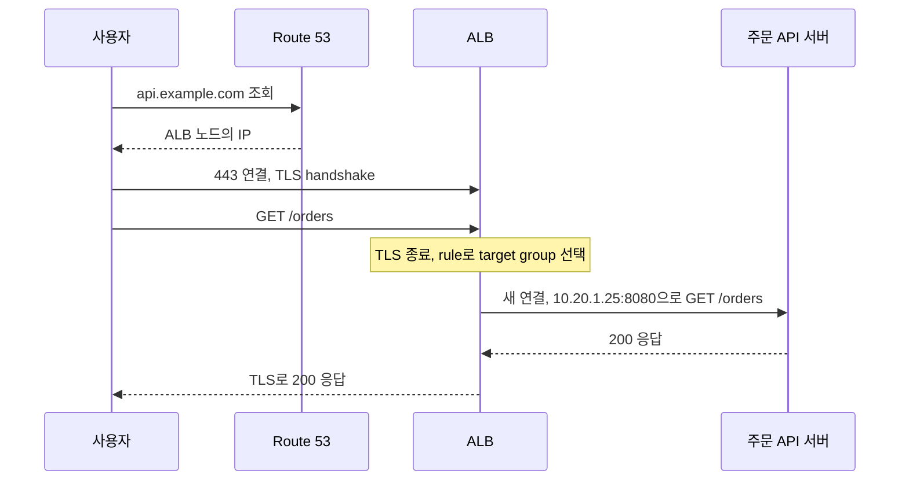
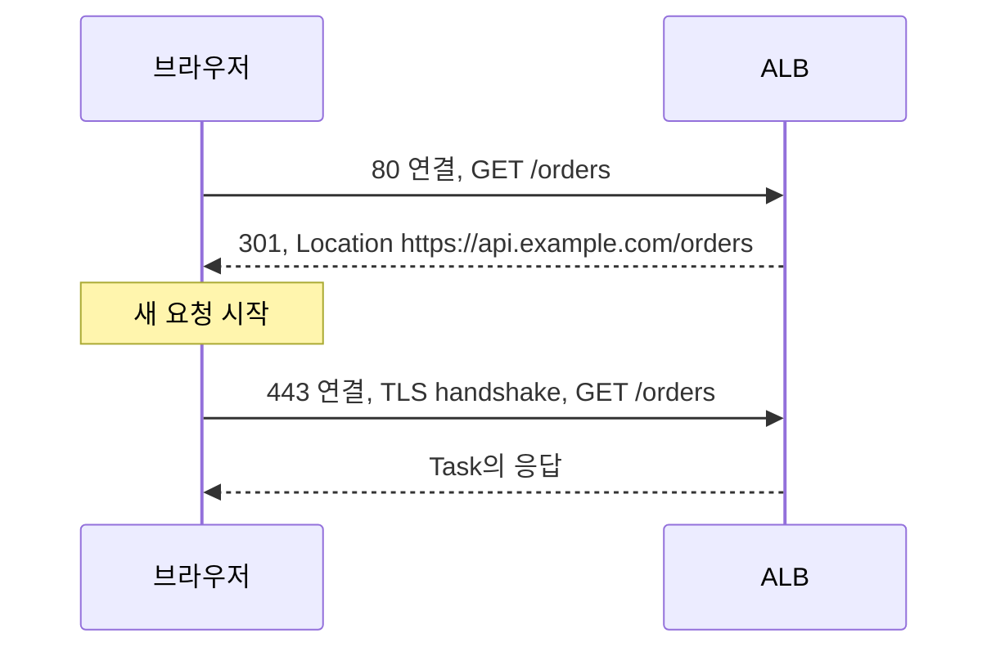

ALB(Application Load Balancer)는 HTTP·HTTPS 요청을 받아 등록된 여러 대상 가운데 하나로 전달하는 로드 밸런서다.
ALB는 사용자와의 연결과 대상과의 연결을 따로 맺으므로, 두 연결이 각각 성립해야 요청이 API 서버에 도착한다.

## ALB 구성 요소

ALB는 다음 구성 요소로 요청을 받아 대상에 넘긴다.

|  구성 요소   | 설명                                                          |
|:------------:|:--------------------------------------------------------------|
|   Listener   | ALB가 요청을 받는 프로토콜과 포트. 예: HTTPS 443              |
|     Rule     | 받은 요청을 경로·호스트 등의 조건으로 처리하는 규칙           |
| Target Group | 요청을 받을 대상의 묶음. 대상 포트와 health check 설정을 가짐 |
|    Target    | target group에 등록된 대상. Fargate Task는 IP 주소로 등록     |
| Health Check | 대상이 요청을 받을 수 있는지 주기적으로 확인하는 검사         |

- 요청 처리 순서: listener가 받음 → rule이 target group을 고름 → health check를 통과한 target 하나로 전달
- 서로 다른 AZ의 서브넷을 두 개 이상 골라야 하며, 인터넷에서 요청을 받는 ALB는 public subnet에 둠

## 사용자 요청이 API 서버에 도착하는 과정

사용자가 `GET /orders`를 보낼 때의 흐름은 다음과 같다.

- DNS: Route 53에 ALB를 가리키는 alias 레코드를 만들면 사용자는 ALB 노드의 공인 IP를 받음
- TLS 종료: ALB가 443 listener에 지정한 ACM(AWS Certificate Manager) 인증서로 TLS를 풀고 HTTP 요청을 읽음
- 별도 연결: ALB는 healthy 상태인 Task의 사설 IP 8080 포트에 새 연결을 맺음
    - Task가 보는 출발지 IP는 ALB 노드이므로, 사용자 IP는 `X-Forwarded-For` 헤더로 확인함

두 연결은 각각 다음 조건을 갖춰야 한다. `alb-sg`, `api-sg`는 ALB와 API 서버에 붙인 Security Group(SG)의 예시 이름이다.

|       구간       | 필요한 조건                                                         |
|:----------------:|:--------------------------------------------------------------------|
| 사용자 → ALB 443 | DNS 레코드, `alb-sg` inbound 443, 443 listener, 유효한 인증서       |
| ALB → Task 8080  | `alb-sg` outbound 8080, `api-sg` inbound 8080, Task가 8080에서 대기 |

## HTTP 요청을 HTTPS로 돌려보내기

80 listener에 redirect 동작을 지정하면 ALB는 Task에 요청을 보내지 않고 301(영구 이동)이나 302(임시 이동)로 직접 응답한다.

브라우저는 `Location` 헤더를 보고 443으로 새 요청을 보낸다. 그래서 80 listener가 정상이어도 `alb-sg`의 443 inbound나 443 listener가 없으면 두 번째 요청에서 실패한다.

## Health Check와 대상 상태

ALB는 각 Task에 health check 요청을 보내고, 연속 성공·실패 횟수로 상태를 정한다. 대상 유형이 IP 또는 인스턴스일 때의 기본값은 다음과 같다.

|        설정         | 기본값 | 의미                                  |
|:-------------------:|:------:|:--------------------------------------|
|        경로         |  `/`   | health check 요청을 보낼 경로         |
|      검사 간격      |  30초  | 한 대상에 health check를 보내는 주기  |
|    응답 타임아웃    |  5초   | 이 시간 안에 응답이 없으면 실패       |
|  healthy 기준 횟수  |   5    | unhealthy 대상을 다시 healthy로 바꾸는 연속 성공 횟수 |
| unhealthy 기준 횟수 |   2    | 연속 실패하면 unhealthy로 바꾸는 횟수 |
|   성공 응답 코드    |  200   | 성공으로 보는 HTTP 상태 코드          |

- 새로 등록한 대상은 기준 횟수와 상관없이 health check를 한 번 통과하면 healthy가 됨
- 모든 대상이 unhealthy이면 ALB는 상태와 상관없이 모든 대상에 요청을 보냄(fail-open)

[Listeners for your Application Load Balancers](https://docs.aws.amazon.com/elasticloadbalancing/latest/application/load-balancer-listeners.html), [Health checks for Application Load Balancer target groups](https://docs.aws.amazon.com/elasticloadbalancing/latest/application/target-group-health-checks.html)

## ALB 오류 응답과 확인 순서

ALB에 연결조차 못 하면 사용자는 연결 타임아웃을 받고, 연결된 뒤 대상에 전달하지 못하면 ALB가 5xx 응답을 직접 만든다.

|     증상      | 실패한 구간  | 주요 원인                                                    | 먼저 확인할 것                           |
|:-------------:|:-------------|:-------------------------------------------------------------|:-----------------------------------------|
| 연결 타임아웃 | 사용자 → ALB | ALB가 private subnet에 있음, `alb-sg`가 listener 포트를 막음 | ALB 서브넷의 경로, `alb-sg` inbound      |
|    ALB 503    | 대상 선택    | target group에 등록된 대상이 없음                            | 대상 등록 상태                           |
|    ALB 504    | ALB → 대상   | 10초 안에 연결 못 함, idle timeout(기본 60초) 안에 응답 없음 | `api-sg` inbound, 애플리케이션 응답 시간 |
|    ALB 502    | 대상의 응답  | 대상이 연결을 거부하거나 끊음, 잘못된 형식의 응답            | 대상 포트, 애플리케이션 오류             |
