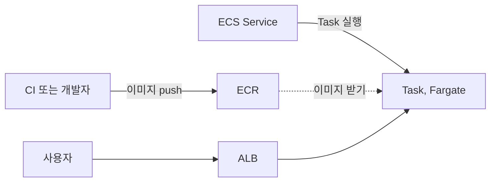
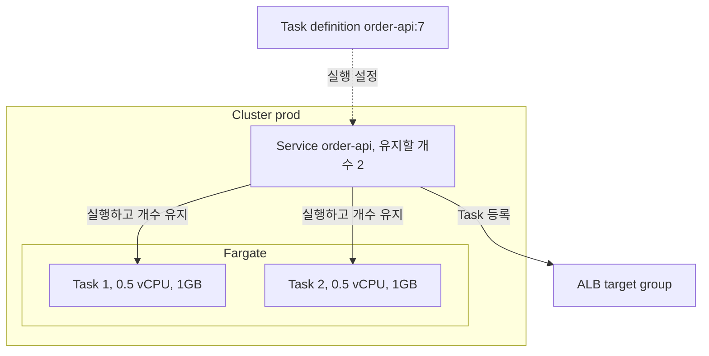
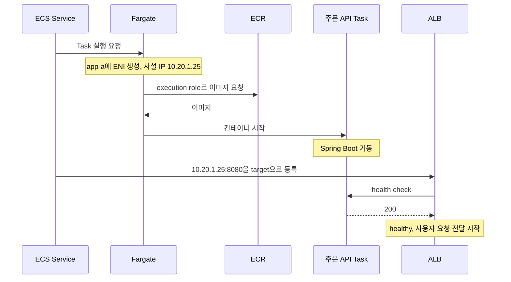

ECS(Elastic Container Service)는 컨테이너 이미지로 앱을 실행하고, 정해 둔 개수만큼 계속 실행되도록 관리하는 AWS 서비스다.
실행할 이미지는 ECR(Elastic Container Registry)에 보관한다.

## 이미지 저장과 실행의 역할 분담

컨테이너를 실행하려면 이미지와 실행 관리 외에, 컨테이너가 돌아갈 CPU·메모리가 필요하다. ECS에서는 이 실행 자원을 두 방식 중 하나로 고른다.

- EC2: 내 계정에 만든 EC2 인스턴스 위에서 컨테이너를 실행
- Fargate: AWS가 관리하는 서버에서 실행. 인스턴스를 만들지 않고 컨테이너 묶음마다 CPU·메모리만 지정

세 구성 요소가 맡는 일은 다음과 같다. 예시는 주문 API 서버 `order-api`를 Fargate로 실행하는 경우다.

|  구성 요소  | 맡는 일                                                          | 예시                     |
|:-----------:|:-----------------------------------------------------------------|:-------------------------|
|     ECR     | Docker Hub처럼 컨테이너 이미지를 저장하는 레지스트리             | `order-api:1.4.0` 이미지 |
|     ECS     | 어떤 이미지를 몇 개 실행할지 관리하고, 멈춘 컨테이너를 다시 실행 | `order-api` Service      |
| EC2·Fargate | 컨테이너가 실제로 실행되는 CPU·메모리                            | Fargate                  |

- ECR에 이미지를 올리는 것만으로는 앱이 실행되지 않음
- ECS가 Task(이미지로 실행한 컨테이너 묶음)를 실행해야 컨테이너가 시작



## ECS의 실행 단위

ECS는 실행 설정(Task definition), 실행 중인 단위(Task), 개수 유지(Service)를 나누고, 이들을 Cluster로 묶는다.

|      단위       | 설명                                                           | 예시                |
|:---------------:|:---------------------------------------------------------------|:--------------------|
|     Cluster     | Service와 Task를 묶는 논리적 단위                              | `prod`              |
| Task definition | 이미지, CPU·메모리, 포트, 환경 변수, role을 적은 실행 설정     | `order-api:7`       |
|      Task       | Task definition대로 실행돼 EC2나 Fargate 위에서 돌고 있는 단위 | Task 2개            |
|     Service     | 지정한 개수만큼 Task를 유지하고 ALB target group에 등록        | `order-api` Service |

- Task definition은 고칠 때마다 새 revision이 생성 (`order-api:7`의 `7`이 revision 번호)
- Task는 실행될 때 CPU·메모리와 사설 IP를 따로 받으며, 안에 컨테이너가 하나 이상 있음
- Service는 Task가 멈추거나 health check에 실패하면 새 Task를 실행해 지정한 개수를 맞춤

Docker에 비유하면 Task definition은 compose 파일, Task는 그 파일로 띄운 컨테이너 묶음이라고 볼 수 있다.



포트 8080으로 요청을 받는 `order-api`의 Task definition에서 주요 항목만 남기면 다음과 같다. 계정 ID와 ARN은 예시값이다.

```json
{
  "family": "order-api",
  "requiresCompatibilities": [
    "FARGATE"
  ],
  "networkMode": "awsvpc",
  "cpu": "512",
  "memory": "1024",
  "executionRoleArn": "arn:aws:iam::123456789012:role/order-api-execution",
  "taskRoleArn": "arn:aws:iam::123456789012:role/order-api-task",
  "containerDefinitions": [
    {
      "name": "app",
      "image": "123456789012.dkr.ecr.ap-northeast-2.amazonaws.com/order-api:1.4.0",
      "portMappings": [
        {
          "containerPort": 8080
        }
      ],
      "environment": [
        {
          "name": "SPRING_PROFILES_ACTIVE",
          "value": "prod"
        }
      ],
      "secrets": [
        {
          "name": "DB_PASSWORD",
          "valueFrom": "arn:aws:secretsmanager:ap-northeast-2:123456789012:secret:order-db"
        }
      ],
      "logConfiguration": {
        "logDriver": "awslogs",
        "options": {
          "awslogs-group": "/ecs/order-api",
          "awslogs-region": "ap-northeast-2",
          "awslogs-stream-prefix": "app"
        }
      }
    }
  ]
}
```

각 항목이 정하는 내용은 다음과 같다.

|        항목        | 정하는 내용                                                                |
|:------------------:|:---------------------------------------------------------------------------|
|  `cpu`, `memory`   | Task 전체에 할당할 CPU·메모리 (`cpu`는 1024가 1 vCPU, `memory`는 MiB 단위) |
|   `networkMode`    | Fargate는 `awsvpc`만 쓸 수 있음                                            |
|      `image`       | ECR 이미지 주소와 태그                                                     |
|   `portMappings`   | 컨테이너가 요청을 받는 포트                                                |
|   `environment`    | 컨테이너에 그대로 넣는 환경 변수                                           |
|     `secrets`      | 시작할 때 Secrets Manager에서 값을 조회해 환경 변수로 넣음                 |
| `logConfiguration` | 컨테이너 표준 출력을 CloudWatch Logs로 보냄                                |
| `executionRoleArn` | 이미지 받기, Secret 조회, 로그 전송에 쓰는 role                            |
|   `taskRoleArn`    | 앱이 AWS SDK로 S3 등을 호출할 때 쓰는 role                                 |

## EC2와 Fargate

EC2와 Fargate는 Task가 올라갈 서버를 누가 관리하는지가 다르다.

|     항목      | EC2                                                                            | Fargate                                                      |
|:-------------:|:-------------------------------------------------------------------------------|:-------------------------------------------------------------|
|     서버      | EC2 인스턴스를 직접 띄우고 OS 패치·ECS 에이전트 관리                           | AWS가 관리해 내 계정에 인스턴스가 생기지 않고 접속할 수 없음 |
|     용량      | Task를 올릴 인스턴스 자원을 미리 늘려 둬야 하고, 모자라면 Task가 배치되지 않음 | Task마다 지정한 CPU·메모리를 AWS가 그때 할당함               |
| 네트워크 모드 | `bridge`, `host`, `awsvpc` 중 선택                                             | `awsvpc`만                                                   |
|     요금      | 실행 중인 인스턴스 기준                                                        | Task에 지정한 CPU·메모리와 실행 시간 기준                    |

- Fargate에서도 Task의 CPU·메모리, 서브넷과 Security Group(SG), 두 role, health check 경로는 직접 정함
- GPU나 특정 인스턴스 유형이 필요하면 EC2를 고름
- Task가 인스턴스 자원을 거의 다 쓰며 계속 실행되면 EC2가 더 쌀 수 있음

## Task가 요청을 받기까지

Service가 새 Task를 실행하면 다음 순서로 요청을 받을 준비를 한다. (Task를 private subnet `app-a`에 실행하고, Task가 사설 IP `10.20.1.25`를 받는 상황을 가정)



- `awsvpc` 모드에서는 Task마다 ENI(Elastic Network Interface)가 하나 붙고 사설 IP를 받음
    - target group은 `ip` 유형으로 만들고, ECS가 Task의 IP와 포트를 직접 등록함
- 이미지 요청도 Task가 있는 서브넷의 Route Table을 따름. NAT gateway 경로가 없으면 다음 endpoint가 필요함
    - ECR용 interface endpoint `ecr.api`, `ecr.dkr`
    - S3 gateway endpoint. ECR은 이미지 레이어를 S3에 저장함
    - 로그와 Secret을 쓰면 `logs`, `secretsmanager` interface endpoint
- 새로 등록한 target은 health check를 한 번 통과하면 healthy가 됨
- health check 유예 기간(`healthCheckGracePeriodSeconds`)은 Task가 시작한 뒤 ALB health check 실패를 무시하는 시간이며 기본값은 0초
    - Spring Boot처럼 기동이 느린 앱은 이 값을 기동 시간보다 길게 잡아야 기동 중에 교체되지 않음

[Amazon ECS task execution IAM role](https://docs.aws.amazon.com/AmazonECS/latest/developerguide/task_execution_IAM_role.html), [Amazon ECS task IAM role](https://docs.aws.amazon.com/AmazonECS/latest/developerguide/task-iam-roles.html), [Amazon ECS task networking options for Fargate](https://docs.aws.amazon.com/AmazonECS/latest/developerguide/fargate-task-networking.html), [Amazon ECR interface VPC endpoints](https://docs.aws.amazon.com/AmazonECR/latest/userguide/vpc-endpoints.html)

## 교체·확장과 실패 지점

Task 수를 나타내는 값은 세 가지이며, 각각 뜻이 다르다.

|       수       | 뜻                                                 |
|:--------------:|:---------------------------------------------------|
| Desired count  | Service가 유지하려는 Task 수                       |
| Running count  | `RUNNING` 상태인 Task 수. 앱 기동 중일 수 있음     |
| healthy target | ALB가 요청을 보내는 Task 수. target group에서 확인 |

Desired count를 2에서 4로 늘려도, 새 Task 2개가 이미지를 받고 기동해 health check를 통과하기 전까지 요청은 기존 Task 2개가 처리한다.

새 이미지를 배포하면 다음 순서로 Task가 바뀐다.

1. 새 이미지 `order-api:1.5.0`을 ECR에 올린다.
2. 이미지 태그를 바꾼 Task definition revision `order-api:8`을 등록한다.
3. Service가 `order-api:8`을 쓰도록 바꾸면 rolling update가 시작된다.
4. 기본값(최소 정상 100%, 최대 200%)에서는 새 Task를 먼저 실행하고, 새 Task가 healthy가 된 만큼 기존 Task를 멈춘다.
5. 기존 Task는 target group에서 빠진 뒤 deregistration delay(기본 300초) 동안 처리 중인 요청을 마치고 종료된다.

Task 실행부터 요청 처리까지 단계마다 실패 증상과 확인할 곳이 다르다.

|     단계     | 주요 원인                                                          | 증상                           | 확인할 곳                                     |
|:------------:|:-------------------------------------------------------------------|:-------------------------------|:----------------------------------------------|
| 이미지 받기  | execution role의 ECR 권한 없음, NAT·endpoint 경로 없음             | Task가 시작 전에 멈춤          | Task의 중지 이유, execution role, Route Table |
| Secret 조회  | execution role의 Secrets Manager 권한 없음, NAT·endpoint 경로 없음 | Task가 시작 전에 멈춤          | Task의 중지 이유, execution role, Route Table |
|   앱 기동    | 설정 오류로 프로세스 종료                                          | 컨테이너가 시작 직후 멈춤      | CloudWatch Logs의 앱 로그                     |
| health check | health check URL 오류, SG가 8080을 막음, 기동보다 짧은 유예 기간   | unhealthy로 교체가 반복됨      | target group 상태, Service 이벤트             |
|  요청 처리   | Task role 권한 없음                                                | 앱의 AWS 호출만 `AccessDenied` | Task role 정책, 앱 로그                       |

[Amazon ECS services](https://docs.aws.amazon.com/AmazonECS/latest/developerguide/ecs_services.html)
