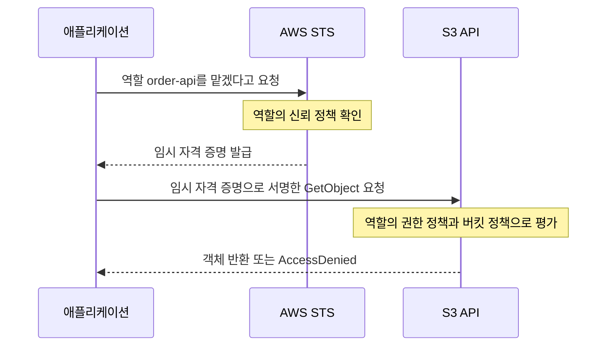
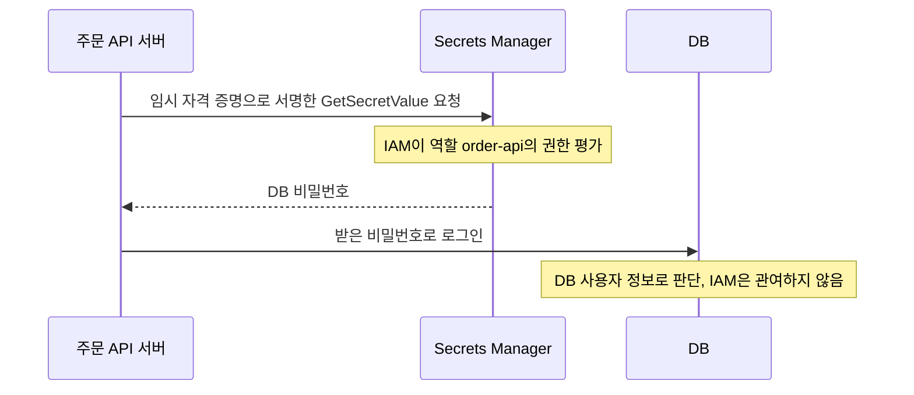
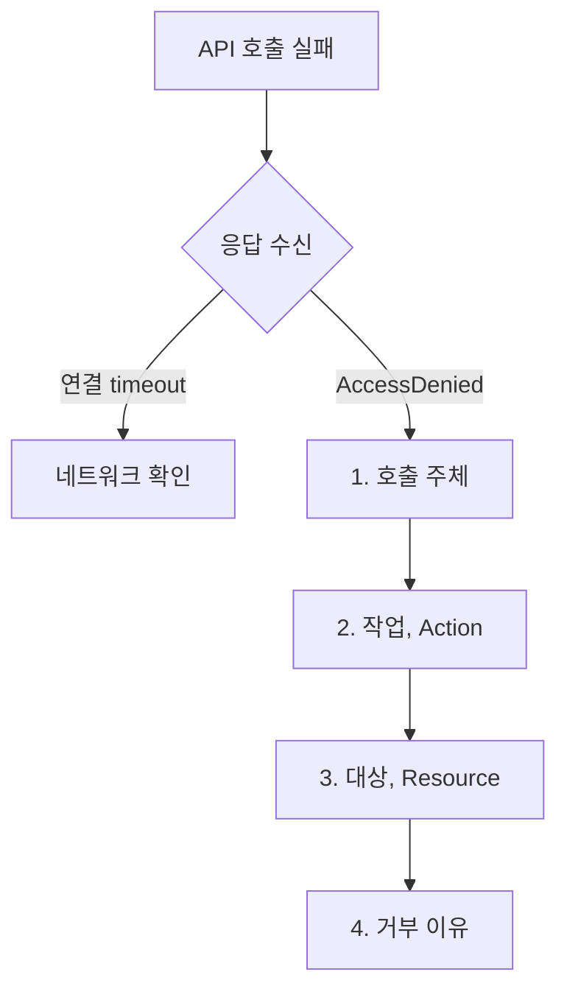

IAM(Identity and Access Management)은 AWS API 요청을 누가 보냈는지 확인하고, 그 요청을 허용할지 판단하는 서비스다.
S3에서 파일을 읽거나 SQS에 메시지를 보내는 요청은 모두 IAM의 판단을 거친다.

## 인증과 권한

AWS API 요청에는 자격 증명으로 만든 서명이 붙는다. AWS는 먼저 서명을 검사해 요청을 보낸 주체를 확인하고(인증), 그 주체와 대상 리소스에 연결된 정책을 읽어 요청한 작업을 허용할지 판단한다(권한 부여).

요청 주체는 사람일 수도, 애플리케이션이나 AWS 서비스일 수도 있다. 같은 S3 버킷에 보내는 요청이라도 누가 보내느냐에 따라 서명에 쓰는 자격 증명이 다르다.

|             상황             | 요청 주체          | 서명에 쓰는 자격 증명 |
|:----------------------------:|:-------------------|:----------------------|
|   개발자가 CLI로 버킷 조회   | IAM 사용자         | 장기 액세스 키        |
| ECS의 API 서버가 파일 업로드 | Task에 지정한 역할 | 역할의 임시 자격 증명 |
|  S3가 이벤트로 Lambda 호출   | S3 서비스          | AWS가 처리            |

세 번째처럼 AWS 서비스가 요청 주체이면 서명은 AWS가 처리하고, 대신 Lambda 함수에 붙인 정책이 S3(`s3.amazonaws.com`)의 호출을 허용해야 한다.

## Principal·Role·Policy

권한 설정과 오류 메시지에는 다음 세 용어가 함께 나온다.

|   용어    | 설명                                                      | 예                    |
|:---------:|:----------------------------------------------------------|:----------------------|
| Principal | 요청을 보낸 주체. ARN으로 표시됨                          | IAM 사용자, 역할 세션 |
|  Policy   | 허용하거나 거부할 요청을 적은 JSON 문서                   | 역할 정책, 버킷 정책  |
|   Role    | 주체가 맡아서 쓰는 권한 묶음. 비밀번호나 액세스 키가 없음 | 역할 `order-api`      |

정책은 붙이는 위치에 따라 두 종류로 나뉜다.

- identity 기반 정책: IAM 사용자나 역할에 붙여, 그 주체가 할 수 있는 작업을 정함
- resource 기반 정책: S3 버킷, SQS 큐 같은 리소스에 붙여, 그 리소스에 누가 접근할 수 있는지 정함. 역할에 붙는 신뢰 정책도 여기에 속하며, 그 역할을 맡을 수 있는 주체를 정함

### 역할과 임시 자격 증명

역할에는 비밀번호나 액세스 키가 없으므로 역할 자체로는 요청에 서명할 수 없다. 주체는 AWS STS(Security Token Service)에서 역할의 임시 자격 증명을 받아 요청에 서명한다.



ECS Task나 Lambda 함수에 역할을 지정하면 역할을 맡는 단계는 실행 환경이 대신 처리하고, 애플리케이션의 AWS SDK는 발급된 임시 자격 증명을 가져다 쓴다.

역할과 임시 자격 증명은 다음과 같이 다르다. (ARN의 계정 ID와 세션 이름은 예시값)

|   구분    | 역할                                       | 임시 자격 증명                          |
|:---------:|:-------------------------------------------|:----------------------------------------|
|   구성    | 이름, 권한 정책, 신뢰 정책                 | 액세스 키 ID, 비밀 액세스 키, 세션 토큰 |
| 유효 기간 | 지울 때까지 유지                           | 발급 후 몇 분에서 몇 시간 뒤 만료       |
| 요청 서명 | 쓰지 않음                                  | 씀                                      |
|    ARN    | `arn:aws:iam::123456789012:role/order-api` | 없음                                    |

임시 자격 증명으로 보낸 요청은 역할 세션이 보낸 것으로 처리되어, 접근 거부 메시지에는 세션 ARN `arn:aws:sts::123456789012:assumed-role/order-api/task-1`이 찍힌다.

[IAM roles](https://docs.aws.amazon.com/IAM/latest/UserGuide/id_roles.html), [Temporary security credentials in IAM](https://docs.aws.amazon.com/IAM/latest/UserGuide/id_credentials_temp.html)

## 정책 문장 읽기

아래는 주문 API 서버가 쓰는 역할 `order-api`에 붙인 identity 기반 정책이다. `order-files` 버킷의 `receipts/` 아래 객체를 HTTPS 요청으로 읽는 것만 허용한다.

```json
{
  "Version": "2012-10-17",
  "Statement": [
    {
      "Effect": "Allow",
      "Action": "s3:GetObject",
      "Resource": "arn:aws:s3:::order-files/receipts/*",
      "Condition": {
        "Bool": {
          "aws:SecureTransport": "true"
        }
      }
    }
  ]
}
```

|    요소     | 설명                                             | 위 정책의 값                                  |
|:-----------:|:-------------------------------------------------|:----------------------------------------------|
|  `Version`  | 정책 문법의 버전                                 | 현재 문법인 `2012-10-17`                      |
|  `Effect`   | 문장이 맞을 때 허용할지 거부할지                 | `Allow`                                       |
|  `Action`   | 허용하거나 거부할 API 작업. `서비스:작업` 형식   | 객체 읽기 `s3:GetObject`                      |
| `Resource`  | 작업 대상의 ARN. `*`로 범위를 지정할 수 있음     | `receipts/` 아래의 모든 객체                  |
| `Condition` | 요청이 추가로 만족해야 하는 조건. 생략할 수 있음 | TLS로 보낸 요청(`aws:SecureTransport`가 true) |

resource 기반 정책에는 `Principal`이 더 들어간다. identity 기반 정책은 이미 주체에 붙어 있어 주체를 적지 않지만, 버킷 정책은 버킷에 붙으므로 누구에게 허용하는지 적어야 한다.

```json
{
  "Version": "2012-10-17",
  "Statement": [
    {
      "Effect": "Allow",
      "Principal": {
        "AWS": "arn:aws:iam::123456789012:role/order-api"
      },
      "Action": "s3:GetObject",
      "Resource": "arn:aws:s3:::order-files/receipts/*"
    }
  ]
}
```

### 요청과 정책 문장 비교

정책 문장은 요청의 작업, 대상, 조건이 모두 맞을 때만 적용된다. 첫 번째 identity 기반 정책만 있고 다른 정책은 없다고 가정하면, 역할 `order-api`의 요청 결과는 다음과 같다.

|              요청               | 결과 | 이유                               |
|:-------------------------------:|:----:|:-----------------------------------|
| `receipts/a.pdf`를 HTTPS로 읽기 | 허용 | 작업, 대상, 조건이 모두 맞음       |
|     `receipts/a.pdf`에 쓰기     | 거부 | 작업 `s3:PutObject`가 정책에 없음  |
| `invoices/a.pdf`를 HTTPS로 읽기 | 거부 | 대상이 `receipts/` 밖              |
| `receipts/a.pdf`를 HTTP로 읽기  | 거부 | 조건 `aws:SecureTransport`가 false |
|      버킷의 객체 목록 조회      | 거부 | 작업과 대상이 모두 정책과 다름     |

마지막 행의 목록 조회 `s3:ListBucket`은 객체가 아니라 버킷 ARN `arn:aws:s3:::order-files`에 허용해야 한다.
이처럼 S3는 작업에 따라 대상 ARN이 다르므로, 객체 읽기 권한만으로는 객체 목록을 조회할 수 없다.

[IAM JSON policy element reference](https://docs.aws.amazon.com/IAM/latest/UserGuide/reference_policies_elements.html), [Examples of Amazon S3 bucket policies](https://docs.aws.amazon.com/AmazonS3/latest/userguide/example-policies-s3.html)

## 권한 평가 순서

앞의 비교 표는 역할 `order-api`의 정책만 보고 결과를 정했다. 그런데 요청 대상인 `order-files` 버킷에도 버킷 정책을 붙일 수 있고, 이때 AWS는 역할 정책과 버킷 정책을 함께 확인한다.
그래서 역할 정책이 허용한 요청도 버킷 정책 때문에 거부될 수 있다.

AWS는 요청과 관련된 정책의 문장을 모두 모아 다음 순서로 결과를 정한다.

1. 요청과 맞는 `Deny` 문장이 하나라도 있으면 거부
2. `Deny`가 없고 요청과 맞는 `Allow` 문장이 하나라도 있으면 허용
3. 둘 다 없으면 거부

역할과 버킷이 같은 계정에 있을 때 두 정책의 조합에 따른 결과는 다음과 같다.

| 역할 정책 | 버킷 정책 | 결과 |
|:---------:|:---------:|:----:|
|   Allow   |   없음    | 허용 |
|   없음    |   Allow   | 허용 |
|   Allow   |   Deny    | 거부 |
|   없음    |   없음    | 거부 |

버킷이 다른 계정에 있으면 두 정책이 모두 `Allow`해야 하므로, 위 표의 두 번째 행도 거부된다. AWS Organizations의 SCP나 권한 경계를 쓰는 계정에서는 그 정책도 허용해야 한다.

[Policy evaluation logic](https://docs.aws.amazon.com/IAM/latest/UserGuide/reference_policies_evaluation-logic.html)

## 임시 자격 증명과 Secret

주문 API 서버가 DB에 접속하려면 비밀 값이 두 개 필요하다.

|   구분    | 임시 자격 증명                          | Secret                          |
|:---------:|:----------------------------------------|:--------------------------------|
|    예     | 역할 `order-api`의 액세스 키, 세션 토큰 | DB 비밀번호                     |
|  쓰는 곳  | AWS API 요청 서명                       | DB, 외부 API 로그인             |
| 만드는 곳 | STS가 발급                              | 사용자가 Secrets Manager에 저장 |
|   교체    | 자동 만료, 실행 환경이 새 값 전달       | 사용자가 교체 주기 설정         |

Secret을 꺼내는 것도 AWS API 요청이므로, DB에 로그인하기까지 두 번의 확인을 거친다.



### 설정 파일에 넣지 않는 값

두 값 모두 `application.yml` 같은 설정 파일에 넣지 않는다.

|      값       | 설정 파일에 넣으면                       | 대신 쓰는 방법                               |
|:-------------:|:-----------------------------------------|:---------------------------------------------|
| AWS 액세스 키 | 지울 때까지 유효해서, 유출되면 직접 폐기 | 역할 지정. 실행 환경이 임시 자격 증명을 전달 |
|  DB 비밀번호  | 파일과 함께 유출되고, 바꾸려면 다시 배포 | Secrets Manager에 저장하고 실행 중에 조회    |

AWS 액세스 키는 Secrets Manager에 넣어 둬도 꺼낼 때 다시 자격 증명이 필요하므로, 역할로 받는다.

### ECS에서 Secret을 받는 방식

ECS에서 실행하는 주문 API 서버는 DB 비밀번호를 두 방식으로 받을 수 있다.

- SDK로 직접 조회: 컨테이너가 시작된 뒤 애플리케이션이 Task role로 Secrets Manager를 호출
- 환경 변수로 주입: ECS가 컨테이너를 시작하기 전에 Execution role로 값을 꺼내 환경 변수에 넣음

환경 변수로 주입할 때는 Task definition의 `secrets` 항목에 어떤 환경 변수에 어떤 Secret의 값을 넣을지 적는다.

```json
"secrets": [
  {
    "name": "DB_PASSWORD",
    "valueFrom": "arn:aws:secretsmanager:ap-northeast-2:123456789012:secret:order-db-AbCdEf"
  }
]
```

애플리케이션은 Secrets Manager를 몰라도 되며, `application.yml`에는 환경 변수를 읽는 자리만 둔다.

```yaml
spring:
  datasource:
    password: ${DB_PASSWORD}
```

두 방식은 다음과 같이 다르다.

|             구분              | SDK로 직접 조회      | ECS가 환경 변수로 주입        |
|:-----------------------------:|:---------------------|:------------------------------|
| Secrets Manager를 호출하는 쪽 | 애플리케이션         | ECS                           |
|           호출 시점           | 애플리케이션 실행 중 | 컨테이너 시작 전              |
|      권한이 필요한 역할       | Task role            | Execution role                |
|           코드 변경           | SDK 호출 코드 추가   | 없음. 환경 변수만 읽음        |
|       값이 바뀌었을 때        | 다시 조회하면 반영   | 컨테이너를 새로 시작해야 반영 |

어느 방식이든 호출하는 쪽의 역할에 붙이는 허용 문장은 같다. Secrets Manager는 Secret ARN 끝에 임의 문자 6자리를 붙이므로 `Resource`는 `order-db-*`처럼 적는다.

```json
{
  "Effect": "Allow",
  "Action": "secretsmanager:GetSecretValue",
  "Resource": "arn:aws:secretsmanager:ap-northeast-2:123456789012:secret:order-db-*"
}
```

비밀번호를 자동으로 교체하지 않는다면 코드 변경이 없는 환경 변수 주입이 간단하다. 자동 교체를 쓰거나 실행 중에 바뀐 값을 반영해야 하면 SDK로 조회한다.

다음 설정은 피한다.

|                      설정                       | 문제                                                                                               | 대신 쓰는 방법                  |
|:-----------------------------------------------:|:---------------------------------------------------------------------------------------------------|:--------------------------------|
| Task definition의 `environment`에 비밀번호 평문 | Task definition을 조회할 수 있는 사람에게 모두 보이고, revision 이력에도 남음                      | `secrets`에 Secret ARN 지정     |
|     자동 교체와 환경 변수 주입을 함께 사용      | 실행 중인 컨테이너는 시작할 때 받은 예전 비밀번호를 계속 써서, 교체 후 새 DB 연결이 실패할 수 있음 | 교체 후 재배포하거나 SDK로 조회 |
|         정책의 `Resource`를 `*`로 지정          | 다른 서비스의 Secret까지 꺼낼 수 있음                                                              | 필요한 Secret ARN으로 한정      |

[What is AWS Secrets Manager?](https://docs.aws.amazon.com/secretsmanager/latest/userguide/intro.html)

## 접근 거부의 확인 순서



### AccessDenied 메시지 읽기

위 1~4번에 필요한 값은 대부분 `AccessDenied` 메시지에 들어 있다. 앞 절의 역할 `order-api`가 `receipts/a.pdf`에 파일을 쓰려다 거부되면 다음 메시지를 받는다.

```text
User: arn:aws:sts::123456789012:assumed-role/order-api/task-1
is not authorized to perform: s3:PutObject
on resource: arn:aws:s3:::order-files/receipts/a.pdf
because no identity-based policy allows the s3:PutObject action
```

|  메시지 부분   | 위 예의 값                         | 확인할 것                                                        |
|:--------------:|:-----------------------------------|:-----------------------------------------------------------------|
|    `User:`     | 역할 `order-api`의 세션            | 예상한 역할인지. 로컬 개발자 키나 다른 역할이면 고칠 정책이 다름 |
|   `perform:`   | `s3:PutObject`                     | 정책의 `Action`에 있는지                                         |
| `on resource:` | `order-files/receipts/a.pdf` 객체  | 정책의 `Resource` 범위 안인지                                    |
|   `because`    | 허용하는 identity 기반 정책이 없음 | 허용 문장이 없는지, `Deny` 문장이 막았는지                       |

이 예에서는 역할 정책의 `Action`에 `s3:GetObject`만 있으므로, 파일을 쓰게 하려면 `Action`에 `s3:PutObject`를 추가한다.

[Troubleshoot access denied error messages](https://docs.aws.amazon.com/IAM/latest/UserGuide/troubleshoot_access-denied.html)
