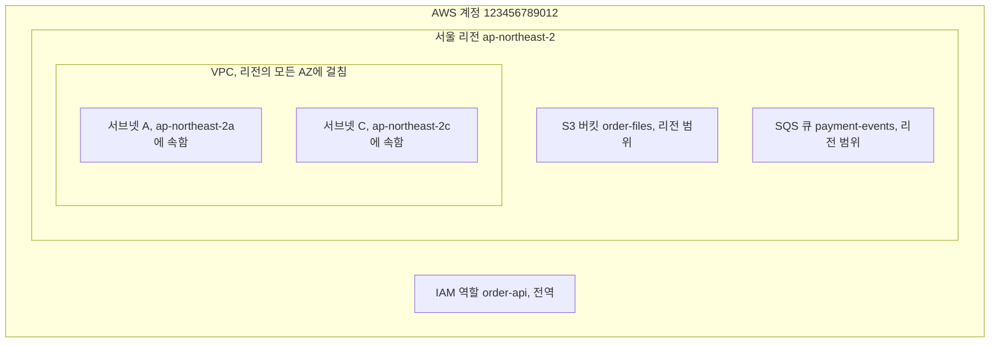

AWS(Amazon Web Services)는 서버·저장소·네트워크 같은 자원을 직접 사서 설치하지 않고, 필요할 때 요청해 만들어 쓰는 클라우드 서비스다.
로컬에서 실행하던 API 서버, DB, 파일 저장소를 AWS로 옮기려면 각 역할을 맡을 서비스를 고르고, 그 안에 만든 리소스가 어느 계정과 위치에 속하는지 구분해야 한다.

## 클라우드와 관리형 서비스

클라우드에서는 데이터 센터와 하드웨어를 AWS가 운영하고, 사용자는 필요한 만큼 자원을 만들어 쓴 만큼 비용을 낸다.
콘솔 화면에서 만들든 CLI·SDK로 만들든, 자원을 만들고 설정을 바꾸는 작업은 모두 AWS API 요청으로 처리된다.

관리형 서비스는 운영 작업의 일부를 AWS가 대신 맡는 서비스이며, AWS가 맡는 범위는 서비스마다 다르다. PostgreSQL을 EC2에 직접 설치할 때와 RDS로 만들 때를 비교하면 다음과 같다.

|               실행 방식               | AWS가 맡는 작업                                                       | 사용자가 맡는 작업                                                                                                  |
|:-------------------------------------:|:----------------------------------------------------------------------|:--------------------------------------------------------------------------------------------------------------------|
| EC2 인스턴스에 PostgreSQL을 직접 설치 | 하드웨어, 가상화                                                      | OS 패치, DB 설치·업그레이드, 백업, 복제 구성, 스키마, DB 사용자                                                     |
|          RDS for PostgreSQL           | 하드웨어, OS·DB 엔진 설치와 패치 적용, 자동 백업 실행, 장애 조치 실행 | 인스턴스 크기, 엔진 버전 업그레이드 시점, 백업 보존 기간, Multi-AZ 사용 여부, 스키마, DB 사용자, 네트워크 접근 허용 |

## Account·Region·Availability Zone

AWS에서 만든 리소스는 모두 한 계정에 속하고, 대부분 특정 리전 안에 만들어진다. 서브넷이나 EC2 인스턴스처럼 리전 안의 AZ까지 정해서 만드는 리소스도 있다.

|          개념          |   구분 기준    | 설명                                                             | 예                            |
|:----------------------:|:--------------:|:-----------------------------------------------------------------|:------------------------------|
|        Account         | 소유·권한·비용 | 리소스의 소유자, 접근 권한을 판단하는 기준, 요금이 청구되는 단위 | 12자리 계정 ID `123456789012` |
|         Region         |  지리적 위치   | 리소스가 실행되고 데이터가 저장되는 지역                         | 서울 `ap-northeast-2`         |
| Availability Zone (AZ) |   장애 격리    | 리전 안에서 전원·네트워크를 따로 갖춘 데이터 센터 묶음           | `ap-northeast-2a`             |

- 하나의 계정으로 여러 리전에 리소스를 만들 수 있으며, 리전은 서로 독립되어 있어 서울 리전에 만든 큐는 도쿄 리전에서 조회되지 않음
- 리전마다 AZ가 3개 이상 있으며, 같은 애플리케이션을 두 AZ에 나눠 실행하면 한 AZ에 장애가 나도 다른 AZ에서 요청을 처리할 수 있음

### 리소스마다 다른 위치 범위

리소스를 만들 때 리전만 고르면 되는 서비스도 있고, AZ까지 골라야 하는 서비스도 있다.

| 범위 | 리소스 예                                          | 만들 때 고르는 위치 |
|:----:|:---------------------------------------------------|:--------------------|
| 전역 | IAM 사용자·역할                                    | 고르지 않음         |
| 리전 | VPC, S3 버킷, SQS 큐, Lambda 함수, DynamoDB 테이블 | 리전                |
|  AZ  | 서브넷, EC2 인스턴스, RDS DB 인스턴스              | 리전과 AZ           |

- S3·SQS·Lambda·DynamoDB는 여러 AZ에 나눠 실행하는 일을 AWS가 맡으므로 사용자가 AZ를 고르지 않음
- RDS DB 인스턴스는 AZ 하나에서 실행되며, Multi-AZ를 켜면 다른 AZ에 대기 인스턴스가 추가됨

한 계정의 서울 리전에 위 리소스를 만들면 다음과 같이 배치된다. 계정 ID, 리소스 이름, 서브넷 위치는 예시값이다.



[Regions and Availability Zones](https://docs.aws.amazon.com/global-infrastructure/latest/regions/aws-availability-zones.html), [Subnets for your VPC](https://docs.aws.amazon.com/vpc/latest/userguide/configure-subnets.html)

## 서비스·리소스·ARN

S3에 버킷을 만들면 S3는 서비스, 만든 버킷은 리소스가 된다. 같은 S3 안에서도 `order-files`, `user-images`처럼 버킷을 여러 개 만들 수 있고, 리전과 접근 권한은 버킷마다 따로 정한다.

ARN(Amazon Resource Name)은 리소스를 AWS 전체에서 하나로 가리키는 식별자다. IAM 정책에서 접근을 허용할 대상을 특정 리소스로 좁힐 때 이 값을 쓴다. 기본 형식은 다음과 같다.

```text
arn:partition:service:region:account-id:resource
```

|     자리     | 뜻                                                                     |
|:------------:|:-----------------------------------------------------------------------|
| `partition`  | 리전 묶음. 일반 리전은 `aws`                                           |
|  `service`   | 서비스 이름. `s3`, `sqs`, `iam`, `lambda` 등                           |
|   `region`   | 리소스가 있는 리전                                                     |
| `account-id` | 리소스를 소유한 계정                                                   |
|  `resource`  | 리소스의 종류와 이름. `role/order-api`처럼 표기 방식은 서비스마다 다름 |

서비스에 따라 리전이나 계정 ID 자리가 비어 있다. 아래 ARN의 계정 ID와 리소스 이름은 예시값이다.

|   리소스    | ARN 예                                                             | 비어 있는 자리                                         |
|:-----------:|:-------------------------------------------------------------------|:-------------------------------------------------------|
|   SQS 큐    | `arn:aws:sqs:ap-northeast-2:123456789012:payment-events`           | 없음                                                   |
| Lambda 함수 | `arn:aws:lambda:ap-northeast-2:123456789012:function:resize-image` | 없음                                                   |
|  IAM 역할   | `arn:aws:iam::123456789012:role/order-api`                         | 리전. IAM이 전역 서비스이기 때문                       |
|   S3 버킷   | `arn:aws:s3:::order-files`                                         | 리전, 계정 ID. 버킷 이름이 파티션 안에서 고유하기 때문 |

[Identify AWS resources with Amazon Resource Names (ARNs)](https://docs.aws.amazon.com/IAM/latest/UserGuide/reference-arns.html)

## 로컬 구성을 AWS 서비스로 옮길 때

로컬에서 실행하던 요소는 아래 AWS 서비스로 옮길 수 있다. 관리형 서비스를 쓰더라도 마지막 열의 항목은 사용자가 직접 설정한다.

|          로컬 요소          | 역할                      | AWS 서비스                  | 직접 설정할 항목                         |
|:---------------------------:|:--------------------------|:----------------------------|:-----------------------------------------|
| `java -jar`로 띄운 API 서버 | 요청 처리                 | EC2, ECS on Fargate, Lambda | 실행 개수, CPU·메모리, 환경 변수         |
|        Docker 이미지        | 실행할 코드와 런타임 묶음 | ECR                         | 저장소 이름, 이미지 태그 규칙, 보관 정책 |
|         PostgreSQL          | 데이터 저장·조회          | RDS for PostgreSQL          | 스키마, 접속 설정, 백업 보존 기간        |
|    업로드 파일 디렉토리     | 파일 저장                 | S3                          | 버킷 이름, 접근 권한, 객체 키 규칙       |
|          로그 파일          | 실행 기록 보관            | CloudWatch Logs             | 로그 그룹, 보존 기간                     |
|   설정 파일의 DB 비밀번호   | 비밀 값 보관              | Secrets Manager             | 조회 권한, 교체 주기                     |

## 운영 책임

AWS는 운영 책임의 분담을 공동 책임 모델(Shared Responsibility Model)로 설명한다.

|  주체  | 책임                       | 예                                                                |
|:------:|:---------------------------|:------------------------------------------------------------------|
|  AWS   | 클라우드 자체의 보안       | 데이터 센터, 하드웨어, 네트워크, 관리형 서비스의 OS·플랫폼        |
| 사용자 | 클라우드 안에 둔 것의 보안 | 데이터와 암호화 설정, IAM 권한, 보안 그룹 규칙, 애플리케이션 코드 |

EC2를 쓰면 게스트 OS 패치까지 사용자가 해야 하지만, S3·DynamoDB처럼 서버가 드러나지 않는 서비스에서는 OS와 플랫폼을 AWS가 관리한다.
데이터와 접근 권한 설정은 어느 서비스를 쓰든 사용자 책임이다.

[Shared Responsibility Model](https://aws.amazon.com/compliance/shared-responsibility-model/)
