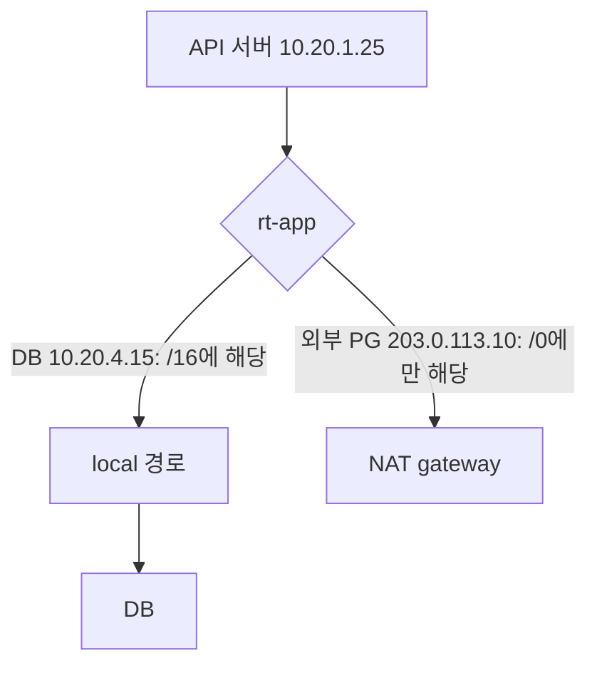
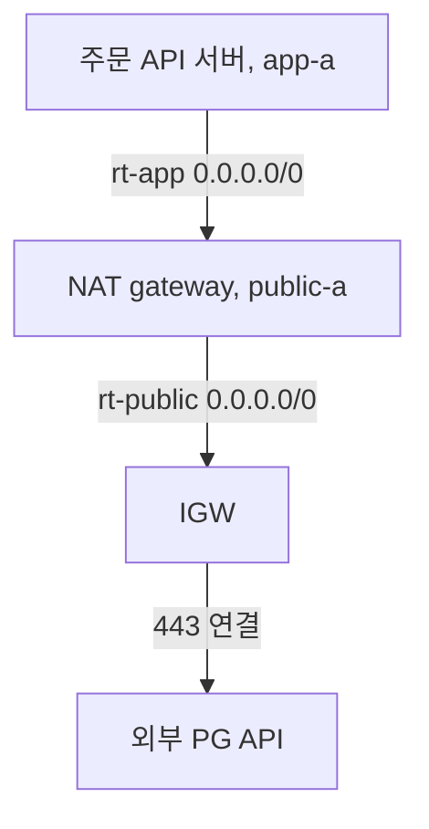

AWS의 EC2나 ECS에서 실행하는 API 서버는 VPC(Virtual Private Cloud)라는 사설 네트워크 안에 놓인다.
요청이 API 서버에 도착하거나 API 서버가 DB·외부 API에 접속하려면, 목적지까지 가는 경로가 있고 그 경로의 통신을 허용하는 규칙이 있어야 한다.

## 네트워크 구성 요소

VPC 네트워크는 다음 구성 요소로 이루어진다.

|      구성 요소      | 설명                                                          |  속하는 곳   |   적용 대상   |
|:-------------------:|:--------------------------------------------------------------|:------------:|:-------------:|
|         VPC         | 계정 안에 만드는 논리적으로 분리된 사설 네트워크              |     리전     |     없음      |
|       Subnet        | VPC의 주소 범위를 나눈 구간. 리소스는 서브넷 안에 배치됨      | VPC, AZ 하나 |     없음      |
|     Route Table     | 목적지 주소에 따라 패킷을 다음에 어디로 보낼지 정한 규칙 목록 |     VPC      | 연결한 서브넷 |
| Security Group (SG) | 어떤 연결을 받거나 보낼 수 있는지 정한 허용 규칙              |     VPC      |  붙인 리소스  |

통신이 되는지는 Route Table과 Security Group이 정한다.

- Route Table: 패킷을 어디로 보낼지(경로)를 결정
- Security Group: 그 패킷을 받거나 보내도 되는지(허용)를 결정

### CIDR와 서브넷 주소 범위

VPC와 서브넷의 주소 범위는 CIDR(Classless Inter-Domain Routing) 표기로 정한다. `/` 뒤의 숫자는 주소 32비트 가운데 앞에서부터 고정한 비트 수이며, 클수록 범위가 좁다.

|      CIDR      | 고정 비트 | 주소 범위                     | 주소 수 |
|:--------------:|:---------:|:------------------------------|--------:|
| `10.20.0.0/16` |    16     | `10.20.0.0` ~ `10.20.255.255` |  65,536 |
| `10.20.1.0/24` |    24     | `10.20.1.0` ~ `10.20.1.255`   |     256 |

- 서브넷의 CIDR는 VPC 범위 안에서 서로 겹치지 않게 설정하며, 크기는 `/16`부터 `/28`까지 가능
- AWS가 서브넷마다 주소 5개를 예약하므로 `/24` 서브넷에서 쓸 수 있는 주소는 251개

예를 들어 서울 리전의 VPC `10.20.0.0/16`에 두 AZ마다 역할별 서브넷을 하나씩 두면 다음과 같다. 이 문서의 이후 예시는 이 구성을 따른다.

|   서브넷   |       AZ        |      CIDR      | 배치하는 리소스       |
|:----------:|:---------------:|:--------------:|:----------------------|
| `public-a` | ap-northeast-2a | `10.20.2.0/24` | ALB 노드, NAT gateway |
| `public-c` | ap-northeast-2c | `10.20.5.0/24` | ALB 노드              |
|  `app-a`   | ap-northeast-2a | `10.20.1.0/24` | 주문 API 서버         |
|  `app-c`   | ap-northeast-2c | `10.20.6.0/24` | 주문 API 서버         |
|   `db-a`   | ap-northeast-2a | `10.20.4.0/24` | DB 주 인스턴스        |
|   `db-c`   | ap-northeast-2c | `10.20.7.0/24` | DB 대기 인스턴스      |

### Public Subnet과 Private Subnet

서브넷 이름의 public, private은 AWS 설정 값이 아닌, 서브넷에 연결한 Route Table에 인터넷 게이트웨이(IGW, Internet Gateway)로 가는 경로의 유무에 따라 나뉜다.

- public subnet: 공인 IP를 가진 리소스가 인터넷과 직접 통신할 수 있음 (ex. 인터넷에서 요청을 받는 ALB, NAT gateway)
- private subnet: 인터넷에서 리소스로 직접 연결할 수 없음 (ex. API 서버, DB)

[How Amazon VPC works](https://docs.aws.amazon.com/vpc/latest/userguide/how-it-works.html), [Subnet CIDR blocks](https://docs.aws.amazon.com/vpc/latest/userguide/subnet-sizing.html)

## 통신 경로와 허용 조건

### Route Table과 경로 선택

Route Table은 "목적지 IP가 이 범위면 다음에 여기로 넘긴다"는 경로의 목록이다. 서브넷마다 Route Table을 하나 연결하며, 여러 서브넷이 같은 Route Table을 쓸 수 있다.

예시 VPC는 서브넷 역할마다 Route Table을 하나씩 둔다. 세 Route Table 모두 `10.20.0.0/16 → local` 경로가 있고, `0.0.0.0/0`(모든 주소)의 다음 경유지만 다르다.

| Route Table |     연결한 서브넷      | `0.0.0.0/0`의 다음 경유지 | 결과                      |
|:-----------:|:----------------------:|:-------------------------:|:--------------------------|
| `rt-public` | `public-a`, `public-c` |      IGW `igw-0a1b`       | 인터넷과 직접 통신        |
|  `rt-app`   |    `app-a`, `app-c`    |  NAT gateway `nat-0c2d`   | NAT gateway를 거쳐 외부로 |
|   `rt-db`   |     `db-a`, `db-c`     |           없음            | 외부로 나갈 수 없음       |

- `local` 경로는 VPC를 만들 때 모든 Route Table에 자동으로 들어가며 지울 수 없음
- `0.0.0.0/0` 경로가 없는 `rt-db`에서도 API 서버로 가는 패킷은 `local`로 감

API 서버가 보내는 패킷은 `app-a`에 연결한 `rt-app`을 따른다.

|           목적지 주소 범위            |      다음 경유지(target)       | 해당하는 패킷의 예                   |
|:-------------------------------------:|:------------------------------:|:-------------------------------------|
| `10.20.0.0/16` (VPC 안의 `10.20.x.x`) | `local` (VPC 안에서 바로 전달) | DB `10.20.4.15`로 가는 패킷          |
|        `0.0.0.0/0` (모든 주소)        |     NAT gateway `nat-0c2d`     | 외부 PG `203.0.113.10`으로 가는 패킷 |

- 목적지가 두 경로에 모두 해당하면 범위가 좁은 쪽(`/` 뒤 숫자가 큰 쪽)을 선택 (longest prefix match)
- 따라서 DB 주소는 `/16`과 `/0`에 모두 해당하지만 `/16`으로 선정

- `rt-app`에서 NAT gateway 경로를 지우면 외부 PG 호출만 실패하고 DB 커넥션은 그대로
- NAT gateway는 `public-a`에 있으므로, 그다음 IGW로 가는 경로는 `rt-public`을 따름 (아래 "NAT gateway를 거친 외부 호출")

[Route priority](https://docs.aws.amazon.com/vpc/latest/userguide/route-tables-priority.html)

### ENI

EC2 인스턴스나 컨테이너는 서브넷에 직접 연결되지 않고 ENI(Elastic Network Interface)를 거쳐 연결된다.
ENI는 리소스에 붙는 가상 네트워크 카드이며, 서브넷·사설 IP·공인 IP(있을 때)·Security Group 같은 네트워크 정보는 리소스가 아니라 ENI에 들어 있다.

|            리소스            | ENI가 붙는 방식                                                           |
|:----------------------------:|:--------------------------------------------------------------------------|
|         EC2 인스턴스         | 만들 때 기본 ENI가 하나 붙음. ENI를 더 붙일 수 있음                       |
| ECS의 Fargate Task(컨테이너) | 시작할 때마다 지정한 서브넷에 ENI를 새로 받고, Task가 끝나면 ENI도 지워짐 |
|    ALB, NAT gateway, RDS     | AWS가 서브넷 안에 ENI를 만들어 씀                                         |

- Fargate Task는 다시 시작하면 IP가 바뀔 수 있으므로, 다른 설정에 Task의 IP를 직접 적지 않음. SG 규칙은 IP 대신 SG를 가리키고, ALB에는 ECS가 새 Task의 IP를 등록함
- SG는 ENI에 붙으므로 같은 서브넷의 리소스끼리도 허용 규칙을 따로 정할 수 있음

### Security Group

Security Group은 ENI로 들어오는(inbound) 연결과 나가는(outbound) 연결을 허용하는 규칙이다.

- 허용 규칙만 적을 수 있고, 규칙에 없는 연결은 거부
- 상태를 기억하여 (stateful) 허용한 연결의 응답 패킷은 반대 방향 규칙과 상관없이 통과
- 규칙의 출발지·목적지에 IP 범위 대신 다른 SG의 ID를 적을 수 있음. 그 SG가 붙은 모든 ENI가 대상이 됨

예시 VPC의 SG 규칙은 다음과 같다. `alb-sg`, `api-sg`, `db-sg`는 ALB, API 서버, DB에 붙인 예시 SG이며, 기본 outbound 규칙을 지우고 필요한 연결만 적었다.

|    SG    |   방향   | 포트 | 출발지·목적지 | 허용하는 연결                |
|:--------:|:--------:|:----:|:-------------:|:-----------------------------|
| `alb-sg` | inbound  |  80  |  `0.0.0.0/0`  | 사용자의 HTTP 요청           |
| `alb-sg` | inbound  | 443  |  `0.0.0.0/0`  | 사용자의 HTTPS 요청          |
| `alb-sg` | outbound | 8080 |   `api-sg`    | ALB가 API 서버로 보내는 요청 |
| `api-sg` | inbound  | 8080 |   `alb-sg`    | ALB에서 오는 요청            |
| `api-sg` | outbound | 5432 |    `db-sg`    | API 서버의 DB 커넥션         |
| `api-sg` | outbound | 443  |  `0.0.0.0/0`  | API 서버의 외부 HTTPS 호출   |
| `db-sg`  | inbound  | 5432 |   `api-sg`    | API 서버에서 오는 DB 커넥션  |

- `api-sg`의 inbound 출발지를 `alb-sg`로 적었으므로, ALB 말고는 8080으로 API 서버에 접속할 수 없고 ALB 노드의 IP가 바뀌어도 규칙을 고치지 않음
- `db-sg`에는 outbound 규칙이 없지만 DB는 쿼리에 응답할 수 있음. SG가 API 서버가 시작한 연결을 기억하기 때문이며, DB가 먼저 연결을 시작하는 것은 막힘

### Network ACL

Network ACL(NACL)은 서브넷 경계에서 패킷을 검사하는 규칙이다. 서브넷에 드나드는 패킷은 NACL과 SG를 모두 통과해야 한다.

|   구분    | Security Group                           | Network ACL                            |
|:---------:|:-----------------------------------------|:---------------------------------------|
| 적용 위치 | ENI                                      | 서브넷                                 |
| 응답 패킷 | 자동으로 허용(stateful)                  | 응답 방향 규칙이 따로 필요(stateless)  |
|  기본값   | 새 SG는 inbound 없음, outbound 전체 허용 | 기본 NACL은 모든 inbound·outbound 허용 |

- 기본 NACL을 그대로 쓰면 SG만 보면 됨
- NACL을 바꿨다면 응답이 돌아오는 임시 포트(ephemeral port, `1024-65535`)도 열어야 함. DB의 응답은 5432가 아니라 API 서버가 연결에 쓴 임시 포트로 감

[Security group rules](https://docs.aws.amazon.com/vpc/latest/userguide/security-group-rules.html), [Control subnet traffic with network access control lists](https://docs.aws.amazon.com/vpc/latest/userguide/vpc-network-acls.html)

## 외부 API와 AWS 서비스 접근

### NAT gateway를 거친 외부 호출

private subnet의 API 서버는 공인 IP가 없어 외부 PG API를 호출하려면 NAT gateway를 거친다.

|  구성 요소  | 설명                                                                 |
|:-----------:|:---------------------------------------------------------------------|
|     IGW     | VPC와 인터넷을 잇는 구성 요소. public subnet의 경로 대상으로 씀      |
| NAT gateway | 나가는 패킷의 출발지를 자신의 공인 IP로 바꿔 내보내고, 응답을 돌려줌 |

NAT gateway는 public subnet에 두고 Elastic IP(고정 공인 IP)를 붙인다.

외부 호출에는 다음 조건이 모두 필요하며, 하나라도 빠지면 연결 타임아웃이 난다.

- `api-sg`의 outbound 443 허용
- `rt-app`의 `0.0.0.0/0` → NAT gateway 경로
- `rt-public`의 `0.0.0.0/0` → IGW 경로

### AWS 서비스 접근과 VPC endpoint

S3, Secrets Manager 같은 AWS 서비스의 API 주소는 VPC 밖의 공인 주소라서, 별도 설정이 없으면 NAT gateway를 거쳐 접속한다.
VPC endpoint를 만들면 NAT gateway 없이 VPC 안에서 바로 접속하며, 서비스에 따라 두 종류가 있다.

- Gateway endpoint: S3, DynamoDB 전용. Route Table에 경로를 추가하며, 무료라서 기본으로 만듦
    - 이 경로는 `0.0.0.0/0`보다 범위가 좁아서 S3로 가는 패킷은 NAT gateway 대신 endpoint로 감
- Interface endpoint: 그 밖의 대부분. 서브넷에 ENI를 만들며, 요금이 있어서 NAT gateway가 없는 서브넷이거나 보안 규정이 있을 때 만듦
- endpoint는 경로만 바꾸므로, Task role에 IAM 권한이 없으면 여전히 `AccessDenied`가 남

[NAT gateways](https://docs.aws.amazon.com/vpc/latest/userguide/vpc-nat-gateway.html), [Gateway endpoints](https://docs.aws.amazon.com/vpc/latest/privatelink/gateway-endpoints.html), [Access an AWS service using an interface VPC endpoint](https://docs.aws.amazon.com/vpc/latest/privatelink/create-interface-endpoint.html)
