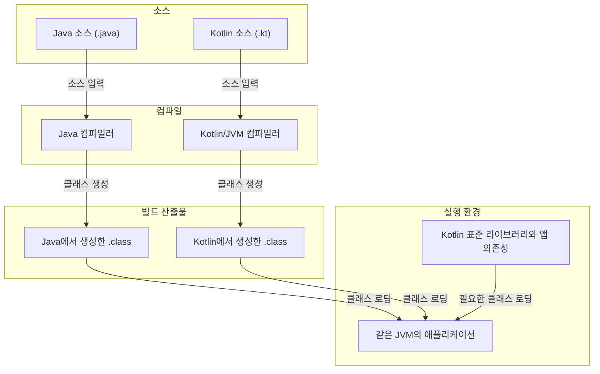

Kotlin/JVM은 Kotlin 소스를 JVM에서 실행할 수 있는 바이트코드로 컴파일하는 방식이다.
기존 Java 코드와 실행 기반을 공유하므로, Spring Boot 프로젝트의 일부 기능부터 Kotlin으로 작성할 수 있다.

| 단계 | Java만 사용하는 프로젝트              | Kotlin을 함께 사용하는 프로젝트                  |
|:----:|:--------------------------------------|:-------------------------------------------------|
| 소스 | `.java` 파일                          | 기존 `.java`와 새 `.kt` 파일                     |
| 빌드 | Java 컴파일러로 컴파일                | Java·Kotlin 컴파일 작업과 필요한 라이브러리 구성 |
| 실행 | Java에서 생성한 클래스를 JVM에서 실행 | 두 언어에서 생성한 클래스를 같은 JVM에서 실행    |

## Kotlin과 Kotlin/JVM

Kotlin은 코드를 실행하기 전에 타입을 검사하는 정적 타입 프로그래밍 언어다. JVM·JavaScript 등 여러 실행 대상을 지원하며, Spring Boot 애플리케이션에는 Kotlin/JVM을 사용한다.

### JVM과 바이트코드

JVM(Java Virtual Machine)은 클래스 파일을 읽고 코드를 실행하는 가상 머신으로, 클래스 파일에는 JVM이 처리할 명령인 바이트코드와 클래스·메서드 정보가 들어 있다.

- Java 컴파일러는 `.java`에서, Kotlin/JVM 컴파일러는 `.kt`에서 `.class` 파일을 생성
- JVM은 이렇게 생성된 클래스 파일을 실행하므로 Kotlin 소스를 Java 소스로 먼저 바꿀 필요가 없음

## Java와 함께 사용하는 구조

하나의 애플리케이션에서 두 언어를 함께 사용할 때의 컴파일·실행 관계는 다음과 같다.



Java와 Kotlin에서 생성한 클래스가 같은 실행 환경에 모이므로, 기존 Java 기능을 유지하면서 Kotlin 기능을 추가할 수 있다.

## 소스 배치와 빌드 설정

Gradle 프로젝트에서는 Java와 Kotlin 소스를 기본적으로 다음과 같이 나눠 둔다. 기존 Java 파일은 옮기지 않고, 새 Kotlin 파일을 `src/main/kotlin`에 추가하면 된다.

```text
service/
├── build.gradle
└── src/
    ├── main/
    │   ├── java/       # Java 코드
    │   ├── kotlin/     # Kotlin 코드
    │   └── resources/
    └── test/
        ├── java/       # Java 테스트
        └── kotlin/     # Kotlin 테스트
```

소스를 배치한 뒤에는 Gradle이 Kotlin 파일도 컴파일할 수 있도록 빌드를 설정한다.

1. Kotlin JVM 플러그인 적용
    - Gradle에 Kotlin 컴파일 작업이 추가되며, 이 작업이 Kotlin 컴파일러로 `.kt` 소스를 `.class` 파일로 변환
2. 빌드에 사용할 JDK와 JVM target 지정
    - Java와 Kotlin을 함께 빌드할 때는 양쪽에서 생성하는 클래스 파일의 버전 설정을 맞춤

문자열·컬렉션 등의 기본 API는 Kotlin 표준 라이브러리가 제공하며, Kotlin Gradle 플러그인은 기본 설정에서 이 라이브러리를 의존성에 자동으로 추가한다.

## Kotlin 버전과 JVM target

Kotlin 컴파일러 버전은 사용할 컴파일러를, JVM target은 생성할 클래스 파일의 Java 버전을 정한다. 이와 별도로 빌드·실행에 사용할 JDK도 선택한다.

|         설정         | 정하는 내용                                                           |
|:--------------------:|:----------------------------------------------------------------------|
| Kotlin 컴파일러 버전 | Kotlin 코드를 컴파일할 도구의 버전                                    |
|    Java toolchain    | 컴파일·테스트에 사용할 JDK. Gradle 자체를 실행하는 JDK와 다를 수 있음 |
|      JVM target      | 생성할 `.class` 파일의 Java 버전                                      |
|       실행 JDK       | 애플리케이션을 실행할 Java 환경                                       |

예를 들어 JVM target이 21이면 Java 21 이상을 지원하는 JVM이 필요하다. Java와 Kotlin을 함께 사용하는 프로젝트에서는 다음 조건을 확인한다.

- 바이트코드 버전: Java의 `targetCompatibility`와 Kotlin의 `jvmTarget` 설정 일치
- 실행 JVM: 생성된 클래스 파일의 버전 지원
- JDK API·라이브러리: 코드에서 사용하는 API와 의존성을 실행 환경에서도 사용 가능

JVM target을 낮춰도 최신 JDK API 호출이 이전 실행 환경에서 동작하는 것은 아니다. 클래스 파일의 버전과 실제 사용하는 API를 함께 확인해야 한다.
