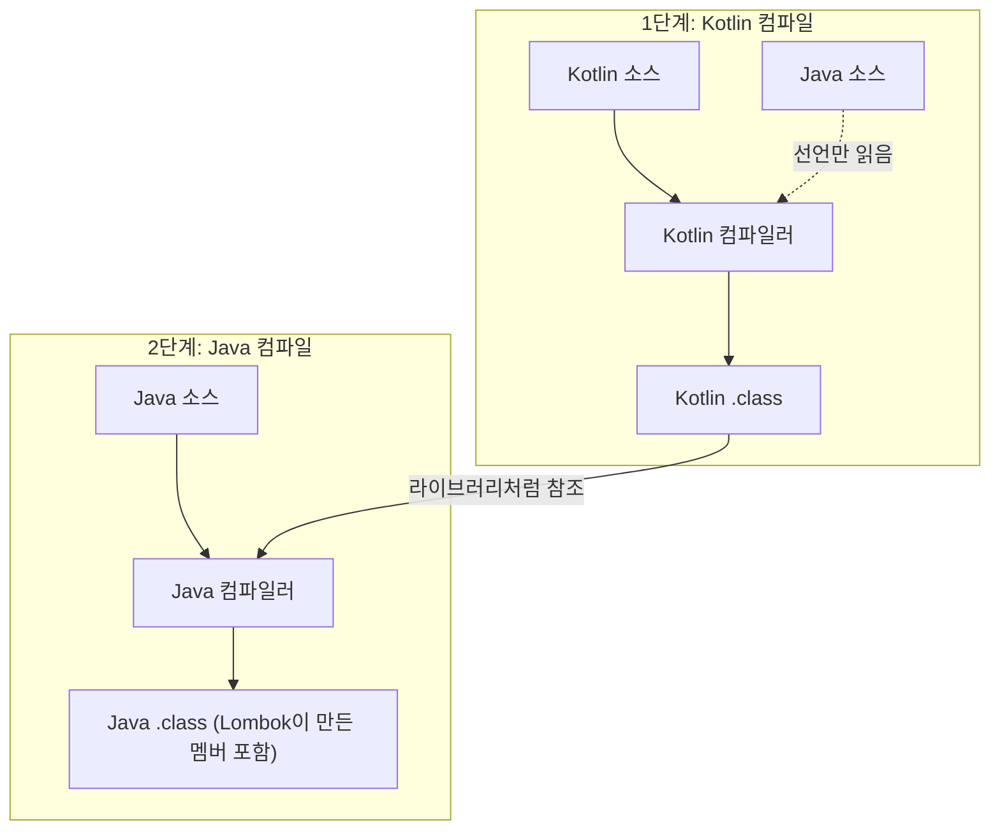

Kotlin과 Java 코드는 같은 모듈에서 서로의 클래스를 호출할 수 있다.
다만 Java 코드에는 `null` 정보가 없고 Java 문법에는 프로퍼티·기본 인자·companion object가 없어, 언어 경계에서 호출 형식과 `null` 처리가 달라진다.

## 혼합 컴파일 순서

Java와 Kotlin 소스가 한 모듈에 있으면 Kotlin 컴파일러가 먼저 실행된다.
Kotlin 컴파일러는 Java 소스에서 선언만 읽고, Java 컴파일러는 Kotlin이 만든 `.class`를 라이브러리처럼 참조해 Java 소스를 컴파일한다.



이 순서 때문에 양쪽 호출이 모두 가능하지만, Java 컴파일 단계에서 만들어지는 코드는 Kotlin에서 보이지 않는다.

- Kotlin 코드는 같은 모듈의 Java 클래스를 컴파일할 때 바로 참조
- Java 코드는 이미 만들어진 Kotlin `.class`를 참조
- Lombok처럼 Java 컴파일 단계에서 코드를 만드는 annotation processor의 결과는 Kotlin 컴파일 시점에 아직 없음
    - 예: Java 클래스에 `@Getter`를 붙여도 getter는 2단계에서 생기므로, 같은 모듈의 Kotlin 코드에서 `user.email`을 쓰면 컴파일 오류 발생
    - 해결 방법: Kotlin Lombok 컴파일러 플러그인. 1단계에서 Kotlin 컴파일러가 Lombok이 만들 멤버를 미리 인식
      ([Lombok](/docs/kotlin/java-interoperability/#lombok) 절)

## Java를 호출하는 Kotlin

Kotlin은 Java의 getter·setter를 프로퍼티처럼 쓰게 해 주고, 나머지 호출은 Java와 같다.

|           Java 선언            | Kotlin에서 호출                         |
|:------------------------------:|:----------------------------------------|
|          `getEmail()`          | `user.email`                            |
| `isActive()`, `setActive(...)` | `user.isActive`, `user.isActive = true` |
|   record 컴포넌트 `email()`    | `record.email` 또는 `record.email()`    |
|    static 메서드 `guest()`     | `JavaUser.guest()`                      |

```java
// JavaUser.java
public class JavaUser {

    private final long id;
    private final String email;
    private boolean active;

    public JavaUser(long id, String email) {
        this.id = id;
        this.email = email;
    }

    public long getId() {
        return id;
    }

    public String getEmail() {
        return email;
    }

    public boolean isActive() {
        return active;
    }

    public void setActive(boolean active) {
        this.active = active;
    }

    public static JavaUser guest() {
        return new JavaUser(0, "guest@example.com");
    }
}
```

```kotlin
// Main.kt
fun main() {
    val user = JavaUser(1, "alice@example.com")
    println(user.email)              // alice@example.com: getEmail() 호출
    user.isActive = true             // setActive(true) 호출
    println(user.isActive)           // true: isActive() 호출
    println(JavaUser.guest().email)  // guest@example.com
}
```

## Platform Type과 Optional

Java 메서드의 반환 타입에는 `null`이 올 수 있는지에 대한 정보가 없다. Kotlin이 이 값을 어떤 타입으로 다루는지에 따라, `null` 검사를 컴파일러가 하는지 개발자가 하는지가 갈린다.

### Platform Type

Platform type은 `null`이 올 수 있는지 Kotlin이 알 수 없는 Java 값의 타입이다.
Java 값을 모두 같은 Kotlin 타입으로 다루면, `String?`(`null` 가능)과 `String`(`null` 불가) 중 어느 쪽을 골라도 문제가 생긴다.

- 모두 `String?`로 다룰 때: `null`이 오지 않는 값에도 Java 호출마다 `?.`나 `!!` 필요
- 모두 `String`으로 다룰 때: 실제로 `null`이 와도 컴파일 단계에서 검사 불가

Platform type 값은 `?.` 없이 쓸 수 있는 대신, 컴파일러가 `null`을 검사하지 않는다.

- 대입: `String`과 `String?` 어느 쪽에도 가능
- `null` 처리: 어느 타입으로 받을지 개발자가 선택
- 표기: `String!`("`String` 또는 `String?`"). 컴파일 오류 메시지와 IDE 타입 힌트에만 나오고, 코드에는 쓸 수 없는 표기

```java
// JavaUser.java (추가한 필드와 메서드)
private String nickname;  // 닉네임을 정하지 않은 사용자는 null

public String findNickname() {
    return nickname;
}
```

```kotlin
// Main.kt
val user = JavaUser(1, "alice@example.com")  // 닉네임을 정하지 않아 findNickname()은 null 반환

// 1. 타입을 적지 않으면 platform type(String!)으로 추론
val inferred = user.findNickname()
println(inferred.length)  // ?. 없이도 컴파일됨. 실행하면 이 줄에서 NullPointerException

// 2. String?로 받으면 Kotlin의 null 검사가 적용됨
val nullable: String? = user.findNickname()
println(nullable?.length)  // null
// println(nullable.length)  → 컴파일 오류: String?에는 ?.나 !!.가 필요

// 3. String으로 받으면 대입하는 줄에서 null 검사
val nonNull: String = user.findNickname()  // NullPointerException: findNickname(...) must not be null
```

- 타입을 적지 않을 때: platform type으로 추론되어 컴파일러가 검사하지 않고, 값을 쓰는 줄에서 예외 발생
- `String?`로 받을 때: `?.`·`?:` 같은 [Null Safety](/docs/kotlin/null-safety/)의 연산자를 컴파일러가 강제
- `String`으로 받을 때: Kotlin 컴파일러가 대입하는 줄에 `null` 검사를 넣어, 값이 `null`이면 그 줄에서 예외 발생
- `null`이 올 수 있는 Java 반환값은 `String?`로 받는 것이 안전

### Nullability 어노테이션

Java 선언에 nullability 어노테이션이 있으면 Kotlin은 platform type 대신 어노테이션에 맞는 타입을 쓴다.
`@Nullable`이면 `String?`, `@NonNull`이면 `String`으로 다루므로 `null` 검사를 컴파일러가 강제한다.

```java
// JavaUser.java (어노테이션을 붙인 메서드)

import org.jspecify.annotations.NonNull;
import org.jspecify.annotations.Nullable;

@Nullable
public String findNickname() {  // 닉네임을 정하지 않으면 null
    return nickname;
}

@NonNull
public String getEmail() {      // 항상 값이 있음
    return email;
}
```

```kotlin
// Main.kt
// @Nullable → String?
// val nickname: String = user.findNickname()
// → 컴파일 오류: initializer type mismatch: expected 'String', actual 'String?'.
val nickname: String? = user.findNickname()
println(nickname?.length)             // ?.로 처리해야 컴파일됨

// @NonNull → String
val email: String = user.email        // ?. 없이 바로 대입
println(user.email.length)            // ?. 없이 바로 호출
```

### Optional

Java 메서드가 `Optional`을 반환하면, Kotlin에서는 `getOrNull()`로 바꿔서 쓴다. (값이 있으면 그 값을, 없으면 `null`을 돌려주는 Kotlin 표준 라이브러리 함수)
`getOrNull()`로 바꾸는 이유는 다음과 같다.

- `Optional`: 값이 없어도 `null`이 아니라 비어 있는 `Optional` 객체를 반환
- `?.`·`?:`: 값이 `null`인지만 검사하므로, 비어 있는 `Optional`은 구분 불가
- `getOrNull()`: 값이 없으면 `null`을 돌려주므로, 결과(`JavaUser?`)에 `?.`·`?:` 사용 가능

```java
// UserPort.java
public interface UserPort {

    Optional<JavaUser> findById(long id);  // 사용자가 없으면 Optional.empty()
}
```

```kotlin
// Main.kt
import kotlin.jvm.optionals.getOrNull

// Optional 그대로: Java처럼 map·orElse로 꺼냄
val email1 = port.findById(1).map { it.email }.orElse("unknown")
// port.findById(1)?.email  → 컴파일 오류: Optional에는 email이 없음

// getOrNull()로 바꾼 뒤: Kotlin의 ?.·?:로 꺼냄
val email2 = port.findById(1).getOrNull()?.email ?: "unknown"
```

`Optional`에서 값을 꺼내는 방법은 여러 가지지만, `null` 검사를 컴파일러가 해 주는 방법은 `getOrNull()`뿐이다.

|      방법      |  결과 타입  | 값이 없을 때                                                            |
|:--------------:|:-----------:|:------------------------------------------------------------------------|
| `getOrNull()`  | `JavaUser?` | `null` 반환. `?.`를 빠뜨리면 컴파일 오류                                |
| `orElse(null)` | `JavaUser!` | `null` 반환. `?.`를 빠뜨려도 컴파일되고, 실행 중 `NullPointerException` |
|    `get()`     | `JavaUser!` | `NoSuchElementException` 발생                                           |

- `orElse(null)`·`get()`은 Java 메서드라 결과가 platform type
- Java에서 받은 직후 한 번만 바꿔 두면, 그 뒤 Kotlin 코드에서는 `Optional` 없이 nullable 타입만 사용

## Kotlin을 호출하는 Java

Java에는 프로퍼티, top-level 함수, companion object, 기본 인자가 없다. Kotlin 컴파일러가 이들을 Java 메서드로 바꿔 만들기 때문에, Java에서는 바뀐 이름과 형식으로 호출한다.

|            Kotlin 선언             | Java에서 호출                          | 호출 형식을 바꾸는 방법                      |
|:----------------------------------:|:---------------------------------------|:---------------------------------------------|
|          프로퍼티 `email`          | `getEmail()`                           | 없음                                         |
|       프로퍼티 `isVerified`        | `isVerified()`                         | 없음                                         |
| `Users.kt`의 top-level `normalize` | `UsersKt.normalize(...)`               | 파일 첫 줄의 `@file:JvmName("UserMapper")`   |
|     companion object 함수 `of`     | `UserResponse.Companion.of(...)`       | `@JvmStatic`을 붙이면 `UserResponse.of(...)` |
|       기본 인자가 있는 함수        | 모든 인자를 넘겨야 함                  | `@JvmOverloads`로 인자 수별 오버로드 생성    |
|        data class의 `copy`         | `copy(1L, "...", false)`처럼 모든 인자 | 없음                                         |

다음 Kotlin 코드를 Java에서 호출한다.

```kotlin
// Users.kt
data class UserResponse(val id: Long, val email: String, val isVerified: Boolean = false) {
    companion object {
        @JvmStatic
        fun of(id: Long, email: String) = UserResponse(id, email)
    }
}

fun normalize(email: String): String = email.trim().lowercase()

object Greeting {
    @JvmStatic
    @JvmOverloads
    fun greet(name: String, prefix: String = "Hello"): String = "$prefix, $name"
}
```

```java
// Main.java
void main(String[] args) {
    UserResponse user = new UserResponse(1L, "alice@example.com", false);  // 기본 인자도 직접 전달
    System.out.println(user.getEmail() + " " + user.isVerified());  // alice@example.com false
    System.out.println(
            UserResponse.of(2L, "bob@example.com"));  // UserResponse(id=2, email=bob@example.com, isVerified=false)
    System.out.println(UsersKt.normalize(" Alice@Example.com "));  // alice@example.com
    System.out.println(Greeting.greet("alice"));  // Hello, alice
    System.out.println(Greeting.greet("alice", "Hi"));  // Hi, alice
}
```

- `new UserResponse(1L, "alice@example.com")`처럼 기본 인자를 빼면 Java에서는 컴파일 오류
- `Greeting.greet("alice")`는 `@JvmOverloads`가 만든 인자 하나짜리 오버로드를 호출
- 생성자에 `@JvmOverloads`를 붙이려면 `class UserResponse @JvmOverloads constructor(...)`처럼 `constructor` 키워드와 함께 사용

### Java가 넘긴 null

Java에서는 Kotlin의 non-null 매개변수에 `null`을 넘길 수 있다.
Kotlin 컴파일러는 외부에서 호출할 수 있는 함수의 시작 부분에 `null` 검사를 넣으므로, 함수 본문이 실행되기 전에 예외가 발생한다.

```java
// Main.java
public class Main {

    public static void main(String[] args) {
        UsersKt.normalize(null);
        // NullPointerException: Parameter specified as non-null is null: method UsersKt.normalize, parameter email
    }
}
```

## Lombok과 Gradle 설정

### Lombok

Lombok은 Java 컴파일 단계에서 getter·생성자를 만든다. 같은 모듈의 Kotlin 코드는 그보다 먼저 컴파일되므로 Lombok이 만들 멤버를 찾지 못하는 문제가 발생한다.

```java
// LombokUser.java
@Getter
@RequiredArgsConstructor
public class LombokUser {

    private final long id;
    private final String email;
}
```

```kotlin
// Main.kt
val user = LombokUser(1, "alice@example.com")
// 컴파일 오류: too many arguments for 'constructor(): LombokUser'.
println(user.email)
// 컴파일 오류: cannot access 'field email: String!': it is private in 'LombokUser'.
```

Kotlin Lombok 컴파일러 플러그인을 적용하면 Kotlin 컴파일러가 Java 소스의 Lombok 어노테이션을 읽고, 생성될 멤버를 미리 인식한다.

- 지원 어노테이션:
    - `@Getter`·`@Setter`, `@Builder`·`@SuperBuilder`, `@NoArgsConstructor`·
      `@RequiredArgsConstructor`· `@AllArgsConstructor`, `@Data`, `@With`, `@Value`
- Lombok을 대신하지 않으므로 기존 Lombok 의존성과 설정은 그대로 둠
- 다른 모듈의 Lombok 클래스를 호출할 때는 이미 컴파일된 `.class`를 읽으므로 플러그인 불필요
- 플러그인 없이 쓰려면 Kotlin에서 호출하는 Java 클래스만 getter·생성자를 직접 작성

[Calling Java from Kotlin](https://kotlinlang.org/docs/java-interop.html), [Calling Kotlin from Java](https://kotlinlang.org/docs/java-to-kotlin-interop.html), [Lombok compiler plugin](https://kotlinlang.org/docs/lombok.html), [Configure a Gradle project](https://kotlinlang.org/docs/gradle-configure-project.html)
