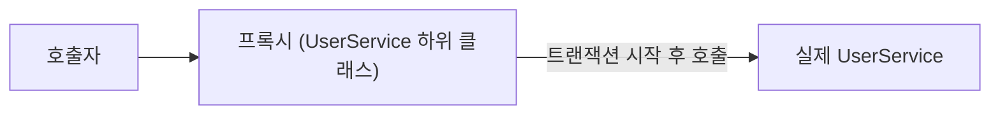

Kotlin 클래스는 Java와 같은 JVM 클래스 파일로 컴파일되므로, Java 클래스처럼 Spring Bean으로 등록하고 HTTP 요청·응답 객체로 쓸 수 있다.
다만 일부 동작은 Java의 관례를 전제로 만들어져, Kotlin의 기본 규칙과 부딪히는 지점에는 플러그인이나 모듈이 더 필요하다.

- 프록시 생성: 클래스를 상속해 만드는 방식이라 Kotlin의 기본 `final` 클래스와 충돌
- JSON 변환: Java 리플렉션으로 생성자를 읽는 방식이라 Kotlin의 기본값·`null` 불가 타입과 충돌

## 생성자 주입

같은 생성자 주입을 Java와 Kotlin으로 쓰면 다음과 같다.

```java
// UserService.java
@Service
@RequiredArgsConstructor
public class UserService {

    private final UserRepository userRepository;
}
```

```kotlin
// UserService.kt
@Service
class UserService(private val userRepository: UserRepository)
```

- 주 생성자: `private val`로 선언한 매개변수가 그대로 `private final` 필드가 되므로 Lombok의 `@RequiredArgsConstructor` 불필요
- `@Autowired` 생략: 생성자가 하나뿐이면 Spring이 그 생성자로 의존성을 주입

## 프록시와 final

`@Transactional` 같은 기능은 Spring이 실제 객체 대신 프록시 객체를 Bean으로 등록해 동작한다.
Spring Boot가 기본으로 쓰는 프록시는 대상 클래스를 상속한 하위 클래스이며, 메서드를 덮어써 트랜잭션 시작·종료 코드를 실제 메서드 앞뒤에 넣는다.



Kotlin 클래스와 메서드는 `open`을 붙이지 않으면 `final`이라 상속하거나 덮어쓸 수 없기 때문에, `@Transactional`을 붙인 Kotlin 클래스는 선언에 따라 다음처럼 동작한다.

|    클래스    |   메서드   | 결과                                                       |
|:------------:|:----------:|:-----------------------------------------------------------|
|   `class`    |  관계없음  | 애플리케이션 시작 시 프록시 생성 실패                      |
| `open class` |   `fun`    | 프록시는 생성되지만 메서드를 덮어쓰지 못해 트랜잭션 미적용 |
| `open class` | `open fun` | 정상 동작                                                  |

클래스만 `open`이고 메서드는 `final`인 경우는 시작할 때 오류가 없어 찾기 더 어렵기 때문에, 보통 아래 방법을 사용하게 된다.

### kotlin-spring 플러그인

모든 클래스와 메서드에 `open`을 직접 붙이는 대신, kotlin-spring 컴파일러 플러그인이 Spring 어노테이션이 붙은 클래스와 그 멤버를 컴파일할 때 `open`으로 바꾼다.

- 대상 어노테이션: `@Component`, `@Async`, `@Transactional`, `@Cacheable`, `@SpringBootTest`
- `@Component`가 붙은 어노테이션도 대상: `@Service`, `@Repository`, `@Controller`, `@RestController`, `@Configuration`
- 대상이 아닌 클래스: 위 어노테이션이 없는 클래스는 그대로 `final`. JPA의 `@Entity`도 대상이 아니라 별도 설정 필요

## JSON 변환과 Jackson Kotlin 모듈

Spring MVC는 요청 본문 JSON을 객체로 바꿀 때(역직렬화)와 응답 객체를 JSON으로 바꿀 때(직렬화) Jackson을 쓴다.
Jackson은 Java 리플렉션으로 생성자를 찾으므로, Kotlin 생성자의 기본값과 `null` 가능 여부는 알지 못한다.

- jackson-module-kotlin: Kotlin 컴파일러가 클래스 파일에 남긴 정보로 기본값과 `null` 가능 여부를 읽어 생성자를 호출하는 Jackson 모듈
- 등록: Spring Boot가 이 모듈이 클래스 경로에 있으면 자동으로 등록

다음 요청 객체로 요청 JSON에 따라 결과가 어떻게 달라지는지 확인한다.

```kotlin
// SignupRequest.kt
data class SignupRequest(
    val email: String,           // null 불가, 기본값 없음
    val nickname: String?,       // null 가능, 기본값 없음
    val role: String = "USER",   // null 불가, 기본값 있음
)
```

|                   요청 JSON                    | 결과                                                                  |
|:----------------------------------------------:|:----------------------------------------------------------------------|
|        `{"email": "alice@example.com"}`        | 생성 성공. `nickname`은 `null`, `role`은 `"USER"`                     |
|            `{"nickname": "alice"}`             | `email`이 없어 역직렬화 예외                                          |
|               `{"email": null}`                | `null` 불가 프로퍼티에 `null`이 들어와 역직렬화 예외                  |
| `{"email": "alice@example.com", "role": null}` | 역직렬화 예외. 기본값이 있어도 명시적 `null`은 기본값으로 바뀌지 않음 |

- 역직렬화 예외: Spring MVC가 요청 본문을 읽지 못한 오류로 처리해 400 응답
- 명시적 `null`을 기본값으로 처리: 모듈의 `NullIsSameAsDefault` 기능 필요. 기본 설정은 꺼진 상태
- `Int`·`Boolean` 같은 기본 타입: `null`이 들어오면 예외 대신 `0`·`false`가 들어갈 수 있어, Jackson의 `FAIL_ON_NULL_FOR_PRIMITIVES` 설정으로 예외 처리
- 기준 버전: jackson-module-kotlin 2.x(Spring Boot 3). Jackson 3용 3.x(Spring Boot 4)는 일부 기본값이 달라 버전별 확인 필요

## 설정 요약

위 조건에 필요한 플러그인과 의존성이다. start.spring.io에서 Kotlin 프로젝트를 만들면 기본으로 들어간다.

```groovy
// build.gradle
plugins {
    id 'org.jetbrains.kotlin.jvm' version '<Kotlin 버전>'
    id 'org.jetbrains.kotlin.plugin.spring' version '<Kotlin 버전>'  // Spring 어노테이션이 붙은 클래스를 open으로 컴파일
}

dependencies {
    implementation 'org.jetbrains.kotlin:kotlin-reflect'                      // Spring의 Kotlin 지원에 필요
    // Spring Boot 3 기준. Spring Boot 4는 tools.jackson.module 그룹
    implementation 'com.fasterxml.jackson.module:jackson-module-kotlin'
    implementation 'org.springframework.boot:spring-boot-starter-validation'  // 검증 어노테이션 사용 시
}
```

[Spring Boot Kotlin Support](https://docs.spring.io/spring-boot/reference/features/kotlin.html), [Kotlin-spring compiler plugin](https://kotlinlang.org/docs/kotlin-spring-plugin.html), [Annotation use-site targets](https://kotlinlang.org/docs/annotations.html#annotation-use-site-targets), [jackson-module-kotlin](https://github.com/FasterXML/jackson-module-kotlin)
