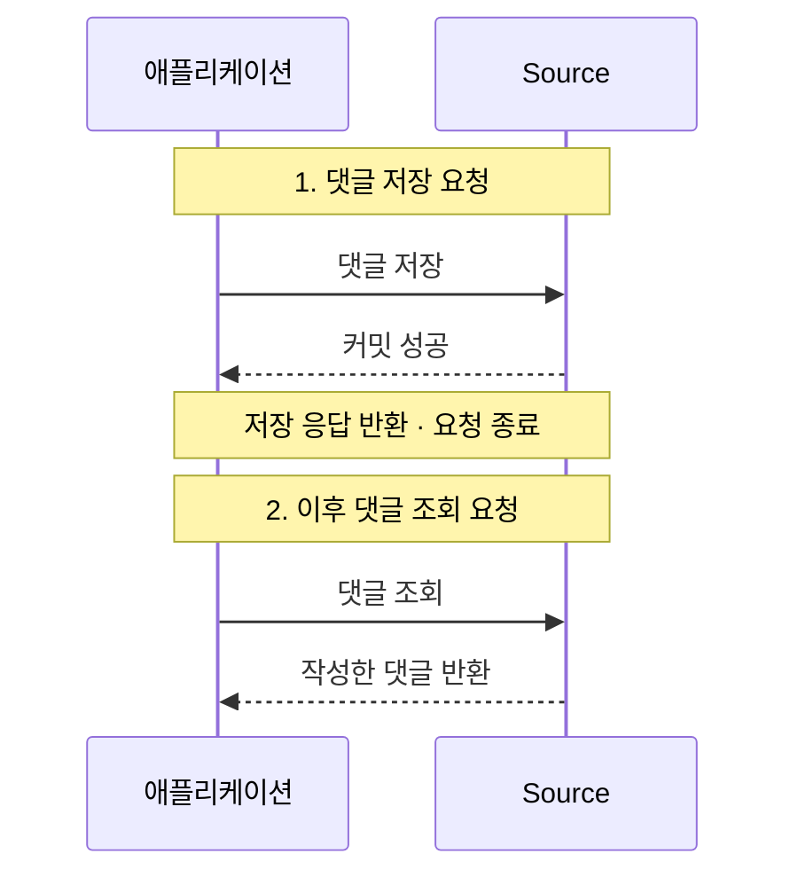
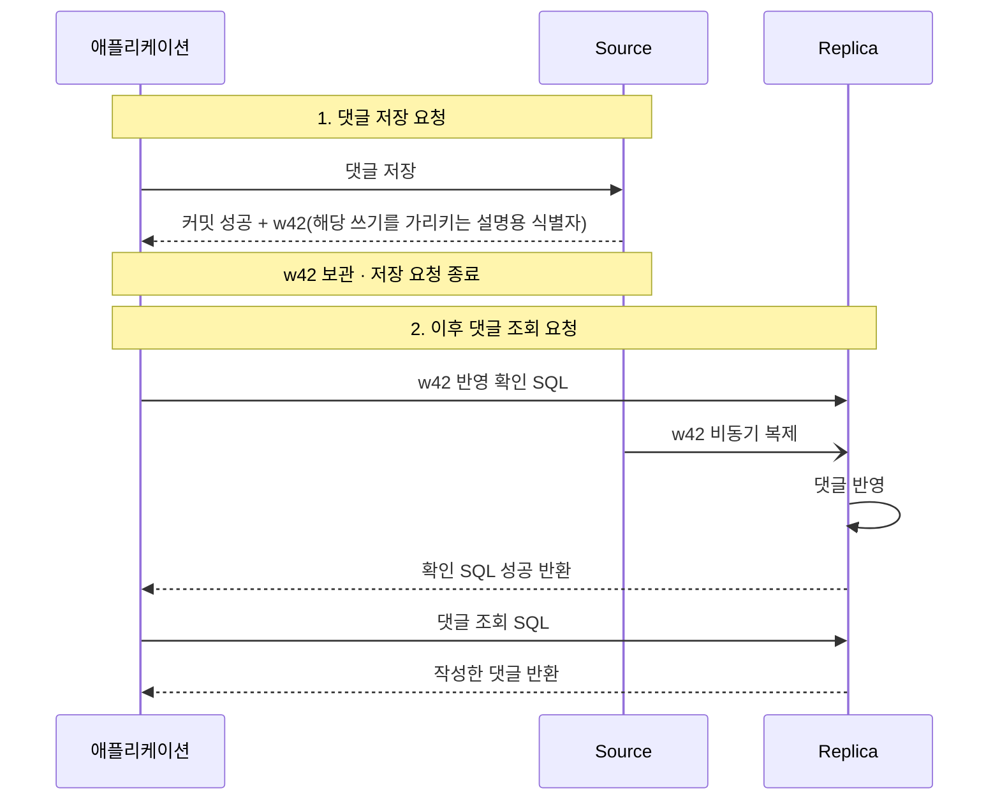
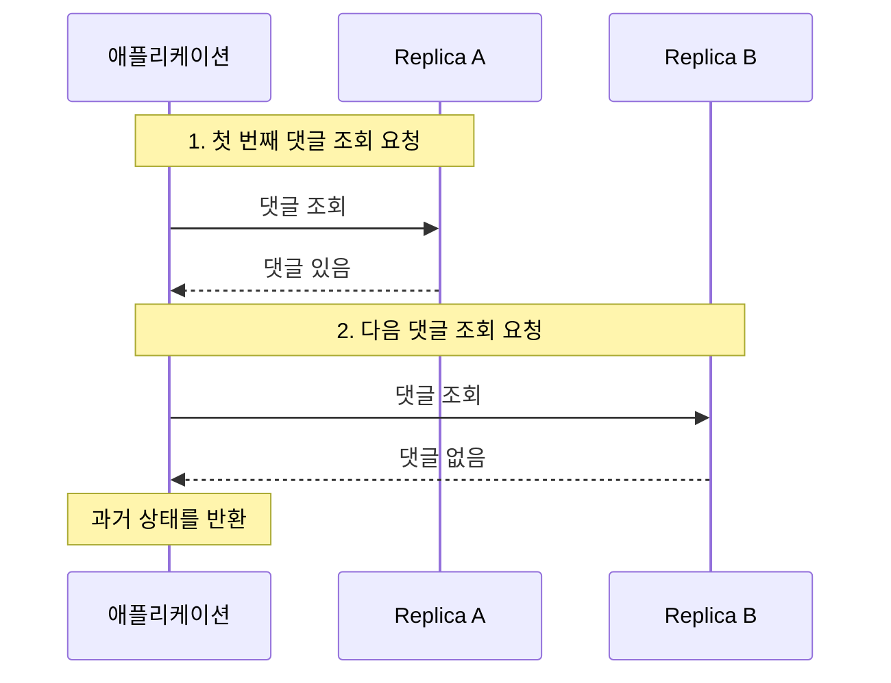
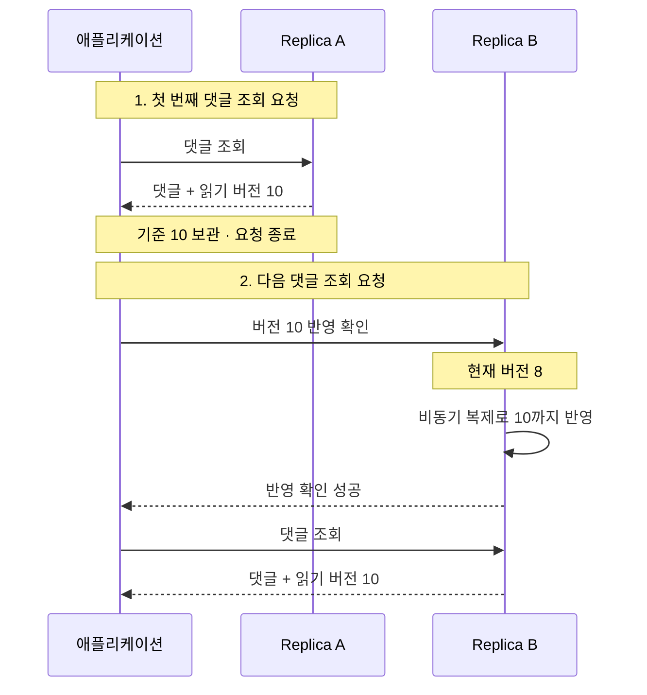

## 읽기 보장의 배경

Source가 쓰기를 처리하고 Replica가 읽기를 분담하는 비동기 복제 환경에서는, 커밋 성공 이후에도 Replica별로 해당 쓰기의 반영 시점이 다를 수 있다.

### 최종 일관성의 한계

- 최종 일관성 (Eventual Consistency)의 보장: 새로운 쓰기가 멈추고 복제가 정상적으로 진행되면 복제본들이 결국 같은 상태로 수렴
- 보장하지 않는 범위: 자신의 쓰기가 직후 조회에 보이는지와 이전 조회보다 과거 상태를 읽지 않는지

### 문제별 읽기 보장

애플리케이션에서 허용하지 않을 현상에 맞춰 필요한 읽기 보장을 선택한다.

|    읽기 보장     |                방지하는 현상                |
|:----------------:|:-------------------------------------------:|
| Read Your Writes |  내가 쓴 댓글이 직후 조회에서 보이지 않음   |
| Monotonic Reads  | 한 번 읽은 댓글이 과거 상태로 돌아가 사라짐 |

## Read Your Writes

자신의 쓰기 읽기는 같은 세션에서 성공한 쓰기가 이후 자신의 읽기에 반영되도록 하는 보장이다.

- 보장 대상: 같은 세션에서 자신이 수행한 쓰기
- 보장 범위 밖: 다른 사용자가 쓴 데이터까지 항상 최신 상태로 읽는 것

### Source 라우팅과 반영 대기

댓글 저장 요청이 끝난 뒤, 별도의 댓글 조회 요청이 들어온 상황을 가정한다. Source에는 댓글이 저장되어 있지만 Replica에는 아직 반영되지 않았다.

두 방식의 차이는 이후 조회 요청을 어디서 처리하느냐에 있다. 그림의 1번과 2번은 서로 다른 사용자 요청을 나타낸다.

#### Source에서 바로 읽기

Source에는 이미 댓글이 있으므로 Replica의 반영을 기다릴 필요가 없이 댓글을 바로 조회할 수 있다.

- 읽기 위치: Source
- 대기 대상: Replica 반영 대기 없음
- 비용: 쓰기 직후의 읽기까지 Source에 집중

#### Replica의 반영을 확인한 뒤 읽기

- 댓글 저장 요청: Source의 커밋 성공 응답에서 쓰기 식별자를 받아 사용자 세션에 보관하고, 사용자에게 저장 성공 응답
- 이후 댓글 조회 요청: 읽을 Replica를 선택하고, 보관한 식별자로 해당 쓰기의 반영을 확인한 뒤 댓글 조회

반영 확인 SQL은 `w42`가 적용될 때까지 반환을 기다리며, 복제는 그동안 별도로 진행된다. (이미 반영된 상태라면 즉시 성공을 반환)

- 읽기 위치: `w42` 적용을 확인한 Replica
- 대기 시점: 저장 요청이 끝난 뒤 들어온 조회 요청에서, 댓글 조회 SQL을 실행하기 전
- 대기 대상: 해당 쓰기의 적용 완료
- 비용: Replica가 뒤처진 만큼 조회 응답이 늦어질 수 있음
- 대기 시간 초과: 해당 쓰기를 보존한 Source로 우회하거나 요청을 실패 처리

> MySQL에서는 GTID (Global Transaction Identifier)가 쓰기 식별자 역할을 한다. [GTID 대기 동작 흐름](/docs/mysql/replication/#gtid-대기-동작-흐름)

## Monotonic Reads

단조 읽기는 같은 세션에서 한 번 읽은 상태보다 과거의 상태를 다음 조회에서 반환하지 않도록 하는 보장이다.

- 보장 대상: 자신이 쓴 데이터뿐 아니라 다른 사람이 쓴 데이터를 읽은 경우도 포함
- 읽기 기준: 이미 관측한 변경 이력을 유지하거나 더 새로운 상태를 읽음 (매번 가장 최신 상태를 읽어야 하는 것은 아님)

### 복제본 변경으로 읽기가 후퇴하는 경우

다른 사람이 작성한 댓글을 두 번 조회하는 상황을 가정한다.

- 첫 조회에서 댓글을 봤지만, 다음 조회가 뒤처진 Replica B로 가면서 댓글 생성 전의 상태를 반환
- 이처럼 읽기 대상이 바뀌어 이미 관측한 변경을 잃는 현상 방지 필요

|         댓글이 사라진 이유         |       상태 변화       | 단조 읽기 위반 |
|:----------------------------------:|:---------------------:|:--------------:|
| 댓글 생성 전의 Replica 상태를 읽음 |      과거로 후퇴      |      해당      |
|  이후 실제 삭제가 커밋되어 반영됨  | 더 새로운 변경을 관측 | 해당하지 않음  |

### 복제본 고정과 관측 버전 추적

#### 같은 Replica로 읽기 대상 고정

첫 조회를 Replica A에서 처리했다면 다음 조회도 A로 보낸다.

- 라우팅 예시: 사용자 ID의 해시로 대상 Replica를 정해 같은 사용자의 조회를 같은 서버에 전달
- 보장 조건: 해당 Replica의 읽기 상태 자체가 후퇴하지 않아야 함. 오래된 트랜잭션 스냅샷을 재사용하는 경우도 확인 필요
- 한계: 장애나 증설로 대상이 B로 바뀌면 B가 이전 관측 상태를 포함하는지 추가 확인 필요

#### 이전 읽기의 버전을 보관하고 다음 조회에서 확인

Replica가 바뀌어도 보장을 유지하려면, 백엔드가 이전 조회에서 읽은 버전을 사용자 세션에 보관한다.

- 버전 10: 변경 1~10까지 반영한 상태. 첫 조회에서 댓글을 읽음
- 버전 8: 변경 1~8까지만 반영한 상태. 첫 조회에서 본 댓글이 아직 없음
- 다음 조회의 최소 기준: 버전 10. 버전 8인 Replica에서는 그대로 조회하지 않음

다음 조회에서는 그 버전 이상을 읽을 수 있는 Replica를 선택하거나 해당 버전까지 반영될 때까지 기다린다.

## 해결 방법의 선택 기준

서비스에서 허용하지 않을 현상에 맞춰 읽기 경로가 확인할 이력을 정한다.

|             방법             |         적용하기 좋은 요구          |                               조건과 비용                               |
|:----------------------------:|:-----------------------------------:|:-----------------------------------------------------------------------:|
|    쓰기 직후 Source 읽기     |          자신의 쓰기 읽기           |  Source 읽기 부하 증가. 스냅샷과 장애 전환 후 쓰기 보존 여부 확인 필요  |
|    같은 Replica로 라우팅     | 복제본 이동으로 인한 읽기 후퇴 방지 | Replica 자체의 상태가 후퇴하지 않아야 하며, 대상 변경 시 추가 검증 필요 |
| 쓰기·읽기 토큰으로 적용 대기 |     자신의 쓰기 읽기, 단조 읽기     |        버전 정보와 세션 상태 관리 필요. 복제 지연만큼 대기 가능         |

조건을 만족하는 서버가 없을 때의 처리도 정해야 한다.

- 대기: 대상 Replica가 필요한 쓰기를 적용할 때까지 대기
- 우회: 같은 조건을 만족하는 다른 서버에서 조회
- 실패: 제한 시간 안에 보장할 수 없다면 요청을 실패 처리

## 최신성·격리 수준과의 구분

두 보장은 자신의 쓰기 반영과 이전에 읽은 상태의 유지에 대한 조건이다. 다음 개념과는 구분해야 한다.

|           개념           | 두 읽기 보장과의 구분                                                                                                                                                                                                    |
|:------------------------:|:-------------------------------------------------------------------------------------------------------------------------------------------------------------------------------------------------------------------------|
|          최신성          | 데이터가 얼마나 최근 상태인지를 판단한다. 오래된 Replica도 자신의 쓰기를 반영하고 이전에 읽은 상태보다 후퇴하지 않으면 두 보장을 만족할 수 있다. 반대로 한 번 최신 데이터를 읽었어도 다음에 후퇴하면 단조 읽기 위반이다. |
| 선형성 (Linearizability) | 완료된 연산의 실시간 선후관계를 지킨다. 두 보장만으로 모든 읽기가 실시간으로 가장 최근에 완료된 쓰기를 반영하지는 않는다.                                                                                                |
|    트랜잭션 격리 수준    | 동시 실행되는 트랜잭션 사이에서 어떤 변경이 보이는지를 다룬다. `REPEATABLE READ`만으로 서로 다른 Replica에 걸친 요청의 단조 읽기가 제공되지는 않는다.                                                                    |

###### 참고자료

- [Designing Data-Intensive Applications, 1st Edition — Chapter 5: Replication](https://www.oreilly.com/library/view/designing-data-intensive-applications/9781491903063/ch05.html):
  복제 지연과 자신의 쓰기 읽기·단조 읽기
- [Terry et al. — Session Guarantees for Weakly Consistent Replicated Data](https://www.cs.cornell.edu/courses/cs734/2000FA/cached%20papers/SessionGuaranteesPDIS_1.html):
  Read Your Writes·Monotonic Reads의 정의와 세션 이력 관리
- [MySQL 8.0 Reference Manual — Functions Used with Global Transaction Identifiers](https://dev.mysql.com/doc/refman/8.0/en/gtid-functions.html):
  지정한 GTID 집합의 적용 대기
- [MySQL 8.0 Reference Manual — Semisynchronous Replication](https://dev.mysql.com/doc/refman/8.0/en/replication-semisync.html):
  로그 수신 확인과 실행 완료의 차이
