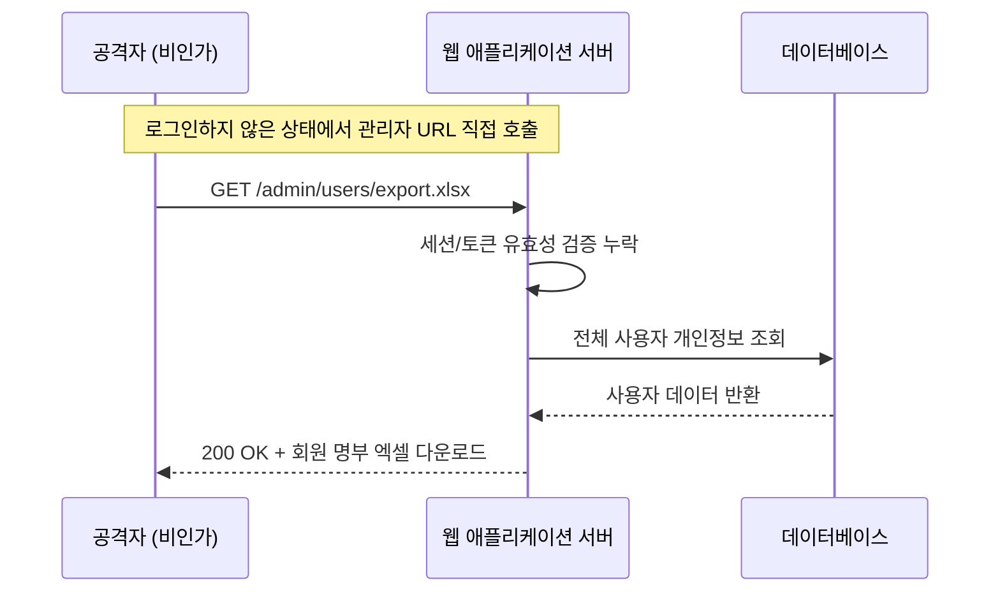
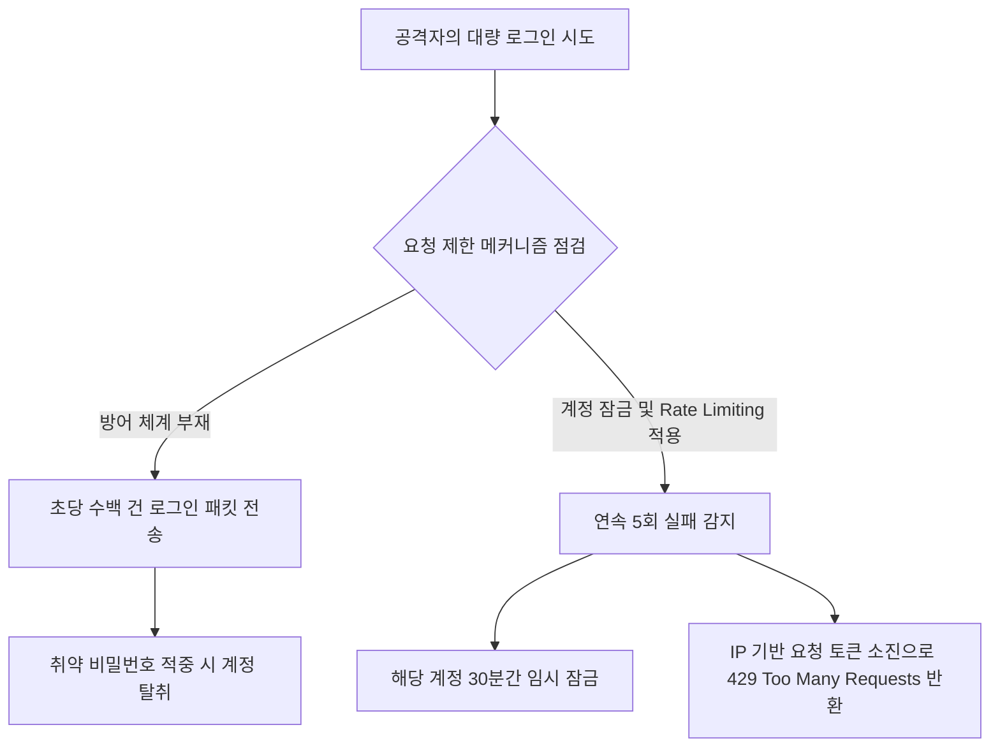
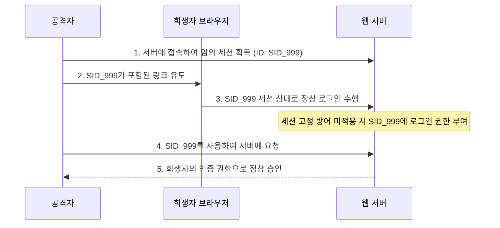

안전한 웹 애플리케이션을 구축하기 위해서는 시스템 자원에 접근하는 사용자의 신원을 명확히 식별하고, 해당 사용자가 요청한 행위를 수행할 정당한 권한이 있는지 엄격하게 통제해야 한다.

## Authentication

사용자의 신원을 증명하고 증명 수단을 안전하게 관리하기 위한 인증 영역의 취약점군이다.

### 1. Missing Authentication for Critical Function

계좌 이체, 비밀번호 변경, 관리자 설정 변경 등 시스템의 중요한 비즈니스 기능이나 API 엔드포인트에 인증 검증 로직이 누락되어 비인가 사용자가 직접 접근할 수 있는 취약점이다.



#### 공격 원리와 발생 조건

- URL 단순 은닉에 의존: 화면 UI에서만 관리자 메뉴 버튼을 감추고, 백엔드 컨트롤러 엔드포인트 자체에는 인증 인터셉터나 필터를 걸어두지 않은 경우 공격자가 URL을 유추하여 직접 호출
- 강제 브라우징 (Forced Browsing): 정적 파일 경로나 API 엔드포인트가 공개 영역에 방치되어 인증 없이 데이터 유출
- 불안전한 직접 객체 참조 (IDOR): 인증은 거쳤으나 자원의 소유권을 검증하지 않아 `GET /orders/105`의 ID 파라미터만 변경하여 타인의 주문 내역에 접근

#### 대응 방안

- 기본 차단 (Deny-by-Default) 원칙 적용: 모든 엔드포인트에 인증 요구를 기본 정책으로 설정하고, 로그인, 회원가입 등 명시적으로 허용된 공개 엔드포인트만 예외로 개방
- 자원 소유권 검증: 데이터 조회 및 수정 요청 시, 현재 인증된 세션의 사용자 식별자와 대상 자원의 소유자 식별자가 일치하는지 비즈니스 로직 레벨에서 대조

#### 코드 예시

```java
// 취약한 예: 인증 여부 및 자원 소유권 검증 없이 파라미터로 계좌 정보 조회
@GetMapping("/api/accounts/{accountId}")
public AccountDto getAccount(@PathVariable Long accountId) {
    // 세션 인증 여부 확인 없이 데이터베이스에서 즉시 조회하여 반환
    return accountService.findById(accountId);
}

// 안전한 예: Spring Security 인증 강제 및 자원 소유권 대조
@GetMapping("/api/accounts/{accountId}")
public AccountDto getAccountSecure(@PathVariable Long accountId,
        @AuthenticationPrincipal CustomUserDetails userDetails) {
    AccountDto account = accountService.findById(accountId);
    if (!account.getOwnerUserId().equals(userDetails.getUserId())) {
        throw new AccessDeniedException("해당 계좌에 대한 조회 권한이 없습니다.");
    }
    return account;
}
```

### 2. Weak Password Requirements

회원가입이나 비밀번호 변경 시 충분한 복잡도와 길이 규칙을 강제하지 않아, 사전 공격 (Dictionary Attack)이나 단순 대입 공격에 쉽게 무력화되는 취약점이다.

#### 취약한 비밀번호의 유형

- 단순 연속 문자 및 키보드 배열: `123456`, `qwerty`, `abcdef`
- 사용자 정보와 연관된 단어: 아이디, 생년월일, 전화번호, 회사명
- 사전 (Dictionary)에 등재된 흔한 단어: `password`, `admin`, `welcome`

#### 대응 방안

- 복잡도 규칙 적용: 영문 대문자, 영문 소문자, 숫자, 특수문자 중 최소 3종류 이상을 조합하도록 강제
- 최소 길이 보장: 영문·숫자·특수문자 조합 시 최소 8자리 이상, 2종류 조합 시 최소 10자리 이상의 길이를 요구
- 개인정보 및 연속 문자열 사용 제한: 사용자 아이디, 연속된 동일 문자 (예: `aaa`), 키보드 연속 배열 (예: `1234`, `qwer`)의 포함 여부를 검증하여 차단
- 유출된 패스워드 사전 대조: 공개된 대규모 침해 데이터베이스 (Have I Been Pwned API 등)나 알려진 취약 패스워드 블랙리스트를 구축하여 대조

#### 코드 예시

```java
// 안전한 예: 정규표현식 및 사용자 정보 포함 여부를 검증하는 패스워드 정책 유효성 검사기
public class PasswordValidator {

    // 영문 대소문자, 숫자, 특수문자 각 1개 이상 포함, 8자리 이상 20자리 이하
    private static final String PASSWORD_PATTERN =
            "^(?=.*[a-z])(?=.*[A-Z])(?=.*\\d)(?=.*[@$!%*?&])[A-Za-z\\d@$!%*?&]{8,20}$";

    private static final Pattern PATTERN = Pattern.compile(PASSWORD_PATTERN);

    public static void validatePassword(String password, String userId) {
        if (password == null || !PATTERN.matcher(password).matches()) {
            throw new IllegalArgumentException(
                    "비밀번호는 영문 대/소문자, 숫자, 특수문자를 포함하여 8~20자리여야 합니다."
            );
        }

        // 사용자 아이디와 동일하거나 포함되어 있는지 검증
        if (userId != null && password.toLowerCase().contains(userId.toLowerCase())) {
            throw new IllegalArgumentException("아이디가 포함된 비밀번호는 사용할 수 없습니다.");
        }

        // 동일 문자 4회 이상 연속 반복 차단
        if (password.matches(".*(.)\\1{3,}.*")) {
            throw new IllegalArgumentException("동일한 문자를 4회 이상 연속하여 사용할 수 없습니다.");
        }
    }
}
```

### 3. Missing Rate Limiting for Authentication Attempts

로그인 엔드포인트에 요청 횟수 제한이나 실패 지연 메커니즘이 존재하지 않아, 공격자가 자동화된 도구를 이용하여 무차별 대입 공격이나 크리덴셜 스터핑을 무제한 수행할 수 있는 취약점이다.



#### 대응 방안

- 계정 잠금 (Account Lockout): 연속된 로그인 실패 횟수 (예: 5회)를 초과할 경우 해당 계정의 로그인을 일정 시간 (예: 30분) 동안 임시 차단
- 요청 빈도 제한 (Rate Limiting): Redis나 메모리 기반 토큰 버킷 (Token Bucket) 알고리즘을 활용하여 단일 IP 주소당 분당 로그인 시도 횟수를 제한
- CAPTCHA 도입: 로그인 연속 실패 시 사용자가 사람임을 증명하는 reCAPTCHA 등의 인증 단계를 동적으로 활성화
- 점진적 지연 (Exponential Backoff): 실패 횟수가 증가할수록 다음 시도까지의 대기 시간을 기하급수적으로 늘려 자동화 공격의 속도를 무력화

#### 코드 예시

```java
// 안전한 예: 로그인 실패 횟수 추적 및 계정 잠금 처리 서비스
@Service
@RequiredArgsConstructor
public class LoginAttemptService {

    private static final int MAX_ATTEMPT = 5;
    private static final Duration LOCK_DURATION = Duration.ofMinutes(30);

    private final RedisTemplate<String, String> redisTemplate;

    public void loginFailed(String username) {
        String key = "login:attempt:" + username;
        Long attempts = redisTemplate.opsForValue().increment(key);

        if (attempts != null && attempts == 1) {
            redisTemplate.expire(key, LOCK_DURATION);
        }

        if (attempts != null && attempts >= MAX_ATTEMPT) {
            String lockKey = "login:locked:" + username;
            redisTemplate.opsForValue().set(lockKey, "LOCKED", LOCK_DURATION);
        }
    }

    public boolean isBlocked(String username) {
        String lockKey = "login:locked:" + username;
        return Boolean.TRUE.equals(redisTemplate.hasKey(lockKey));
    }

    public void loginSucceeded(String username) {
        redisTemplate.delete("login:attempt:" + username);
        redisTemplate.delete("login:locked:" + username);
    }
}
```

## Authorization

인증된 사용자의 역할과 범위를 확인하여 허가된 자원에만 접근을 허용하는 인가 영역의 취약점군이다.

### 4. Broken Authorization

인증된 사용자가 자신에게 허용된 권한 범위를 넘어 다른 사용자의 자원에 접근하거나 (수평적 권한 상승), 일반 사용자가 관리자 전용 기능을 호출하는 (수직적 권한 상승) 취약점이다.

#### 권한 상승 유형 비교

|                        구분                        |                                        발생 상황                                        |                위험성 및 피해                |
|:--------------------------------------------------:|:---------------------------------------------------------------------------------------:|:--------------------------------------------:|
| 수평적 권한 상승 (Horizontal Privilege Escalation) |  동일 권한 레벨의 사용자 간에 타인의 데이터(장바구니, 게시글 수정, 주문서)에 무단 접근  |    타인 개인정보 노출, 데이터 임의 위변조    |
|  수직적 권한 상승 (Vertical Privilege Escalation)  | 일반 사용자가 관리자(ADMIN) 권한의 엔드포인트를 호출하여 시스템 설정이나 타인 계정 삭제 | 시스템 제어권 상실, 서비스 데이터베이스 파괴 |

#### 대응 방안

- 역할 기반 접근 제어 (RBAC): 엔드포인트 및 서비스 메서드 단위로 허용된 역할 (`ROLE_USER`, `ROLE_ADMIN`)을 선언적으로 바인딩
- 서버 측 소유권 대조: 사용자가 URL이나 폼으로 넘겨준 식별자 (`userId`)를 신뢰하지 않고, 현재 세션/토큰 컨텍스트에서 추출한 본인의 식별자와 일치하는지 항상 대조

#### 코드 예시

```java
// 안전한 예: Spring Security 선언적 인가 및 소유권 동적 검증
@RestController
@RequestMapping("/api/articles")
public class ArticleController {

    @Autowired
    private ArticleService articleService;

    // 수직적 권한 제어: 관리자만 접근 가능
    @DeleteMapping("/admin/{articleId}")
    @PreAuthorize("hasRole('ADMIN')")
    public ResponseEntity<Void> deleteByAdmin(@PathVariable Long articleId) {
        articleService.deleteForce(articleId);
        return ResponseEntity.noContent().build();
    }

    // 수평적 권한 제어: 작성자 본인 또는 관리자만 수정 가능
    @PutMapping("/{articleId}")
    @PreAuthorize("@articleSecurityService.isAuthor(#articleId, authentication.name) or hasRole('ADMIN')")
    public ResponseEntity<Void> updateArticle(@PathVariable Long articleId,
            @RequestBody ArticleUpdateRequest request) {
        articleService.update(articleId, request);
        return ResponseEntity.ok().build();
    }
}
```

### 5. Improper Access Control

웹 리소스, 디렉터리, 파일, API 엔드포인트에 대한 접근 통제 규칙이 느슨하거나 불완전하게 구성되어 인가되지 않은 엔드포인트가 외부로 노출되는 취약점이다.

#### 공격 원리와 발생 조건

- 프레임워크 기본 경로 방치: Actuator, Swagger UI 등 운영 진단 및 문서화 엔드포인트가 운영 환경에서 인증 없이 공개
- HTTP Method 우회: `GET` 요청에는 권한 검사를 걸어두었으나, 동일 경로의 `POST`, `PUT`, `DELETE` 요청에 대한 접근 규칙 누락
- 패턴 매칭 누락: `/admin/*` 패턴은 하위 1단계 경로만 일치하므로 `/admin/users/list`와 같은 다중 하위 경로 (`/admin/**`)에 대한 통제가 누락

#### 대응 방안

- 완전한 AntPathMatcher 패턴 적용: 다중 하위 디렉터리를 포함하는 더블 에스터리스크 (`/**`)를 사용하여 하위 경로 전체를 빠짐없이 보호
- HTTP 메서드별 명시적 규칙 지정: 동일 URL이라도 조회와 수정/삭제에 서로 다른 권한이 적용되도록 `HttpMethod`를 명시하여 인가 규칙을 구성
- 관리 도구 및 메트릭 포트 격리: Actuator 등 관리용 엔드포인트는 내부망 전용 포트로 분리하거나 운영 배포 시 프로필 (Profile) 설정으로 비활성화

#### 코드 예시

```java
// 안전한 예: 엔드포인트별 세분화된 접근 통제 및 Actuator 보호 설정
@Configuration
@EnableWebSecurity
public class SecurityConfiguration {

    @Bean
    public SecurityFilterChain filterChain(HttpSecurity http) throws Exception {
        http
                .authorizeHttpRequests(authorize -> authorize
                        // 공개 엔드포인트
                        .requestMatchers("/public/**", "/auth/login", "/auth/signup").permitAll()
                        // HTTP 메서드별 차등 인가: 조회는 인증된 모든 사용자, 생성/수정은 관리자
                        .requestMatchers(HttpMethod.GET, "/api/notices/**").authenticated()
                        .requestMatchers(HttpMethod.POST, "/api/notices/**").hasRole("ADMIN")
                        .requestMatchers(HttpMethod.DELETE, "/api/notices/**").hasRole("ADMIN")
                        // 관리자 전체 영역 통제
                        .requestMatchers("/admin/**").hasRole("ADMIN")
                        // 시스템 운영 진단 엔드포인트 격리
                        .requestMatchers("/actuator/**").hasRole("SYSTEM_ADMIN")
                        // 그 외 모든 요청은 기본 인증 요구
                        .anyRequest().authenticated()
                );
        return http.build();
    }
}
```

## Session and Cookie Management

사용자가 인증을 완료한 이후 상태를 유지하기 위해 발급되는 세션과 쿠키를 탈취 및 조작으로부터 보호하기 위한 취약점군이다.

### 6. Sensitive Cookie Exposure

민감한 세션 식별자나 인증 정보가 담긴 HTTP 쿠키에 적절한 보안 플래그 (`Secure`, `HttpOnly`, `SameSite`)가 설정되지 않아, 네트워크 도청이나 쿠키가 탈취되는 취약점이다.

#### 쿠키 보안 속성의 역할

| 쿠키 속성  |                               보안 목적                               |                 미설정 시 발생하는 위험                  |
|:----------:|:---------------------------------------------------------------------:|:--------------------------------------------------------:|
|  `Secure`  |             암호화된 HTTPS 연결을 통해서만 쿠키 전송 강제             |   평문 HTTP 통신 구간에서 패킷 스니핑으로 세션 ID 탈취   |
| `HttpOnly` |          브라우저 자바스크립트의 `document.cookie` 접근 차단          | XSS 공격 발생 시 자바스크립트를 통해 세션 쿠키 즉시 탈취 |
| `SameSite` | 크로스 사이트 요청 시 브라우저의 쿠키 자동 첨부 제한 (`Strict`/`Lax`) |  CSRF 공격에 노출되어 사용자 모르게 권한 도용 요청 수행  |

#### 대응 방안

- 서블릿 컨테이너 레벨 세션 쿠키 속성 강제: `application.yml` 설정을 통해 애플리케이션의 세션 쿠키 (`JSESSIONID`)에 세 가지 보안 플래그를 기본 활성화
- 쿠키 발급 시 보안 빌더 사용: 비즈니스 로직에서 `ResponseCookie` 객체를 생성할 때 `.secure(true)`, `.httpOnly(true)`, `.sameSite("Lax")` 명시

#### 코드 및 설정 예시

```yaml
# application.yml: Spring Boot 세션 쿠키 보안 설정
server:
  servlet:
    session:
      cookie:
        name: JSESSIONID
        secure: true          # HTTPS 연결에서만 전송
        http-only: true       # 자바스크립트 접근 차단
        same-site: lax        # 크로스 사이트 요청 시 기본 전송 제한
```

```java
// 안전한 예: ResponseCookie 빌더를 활용한 쿠키 보안 속성 구성
public void addAuthCookie(HttpServletResponse response, String token) {
    ResponseCookie cookie = ResponseCookie.from("access_token", token)
            .path("/")
            .secure(true)
            .httpOnly(true)
            .sameSite("Strict")
            .maxAge(Duration.ofHours(2))
            .build();

    response.addHeader(HttpHeaders.SET_COOKIE, cookie.toString());
}
```

### 7. Session Hijacking and Fixation

로그인 전 공격자가 생성한 고유 세션 ID를 희생자에게 주입한 뒤, 희생자가 로그인을 완료해도 세션 ID가 변경되지 않아 공격자가 동일한 세션 ID로 희생자의 권한을 획득하는 취약점이다.



#### 공격 원리와 발생 조건

- 세션 ID 재발급 누락: 로그인 이전의 익명 상태에서 사용하던 세션 식별자를 로그인 성공 이후에도 그대로 유지할 때 발생
- 세션 유효 시간 (Timeout) 미설정: 브라우저가 종료되거나 사용자가 장시간 자리를 비워도 서버 세션이 영구적으로 만료되지 않아 탈취된 세션이 장기간 악용
- 서블릿 인스턴스 변수 공유: 멀티스레드 환경의 서블릿이나 스프링 싱글톤 빈 내에 사용자별 상태 필드를 선언하여 동시 접속자 간에 데이터가 섞여 노출

#### 대응 방안

- 세션 고정 보호 (Session Fixation Protection): 로그인 성공 시점에 반드시 기존 세션을 무효화하고 새로운 세션 ID를 발급
- 적절한 세션 유효 시간 구성: 금융·결제 서비스는 10~15분, 일반 웹 서비스는 30분 이내로 비활성 타임아웃을 설정
- 싱글톤 컴포넌트의 상태 비저장 (Stateless): 스프링 빈은 싱글톤으로 관리되므로 클래스 인스턴스 필드에 사용자 개인 데이터나 요청 단위 정보를 보관하지 않음

#### 코드 및 설정 예시

```java
// 안전한 예: Spring Security 세션 고정 방어 및 동시 세션 제어 설정
@Configuration
@EnableWebSecurity
public class WebSecuritySessionConfig {

    @Bean
    public SecurityFilterChain securityFilterChain(HttpSecurity http) throws Exception {
        http
                .sessionManagement(session -> session
                        // 로그인 성공 시 새 세션 생성 후 기존 세션 속성 복사 (세션 고정 공격 차단)
                        .sessionFixation(fixation -> fixation.migrateSession())
                        // 동시 세션 1개로 제한 (중복 로그인 제어)
                        .maximumSessions(1)
                        .maxSessionsPreventsLogin(false) // 새로운 로그인이 발생하면 기존 세션 만료
                );
        return http.build();
    }
}
```

```yaml
# application.yml: 세션 유효 시간 30분 설정
server:
  servlet:
    session:
      timeout: 30m
```

---

###### 참고자료

- 행정안전부·한국인터넷진흥원 (KISA) 소프트웨어 개발보안 가이드 (2021.12)
- OWASP Top 10: Broken Access Control & Identification and Authentication Failures
- CWE-306: Missing Authentication for Critical Function
- CWE-287: Improper Authentication
- CWE-285: Improper Authorization
- CWE-384: Session Fixation
- CWE-614: Sensitive Cookie in HTTPS Session Without 'Secure' Attribute
