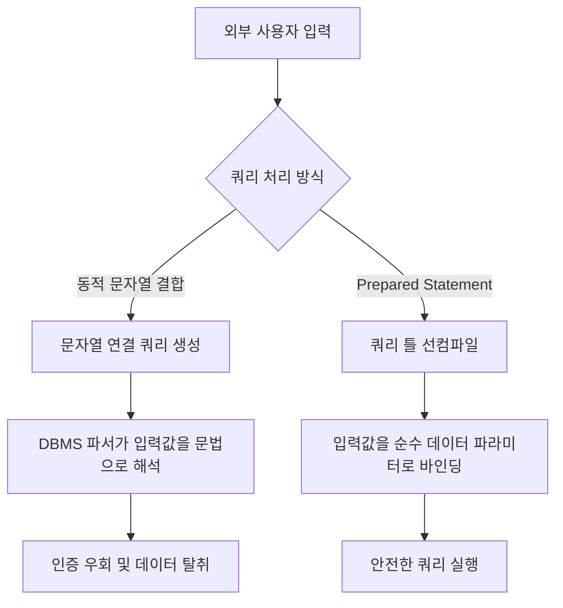
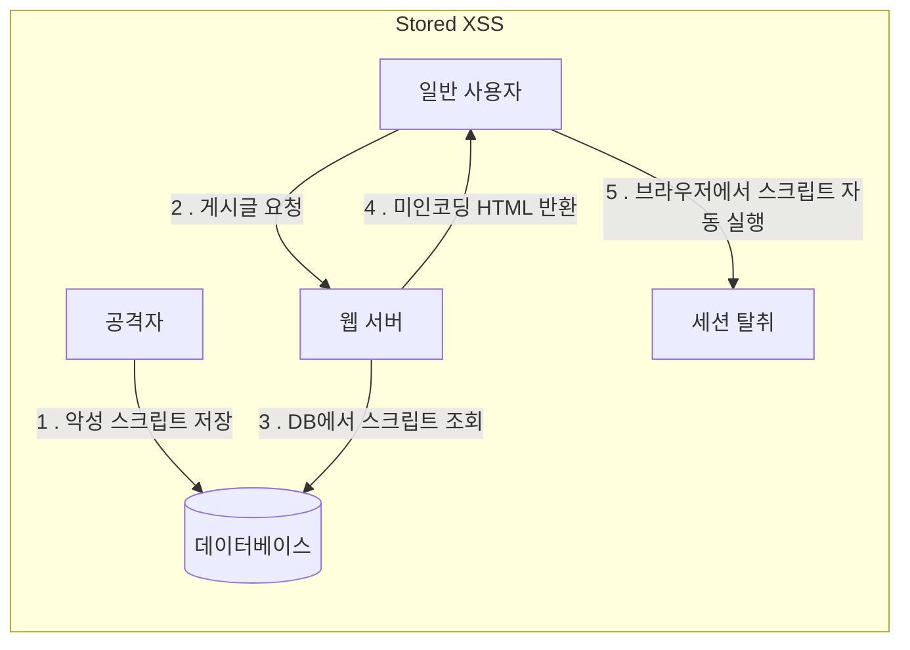
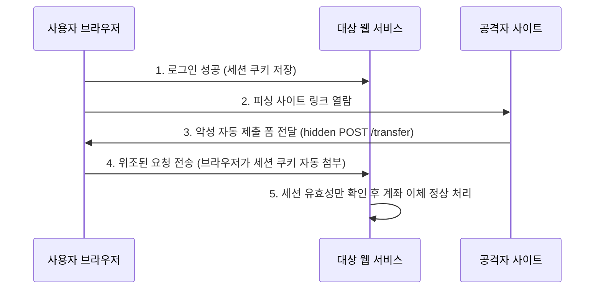
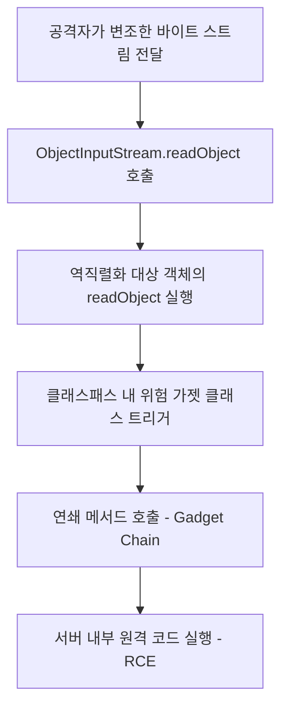

웹 애플리케이션 보안에서 가장 빈번하게 발생하는 취약점의 상당수는 외부 유입 데이터에 대한 신뢰에서 비롯된다.

## 입력값 삽입 공격

외부 입력값이 시스템 인터프리터나 파서에 전달될 때 구조적 제어 명령과 데이터가 분리되지 않아 발생하는 취약점군이다.

### 1. SQL Injection

DBMS의 쿼리 구문 분석 (Parsing) 단계를 악용하여 데이터가 들어가야 할 위치에 SQL 문법 요소를 주입함으로써 쿼리 구조를 변경하는 취약점이다.



#### 공격 원리와 발생 조건

공격자가 입력값 내에 따옴표, 주석 기호, 논리 연산자를 삽입하여 WHERE 절의 조건을 무효화 시키거나 다른 쿼리를 연쇄 실행 (`UNION SELECT`)할 수 있다.

```sql
-- 의도한 쿼리
SELECT *
FROM users
WHERE user_id = 'admin'
  AND password = 'user_input';

-- 공격자 입력: ' OR '1'='1' --
-- 변조된 실행 쿼리
SELECT *
FROM users
WHERE user_id = 'admin' AND password = ''
   OR '1' = '1' - -';
```

#### 대응 방안

- Prepared Statement 사용: 쿼리 구문을 사전에 컴파일하여 실행 계획을 확정하고, 입력값은 단순 파라미터 (Placeholder `?`)로 전달하여 SQL 구조 변경을 원천 차단
- ORM 바인딩 활용: JPA, Hibernate, MyBatis의 바인딩 변수 (`#{}`, JPQL Named Parameter)를 활용
- 입력값 화이트리스트 검증: ORDER BY 절이나 테이블명 등 Prepared Statement의 파라미터로 지정할 수 없는 동적 식별자는 허용된 컬럼명 목록 (WhiteList)과 일치하는지 검증

#### 코드 예시

```java
// 취약한 예: 문자열 단순 결합을 통한 동적 쿼리 생성
public User findUser(String userId, String password) throws SQLException {
    String query = "SELECT * FROM users WHERE id = '" + userId + "' AND pwd = '" + password + "'";
    Statement stmt = connection.createStatement();
    ResultSet rs = stmt.executeQuery(query);
    return mapUser(rs);
}

// 안전한 예: PreparedStatement 파라미터 바인딩 적용
public User findUserSecure(String userId, String password) throws SQLException {
    String sql = "SELECT * FROM users WHERE id = ? AND pwd = ?";
    try (PreparedStatement pstmt = connection.prepareStatement(sql)) {
        pstmt.setString(1, userId);
        pstmt.setString(2, password);
        try (ResultSet rs = pstmt.executeQuery()) {
            return mapUser(rs);
        }
    }
}
```

### 2. OS Command Injection

웹 애플리케이션이 시스템 명령어를 직접 실행하는 과정에서 외부 입력값을 적절한 검증 없이 명령어 인자로 포함시킬 때 메타문자를 이용해 추가 시스템 명령어를 주입하는 취약점이다.

#### 공격 원리와 발생 조건

운영체제 셸에서 특수 명령 분기 기호 (`;`, `&`, `|`, `` ` ``, `$()`)는 단일 라인에서 다중 명령을 수행하도록 지원하는 것을 악용하여 임의의 시스템 명령어가 실행되도록 한다.

| 운영체제 메타문자 |                            기능 및 공격 활용                            |
|:-----------------:|:-----------------------------------------------------------------------:|
|        `;`        |           이전 명령어 완료 후 다음 명령어 실행 (명령어 연결)            |
|   `&&`, `\|\|`    |      조건부 명령어 실행 (선행 명령어의 성공/실패 여부에 따른 분기)      |
|       `\|`        | 선행 명령어의 표준 출력을 후속 명령어의 표준 입력으로 전달 (파이프라인) |
|  `` ` ``, `$()`   |      내부 명령어를 먼저 실행하고 그 출력을 외부 명령어 인자로 치환      |

#### 대응 방안

- 고수준 API 대체: 시스템 명령어 실행 대신 Java 표준 API (예: ping 대신 `InetAddress.isReachable()`, 파일 복사 시 `Files.copy()`)를 우선 사용
- 인자 분리 실행: 명령어 실행이 불가피한 경우 `Runtime.getRuntime().exec(String)` 대신 `ProcessBuilder`에 명령어와 인자를 분리된 배열 또는 리스트로 전달
- 화이트리스트 기반 인자 검증: 입력값에 허용되는 문자 집합 (예: 영문자, 숫자, 하이픈)만 허용하고 특수문자를 엄격히 차단

#### 코드 예시

```java
// 취약한 예: 셸 호출 및 문자열 결합을 통한 명령어 전달
public void executePing(String host) throws IOException {
    // host 파라미터에 "127.0.0.1; cat /etc/passwd" 주입 시 추가 명령 실행
    Runtime.getRuntime().exec("sh -c ping -c 1 " + host);
}

// 안전한 예: ProcessBuilder를 통한 명령어 및 인자 분리 전달과 입력값 유효성 검증
public void executePingSecure(String host) throws IOException {
    if (!host.matches("^[a-zA-Z0-9.-]+$")) {
        throw new IllegalArgumentException("유효하지 않은 호스트 형식입니다.");
    }

    List<String> command = List.of("ping", "-c", "1", host);
    ProcessBuilder pb = new ProcessBuilder(command);
    Process process = pb.start();
}
```

### 3. Path Traversal

외부 입력값을 파일 시스템 경로나 파일 식별자로 사용할 때, 상위 디렉터리 순회 문자 (`../`, `..\`)를 악용하여 허가되지 않은 디렉터리나 민감 시스템 파일에 접근하는 취약점이다.

#### 공격 원리와 발생 조건

사용자가 다운로드하거나 열람할 파일명을 직접 지정할 때, 경로 탐색 기호를 조합하여 웹 루트나 지정 저장소 디렉터리를 벗어나 시스템 설정 파일을 열람하거나 덮어쓸 수 있다.

#### 대응 방안

- 경로 정규화 및 상위 디렉터리 검증: 기호 링크와 상대 경로 (`..`)가 모두 해소된 절대 정규화 경로가 허용된 기본 디렉터리로 시작하는지 확인
- 파일명 화이트리스트 및 파일명 추출: 파일 경로에서 디렉터리 분리자 (`/`, `\`)를 완전히 배제하고 순수 파일명만 추출
- 식별자 (ID) 기반 간접 참조: 클라이언트에 실제 파일명을 노출하거나 전달받지 않고, 데이터베이스 기본키 (PK)나 난수 UUID를 전달받아 서버 내부 매핑 테이블에서 안전한 파일 경로 조회

#### 코드 예시

```java
// 취약한 예: 입력값을 그대로 파일 경로 결합에 사용
public File getDownloadFile(String fileName) {
    // fileName: "../../../etc/passwd"
    return new File("/app/storage/uploads/", fileName);
}

// 안전한 예: 경로 정규화 및 기본 디렉터리 이탈 검증
public File getDownloadFileSecure(String userFileName) throws IOException {
    // 디렉터리 순회 기호 제거 및 순수 파일명 추출
    String baseName = Paths.get(userFileName).getFileName().toString();

    File baseDir = new File("/app/storage/uploads").getCanonicalFile();
    File targetFile = new File(baseDir, baseName).getCanonicalFile();

    // 정규화된 경로가 허용된 기준 디렉터리 하위에 존재하는지 확인
    if (!targetFile.getPath().startsWith(baseDir.getPath() + File.separator)) {
        throw new SecurityException("허용되지 않은 파일 경로 접근입니다.");
    }
    return targetFile;
}
```

### 4. XXE (XML External Entity)

XML 문서 파싱 시 외부 일반 엔티티 (External Entity) 참조 기능을 악용하여 서버 로컬 파일 읽기, 내부 네트워크 스캔 (SSRF 유발), 서비스 거부 (DoS) 공격을 유발하는 취약점이다.

#### 공격 원리와 발생 조건

XML 표준은 DTD (Document Type Definition) 내에서 `SYSTEM` 키워드를 통해 로컬 파일이나 원격 URI를 엔티티로 정의할 수 있도록 지원한다.

```xml
<!-- 공격용 악성 XML 예시 -->
<?xml version="1.0" encoding="UTF-8"?>
<!DOCTYPE data [
  <!ENTITY xxe SYSTEM "file:///etc/passwd">
  ]>
<userInfo>
  <name>&xxe;</name>
</userInfo>
```

파서가 외부 엔티티 해석을 기본 허용하고 있는 경우 공격자가 주입한 악의적인 XML 문서가 파싱되면서 파일 내용이 출력되거나 외부로 유출된다.

#### 대응 방안

- DTD (문서 유형 정의) 비활성화: XML 파서 설정에서 `disallow-doctype-decl`을 활성화하여 DOCTYPE 선언 자체를 전면 차단
- 외부 엔티티 파싱 명시적 차단: 일반 외부 엔티티 (`external-general-entities`) 및 파라미터 엔티티 (`external-parameter-entities`) 확장을 비활성화
- 최신 포맷 사용: 가능한 경우 XML 대신 JSON이나 프로토콜 버퍼와 같은 현대적인 직렬화 포맷을 사용

#### 코드 예시

```java
// 안전한 예: DocumentBuilderFactory의 DTD 및 외부 엔티티 차단 설정
public Document parseXmlSecure(InputStream inputStream) throws Exception {
    DocumentBuilderFactory factory = DocumentBuilderFactory.newInstance();

    // DTD 선언 자체를 비활성화 (권장)
    factory.setFeature("http://apache.org/xml/features/disallow-doctype-decl", true);

    // 일반 외부 엔티티 및 파라미터 엔티티 비활성화
    factory.setFeature("http://xml.org/sax/features/external-general-entities", false);
    factory.setFeature("http://xml.org/sax/features/external-parameter-entities", false);

    // 외부 DTD 로드 차단
    factory.setFeature("http://apache.org/xml/features/nonvalidating/load-external-dtd", false);

    // XInclude 처리 비활성화
    factory.setXIncludeAware(false);
    factory.setExpandEntityReferences(false);

    DocumentBuilder builder = factory.newDocumentBuilder();
    return builder.parse(inputStream);
}
```

## 웹 요청·응답 조작

웹 통신 규약 (HTTP)의 특성과 브라우저 동작 방식을 악용하여 클라이언트와 서버 간의 상호작용을 왜곡하는 취약점군이다.

### 5. XSS (Cross-Site Scripting)

웹 애플리케이션이 신뢰할 수 없는 외부 데이터를 적절한 검증이나 인코딩 없이 웹 브라우저에 출력할 때 공격자가 삽입한 악성 스크립트 (JavaScript)가 사용자의 브라우저에서 실행되는 취약점이다.



#### XSS 유형별 특성

|        구분        |  공격 스크립트 저장 위치   |                      실행 메커니즘                      |                주요 공격 경로                |
|:------------------:|:--------------------------:|:-------------------------------------------------------:|:--------------------------------------------:|
|  Stored (저장형)   |    서버 DB, 파일 시스템    |   페이지 조회 시 DB에서 로드되어 모든 열람자에게 실행   |       게시판 본문, 댓글, 사용자 프로필       |
| Reflected (반사형) | 미저장 (URL 쿼리, 폼 요청) | 요청에 포함된 스크립트가 응답 본문에 즉시 반사되어 실행 |     검색어 결과, 에러 메시지, 피싱 링크      |
| DOM-based (DOM형)  | 클라이언트 브라우저 메모리 | 클라이언트 측 스크립트가 DOM 요소를 안전하지 않게 조작  | `location.hash`, `location.search` 직접 파싱 |

#### 대응 방안

- 문맥별 출력 인코딩 (Context-aware Output Encoding): HTML Body, 속성 (Attribute), JavaScript 영역, URL 등 출력 지점에 맞는 이스케이프 처리 수행
- 안전한 DOM 조작 API 사용: 클라이언트 자바스크립트 작성 시 데이터를 순수 텍스트로 처리하는 `textContent`, `innerText` 사용
- CSP (Content Security Policy) 적용: HTTP 응답 헤더에 CSP를 선언하여 인라인 스크립트 실행을 차단하고 허가된 도메인의 스크립트만 로드되도록 브라우저 정책을 강제
- 세션 쿠키 보호: 민감한 세션 쿠키에 `HttpOnly` 속성을 지정하여 XSS가 발생하더라도 자바스크립트의 `document.cookie` 접근 차단

#### 코드 예시

```java
// 취약한 예: 사용자 입력 검색어를 HTML 본문에 그대로 반사
@GetMapping("/search")
@ResponseBody
public String search(@RequestParam("keyword") String keyword) {
    return "<div>검색 결과: " + keyword + "</div>";
}

// 안전한 예: HTML 특수문자 이스케이프 처리 후 출력
@GetMapping("/search-secure")
@ResponseBody
public String searchSecure(@RequestParam("keyword") String keyword) {
    String safeKeyword = HtmlUtils.htmlEscape(keyword);
    return "<div>검색 결과: " + safeKeyword + "</div>";
}
```

```http
// 안전한 CSP 및 쿠키 보안 헤더 적용 예시
Content-Security-Policy: default-src 'self'; script-src 'self' https://trusted.cdn.com; object-src 'none';
Set-Cookie: JSESSIONID=abc123xyz; Path=/; Secure; HttpOnly; SameSite=Lax
```

### 6. CSRF (Cross-Site Request Forgery)

사용자가 이미 인증된 세션을 유지하고 있는 상태에서, 공격자가 준비한 악성 웹사이트를 방문하게 만들어 사용자의 브라우저가 신뢰하는 대상 서버로 비정상적인 상태 변경 요청을 전송하게 만드는 공격이다.



#### 대응 방안

- CSRF 토큰 (Token) 검증: 고유하고 추측 불가능한 일회성 토큰을 발급하여 폼 전송 시 숨은 필드 (`_csrf`)나 HTTP 헤더에 포함시키고, 서버 수신 시 일치 여부 검증
- SameSite 쿠키 속성 구성: 쿠키 발급 시 `SameSite=Strict` 또는 `SameSite=Lax`를 적용하여 제3자 사이트에서 시작된 크로스 사이트 요청 시 인증 쿠키의 자동 전송 제한
- 중요 기능 재인증 (Re-authentication): 비밀번호 변경, 자금 이체, 개인정보 수정 등 치명적인 상태 변경 기능 수행 시 현재 비밀번호를 재입력하거나 2차 인증 (OTP)을 요구

#### 코드 예시

```html
<!-- CSRF 토큰이 포함된 안전한 HTML 폼 예시 -->
<form action="/account/transfer" method="POST">
  <input type="hidden" name="_csrf" value="d2e4f6a8-3b1c-4d5e-9f0a-1a2b3c4d5e6f"/>
  <input type="text" name="recipientAccount"/>
  <input type="number" name="amount"/>
  <button type="submit">송금</button>
</form>
```

```java
// Spring Security CSRF 기본 보호 설정
@Configuration
@EnableWebSecurity
public class WebSecurityConfig {

    @Bean
    public SecurityFilterChain securityFilterChain(HttpSecurity http) throws Exception {
        http
                .csrf(csrf -> csrf
                        // CSRF 토큰 저장소를 쿠키 기반 또는 세션 기반으로 명시
                        .csrfTokenRepository(CookieCsrfTokenRepository.withHttpOnlyFalse())
                );
        return http.build();
    }
}
```

### 7. SSRF (Server-Side Request Forgery)

서버가 제공하는 원격 자원 조회 기능 (URL 파싱, 웹훅, 썸네일 생성 등)을 악용하여, 외부에서 직접 접근이 불가능한 서버 내부 사설망 자원이나 클라우드 메타데이터 API를 호출하도록 유도하는 취약점이다.

#### 공격 대상과 위험성

|        공격 대상        |            목적 및 탈취 정보             |                 URL 입력 예시                  |
|:-----------------------:|:----------------------------------------:|:----------------------------------------------:|
| 클라우드 메타데이터 API | AWS IAM 롤 임시 토큰, 인스턴스 설정 탈취 |   `http://169.254.169.254/latest/meta-data/`   |
|  로컬호스트 관리 콘솔   |    인증 없이 열려 있는 내부 포트 제어    |      `http://localhost:8080/actuator/env`      |
| 내부 사설망 DB 및 캐시  |  내부 인프라 탐색 및 비인가 데이터 조작  | `http://10.0.1.5:6379/`, `http://192.168.1.1/` |
| 로컬 파일 시스템 스키마 |        시스템 내부 파일 직접 열람        |              `file:///etc/hosts`               |

#### 대응 방안

- URL 스키마 화이트리스트 적용: 오직 `http`, `https` 프로토콜만 허용하고 `file`, `gopher`, `ftp`, `ldap` 등 위험한 스키마 차단
- 내부 사설망 IP 및 루프백 접근 차단: DNS 확인 (Resolution) 후 파악된 최종 목적지 IP 주소가 사설 대역, 루프백, 링크 로컬에 속하는 경우 연결을 거부
- 신뢰할 수 있는 도메인 화이트리스트 운영: 외부 호출 대상 도메인이 사전에 정의된 목록으로 한정될 수 있다면 완전 일치 검증을 수행

#### 코드 예시

```java
// 안전한 예: URL 검증 및 사설망 IP 차단 로직
public void validateUrl(String inputUrl) throws Exception {
    URI uri = new URI(inputUrl);
    String scheme = uri.getScheme();

    if (!"http".equalsIgnoreCase(scheme) && !"https".equalsIgnoreCase(scheme)) {
        throw new SecurityException("허용되지 않은 프로토콜입니다.");
    }

    String host = uri.getHost();
    InetAddress address = InetAddress.getByName(host);

    if (address.isLoopbackAddress() || address.isSiteLocalAddress() || address.isLinkLocalAddress()) {
        throw new SecurityException("내부 사설 네트워크 주소로의 접근은 차단됩니다.");
    }

    // 클라우드 메타데이터 링크 로컬 주소(169.254.169.254) 추가 차단
    byte[] ip = address.getAddress();
    if (ip[0] == (byte) 169 && ip[1] == (byte) 254) {
        throw new SecurityException("메타데이터 서비스 접근이 금지됩니다.");
    }
}
```

### 8. Open Redirect

사용자 입력값을 그대로 리다이렉트 목적지 URL로 사용하여 신뢰할 수 없는 외부 사이트로 브라우저를 강제 이동시키는 취약점이다. 공격자는 서비스의 정상 도메인 신뢰성을 악용해 사용자를 정교한 피싱 사이트로 유인한다.

#### 대응 방안

- 상대 경로 강제: 외부 사이트로의 리다이렉트가 필요 없는 경우, 슬래시 하나 (`/`)로 시작하는 상대 경로만 허용
    - 프로토콜 (`http://`, `https://`)이나 스키마 생략 표기 (`//attacker.com`)를 엄격히 차단
- 사전 정의된 화이트리스트 도메인 대조: 이동할 외부 도메인 목록을 설정으로 관리하고, 입력된 URL의 호스트명이 목록에 정확히 포함되어 있는지 검증

#### 코드 예시

```java
// 취약한 예: 입력 파라미터를 그대로 리다이렉트 경로로 지정
@GetMapping("/login")
public String loginSuccess(@RequestParam("returnUrl") String returnUrl) {
    // returnUrl이 "https://evil-phishing.com"일 경우 악성 사이트로 이동
    return "redirect:" + returnUrl;
}

// 안전한 예: 상대 경로 강제 및 허용 도메인 화이트리스트 검증
@GetMapping("/login-secure")
public String loginSuccessSecure(@RequestParam("returnUrl") String returnUrl) {
    if (returnUrl != null && returnUrl.startsWith("/") && !returnUrl.startsWith("//")) {
        return "redirect:" + returnUrl;
    }

    Set<String> allowedHosts = Set.of("service.example.com", "auth.example.com");
    try {
        URI uri = new URI(returnUrl);
        if (uri.getHost() != null && allowedHosts.contains(uri.getHost())) {
            return "redirect:" + uri.toString();
        }
    } catch (URISyntaxException e) {
        // 비정상 URL 포맷 예외 처리
    }

    return "redirect:/dashboard";
}
```

### 9. HTTP Response Splitting

HTTP 응답 헤더 값으로 설정될 때 개행 문자 검증이 누락되어, 공격자가 임의의 HTTP 헤더를 삽입하거나 독립적인 HTTP 응답 패킷으로 분할시키는 취약점이다.

#### 공격 원리와 발생 조건

HTTP 프로토콜에서 헤더와 헤더는 CRLF (`\r\n`)로 구분되며, 헤더와 본문 (Body)은 연속된 두 개의 CRLF (`\r\n\r\n`)로 구분된다.

- 입력값에 개행 문자가 포함되면 공격자는 첫 번째 응답의 본문이 강제 종료됨
- 새로운 가짜 HTTP 200 OK 응답을 주입하여 캐시 오염 (Web Cache Poisoning)이나 XSS를 유발 가능

```http
// 주입된 입력값 예시
param=Value%0d%0aContent-Length:%200%0d%0a%0d%0aHTTP/1.1%20200%20OK%0d%0aContent-Type:%20text/html%0d%0a%0d%0a<html><script>alert(1)</script></html>
```

#### 대응 방안

- 개행 문자 필터링 및 차단: 헤더 값에 삽입되는 모든 문자열에서 `\r` 및 `\n` 문자를 완전히 제거하거나 검증 오류로 거부
- 웹 프레임워크 및 서블릿 컨테이너 보안 기능 활용: 최신 Tomcat, Spring 프레임워크는 헤더에 CRLF가 포함될 경우 자동으로 `IllegalArgumentException`을 발생시켜 응답을 차단

#### 코드 예시

```java
// 안전한 예: 개행 문자 필터링 후 헤더 설정
public void setCustomHeader(HttpServletResponse response, String headerName, String headerValue) {
    if (headerValue == null) {
        return;
    }
    // 개행 문자(CR, LF) 제거
    String sanitizedValue = headerValue.replaceAll("[\\r\\n]", "");
    response.setHeader(headerName, sanitizedValue);
}
```

### 10. File Upload

외부에서 유입되는 파일의 유효성을 확장자만으로 단순 판단할 때, 공격자가 웹 쉘과 같은 서버 측 실행 파일 (`.jsp`, `.php`, `.sh`)을 업로드하여 원격 코드를 실행하는 취약점이다.

#### 공격 원리와 발생 조건

- 파일 확장자 변조: 이중 확장자 (`shell.jsp.jpg`)나 대소문자 혼용 (`shell.Jsp`), 널 바이트 삽입 (`shell.jsp%00.png`)을 통해 확장자 필터링 우회
- 웹 루트 내부 저장: 업로드된 파일이 웹 서버의 문서 루트 (DocumentRoot) 하위에 원본 이름 그대로 저장되어, URL 호출을 통해 스크립트 직접 실행

#### 대응 방안

- 파일 매직 넘버 (Magic Number) 검증: 파일의 맨 앞부분에 위치한 고유 바이너리 시그니처 바이트를 검사하여 실제 파일 포맷 식별
- 파일명 난수화 및 확장자 격리: 업로드 파일명을 UUID 등 예측 불가능한 난수 문자열로 치환하여 저장하며, 안전하게 검증된 확장자만 서버 측에서 새로 부여
- 웹 루트 외부 저장 및 실행 권한 제거: 업로드 디렉터리를 웹 애플리케이션 루트 외부에 배치하고, OS 파일 시스템 레벨에서 해당 디렉터리의 실행 권한 완전히 제거
- 파일 다운로드 프록시 처리: 파일에 직접 URL로 접근하지 못하게 하고, 서버가 파일 스트림을 읽어 `Content-Disposition: attachment` 헤더와 함께 브라우저 다운로드로만 응답

#### 주요 파일 매직 넘버 바이트

| 파일 형식 |              매직 넘버 (16진수)              |
|:---------:|:--------------------------------------------:|
|   JPEG    |                  `FF D8 FF`                  |
|    PNG    |          `89 50 4E 47 0D 0A 1A 0A`           |
|    GIF    | `47 49 46 38 37 61` 또는 `47 49 46 38 39 61` |
|    PDF    |            `25 50 44 46` (`%PDF`)            |
|    ZIP    |                `50 4B 03 04`                 |

#### 코드 예시

```java
// 안전한 예: 파일 시그니처 검증 및 웹 루트 외부 난수명 저장
public void uploadImageSecure(MultipartFile file) throws IOException {
    if (file.isEmpty()) {
        throw new IllegalArgumentException("업로드 파일이 비어 있습니다.");
    }

    // 파일 매직 넘버(시그니처) 검증: PNG 헤더 확인
    byte[] header = new byte[8];
    try (InputStream is = file.getInputStream()) {
        if (is.read(header) < 8) {
            throw new SecurityException("파일 크기가 너무 작습니다.");
        }
    }

    byte[] pngSignature = new byte[]{(byte) 0x89, 0x50, 0x4E, 0x47, 0x0D, 0x0A, 0x1A, 0x0A};
    if (!Arrays.equals(header, pngSignature)) {
        throw new SecurityException("PNG 이미지 형식이 아닙니다.");
    }

    // 파일명 난수화 및 웹 루트 외부 저장
    String safeFileName = UUID.randomUUID().toString() + ".png";
    Path targetPath = Paths.get("/var/app/safe_storage", safeFileName);
    Files.copy(file.getInputStream(), targetPath, StandardCopyOption.REPLACE_EXISTING);
}
```

## 데이터 처리 및 비즈니스 로직 취약점

외부에서 유입된 데이터가 프로그램의 연산, 직렬화 복원, 권한 결정 로직에 반영될 때 발생하는 취약점군이다.

### 11. Integer Overflow

정수 연산의 결과가 해당 데이터 타입이 표현할 수 있는 최대값 (또는 최소값)의 범위를 벗어나 부호가 반전되거나 아주 작은 값으로 순환 (Wrap-around)하는 현상이다.

#### Java 환경에서의 발현 맥락

오버플로우 발생 시 예외 (Exception)를 기본적으로 던지지 않고 비트가 절삭되어 순환되면서, 상거래 결제 금액 계산, 상품 수량 한도 확인, 배열 크기 할당 시 치명적인 보안 약점이 된다.

```java
// 정수 오버플로우 현상
int maxPrice = Integer.MAX_VALUE; // 2,147,483,647
int nextPrice = maxPrice + 1;     // -2,147,483,648 (음수로 반전)
```

#### 대응 방안

- 정밀 연산 클래스 사용: 금융 계산이나 결제 시스템에서는 자릿수 제한이 없는 `BigDecimal` 또는 `BigInteger`를 사용
- 정확 연산 메서드 활용: Java 기준으로  `Math.addExact()`, `Math.multiplyExact()` 를 사용하여 비정상 연산을 즉시 `ArithmeticException`으로 탐지
- 입력값의 비즈니스 유효 범위 사전 검증: 연산 수행 전 수량이나 금액이 업무상 허용 가능한 정상 범위 (예: 1 이상 10,000 이하) 내에 있는지 확인

#### 코드 예시

```java
// 취약한 예: 기본 정수 연산으로 인한 총액 오버플로우
public int calculateTotal(int unitPrice, int quantity) {
    // unitPrice = 300,000, quantity = 10,000 -> 3,000,000,000 (int 표현 한도 초과)
    return unitPrice * quantity; // 음수 값 반환 위험
}

// 안전한 예: Math 정확 연산 API 및 사전 범위 검증
public long calculateTotalSecure(int unitPrice, int quantity) {
    if (unitPrice <= 0 || quantity <= 0 || quantity > 1000) {
        throw new IllegalArgumentException("허용 범위를 벗어난 수량 또는 단가입니다.");
    }
    try {
        // 오버플로우 발생 시 즉시 ArithmeticException 발생
        return Math.multiplyExact((long) unitPrice, (long) quantity);
    } catch (ArithmeticException e) {
        throw new SecurityException("계산 금액이 허용 범위를 초과했습니다.", e);
    }
}
```

### 12. Insecure Deserialization

네트워크를 통해 전달받은 바이트 스트림이나 문자열을 다시 애플리케이션 객체로 복원 (Deserialization)할 때, 악의적인 직렬화 객체가 역직렬화 과정을 거치며 임의의 코드를 실행 (RCE)하는 취약점이다.

#### 공격 원리와 가젯 체인 (Gadget Chain)

Java 표준 역직렬화 (`ObjectInputStream.readObject()`)는 객체를 복원하면서 클래스 내에 정의된 `readObject()` 메서드를 자동으로 호출한다.



애플리케이션 클래스패스 내에 적절한 라이브러리가 존재할 경우, 객체 복원 시 연쇄적으로 메서드가 호출되도록 가젯을 엮어 최종적으로 `Runtime.getRuntime().exec()`를 실행하도록 유도할 수 있다.

#### 대응 방안

- 표준 직렬화 사용 지양: 신뢰할 수 없는 외부 데이터 교환 시 Java 네이티브 직렬화 포맷을 사용하지 않고 JSON, Protocol Buffers 등 데이터만 전달하는 순수 포맷 사용
- 객체 입력 필터링 (ObjectInputFilter): Java 9 이상에서 도입된 `ObjectInputFilter`를 적용하여 허용된 클래스 패키지만 역직렬화되도록 화이트리스트 강제
- 무결성 검증: 직렬화 데이터 전송이 불가피한 경우 HMAC 서명을 첨부하여 인가되지 않은 객체 변조를 사전에 차단

#### 코드 예시

```java
// 안전한 예: ObjectInputFilter를 통한 화이트리스트 기반 클래스 역직렬화
public Object deserializeSecure(byte[] data) throws IOException, ClassNotFoundException {
    try (ByteArrayInputStream bais = new ByteArrayInputStream(data);
            ObjectInputStream ois = new ObjectInputStream(bais)) {

        // 도메인 내부 신뢰 클래스만 허용하는 필터 구성
        ObjectInputFilter filter = ObjectInputFilter.Config.createFilter(
                "com.example.dto.UserSession;!*" // UserSession만 허용하고 그 외 모든 클래스 거부
        );
        ois.setObjectInputFilter(filter);

        return ois.readObject();
    }
}
```

### 13. Reliance on Untrusted Inputs in Security Decision

사용자의 권한 인증 여부, 관리자 접근 권한, 가격 정보, 할인율 등 시스템의 핵심 보안 결정을 내릴 때 클라이언트가 조작할 수 있는 외부 입력값에 의존하여 발생하는 취약점이다.

#### 공격 시나리오와 위험성

- 클라이언트 조작 가능 영역 의존: HTTP 요청 폼이나 클라이언트 쿠키 `isAdmin=false`, URL 파라미터`?price=10000` 등을 서버가 그대로 신뢰하여 접근 인가나 결제 금액을 결정할 때 발생
- 공격자는 프록시 도구 (Burp Suite 등)나 개발자 도구를 이용하여 `isAdmin=true`, `price=10`으로 변조하여 전송함으로써 관리자 권한을 획득하거나 물품을 정상 가격보다 훨씬 저렴하게 구매

#### 대응 방안

- 보안 결정 요소의 서버 측 상태 (State) 보관: 권한 정보, 사용자 역할, 가격 정보는 반드시 서버 세션, 인증 토큰 (서명된 JWT의 Claims), 혹은 서버 데이터베이스에서만 조회하여 결정
- 클라이언트 전달 값의 무결성 재검증: 클라이언트로부터 전달받은 상품 ID를 바탕으로 서버 DB에서 실제 판매 가격을 직접 재조회하여 결제 금액을 산정

#### 코드 예시

```java
// 취약한 예: 클라이언트가 전달한 role 파라미터로 관리자 기능 수행 여부 결정
@PostMapping("/admin/deleteUser")
public ResponseEntity<String> deleteUser(@RequestParam("targetUserId") String targetUserId,
        @RequestParam("role") String role) {
    if ("ADMIN".equals(role)) {
        userService.delete(targetUserId);
        return ResponseEntity.ok("삭제 완료");
    }
    return ResponseEntity.status(HttpStatus.FORBIDDEN).body("권한 없음");
}

// 안전한 예: 서버 보안 컨텍스트(Spring Security Authentication)에서 인증된 주체의 권한 조회
@PostMapping("/admin/deleteUserSecure")
@PreAuthorize("hasRole('ADMIN')")
public ResponseEntity<String> deleteUserSecure(@RequestParam("targetUserId") String targetUserId,
        @AuthenticationPrincipal UserDetails currentUser) {
    userService.delete(targetUserId);
    return ResponseEntity.ok("삭제 완료");
}
```

---

###### 참고자료

- 행정안전부·한국인터넷진흥원 (KISA) 소프트웨어 개발보안 가이드 (2021.12)
- OWASP Top 10 Web Application Security Risks
- CWE-89: Improper Neutralization of Special Elements used in an SQL Command ('SQL Injection')
- CWE-79: Improper Neutralization of Input During Web Page Generation ('Cross-site Scripting')
- CWE-352: Cross-Site Request Forgery (CSRF)
- CWE-918: Server-Side Request Forgery (SSRF)
- CWE-611: Improper Restriction of XML External Entity Reference
- CWE-502: Deserialization of Untrusted Data
