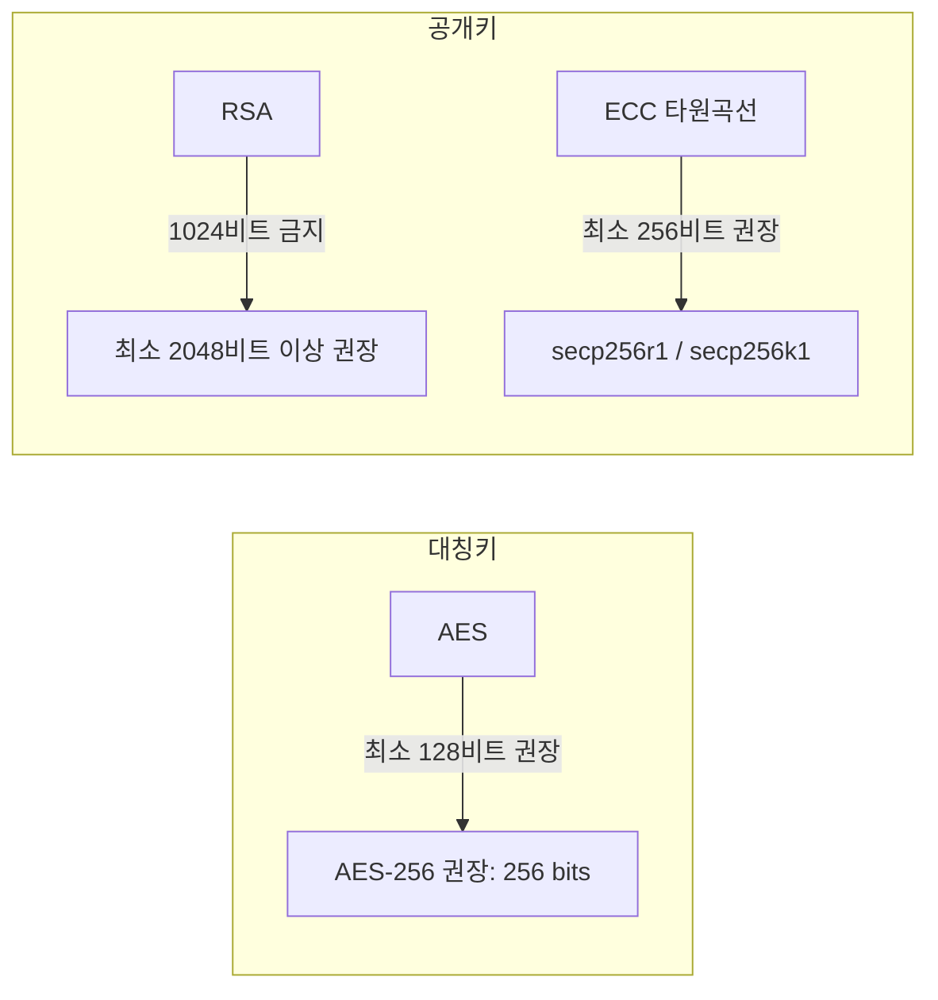
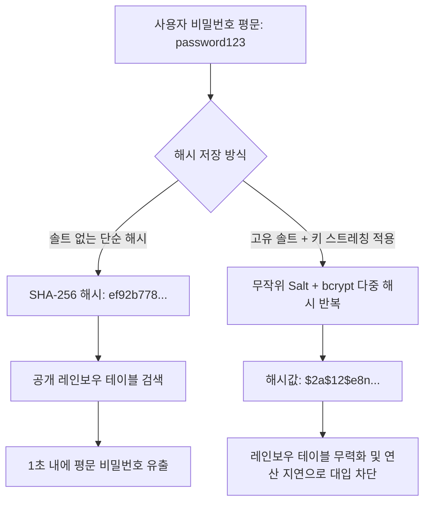
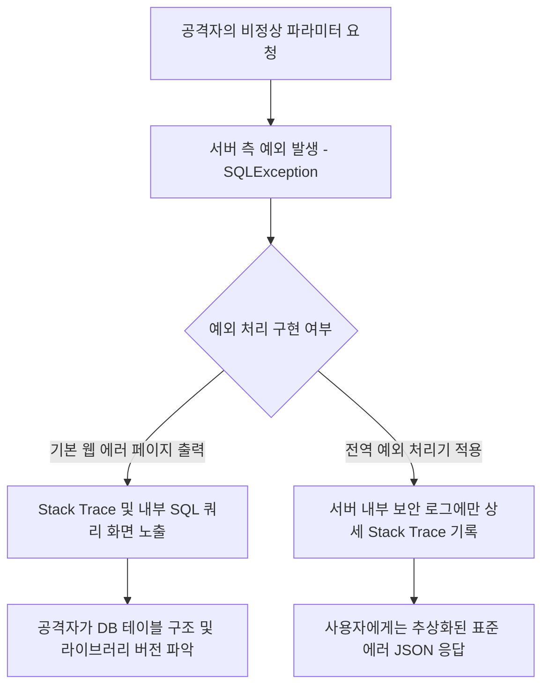
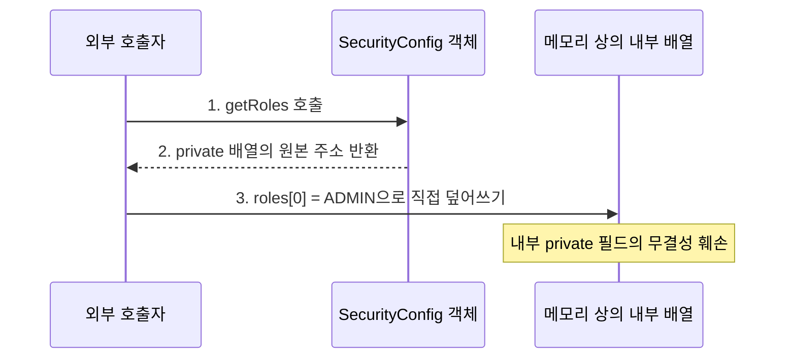
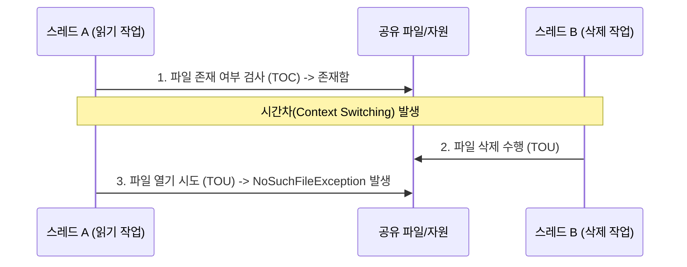

애플리케이션이 취급하는 민감 정보는 보관 중이거나 전송되는 동안 기밀성과 무결성이 보장되어야 한다.

## Cryptography and Key Management

데이터의 기밀성과 무결성을 보호하기 위해 적용되는 암호 연산 및 난수 생성 영역의 취약점군이다.

### 1. Use of a Broken or Risky Cryptographic Algorithm

과거에 설계되었으나 현재는 계산 능력의 비약적 발전과 수학적 해독 기법의 발견으로 안전성이 상실된 구형 암호화 알고리즘 및 해시 함수를 사용하는 취약점이다.

#### 취약한 알고리즘과 권장 대체 알고리즘

|            분류             |         취약·사용 금지 알고리즘          |              안전한 권장 알고리즘               |                                     사유 및 위험성                                     |
|:---------------------------:|:----------------------------------------:|:-----------------------------------------------:|:--------------------------------------------------------------------------------------:|
|   대칭키 암호 (블록 암호)   | DES, 3DES, RC2, RC4, SEED (128비트 이하) | AES (128/256비트, GCM 모드), ARIA (128/256비트) |    키 길이가 56비트에 불과하여 현대 컴퓨팅 환경에서 전수조사로 수 시간 내 해독 가능    |
| 비대칭키 암호 (공개키 암호) |           RSA (1024비트 이하)            | RSA (2048비트 이상), ECC (ECDSA, 256비트 이상)  |              소인수분해 알고리즘의 발달로 1024비트 RSA 키 해독 위험 증대               |
|      일방향 해시 함수       |                MD5, SHA-1                |             SHA-256, SHA-512, SHA-3             | 충돌 공격(Collision Attack)이 성공하여 서로 다른 데이터가 동일한 해시값을 가질 수 있음 |

#### 대응 방안

- 기밀성 암호화 시 AES-256-GCM 표준 채택: AES 알고리즘과 GCM 운용 모드를 결합하여 암호문 변조 여부까지 검증
- 무결성 검증 시 SHA-256 이상 해시 채택: 파일 무결성이나 전자서명 시 SHA-1과 MD5 사용을 전면 배제
- 레거시 알고리즘 지속 검토: 정부 및 글로벌 표준 기관 (KISA, NIST)의 암호 알고리즘 가이드라인을 정기적으로 확인하여 사용 중인 암호 체계를 갱신

#### 코드 예시

```java
// 취약한 예: 안전하지 않은 DES 알고리즘 및 패턴이 노출되는 ECB 모드 사용
public byte[] encryptInsecure(byte[] data, byte[] keyBytes) throws Exception {
    SecretKey key = new SecretKeySpec(keyBytes, "DES");
    Cipher cipher = Cipher.getInstance("DES/ECB/PKCS5Padding");
    cipher.init(Cipher.ENCRYPT_MODE, key);
    return cipher.doFinal(data);
}

// 안전한 예: 현대적 표준인 AES-256-GCM 인증 암호화 모드 적용
public byte[] encryptSecure(byte[] plaintext, SecretKey secretKey) throws Exception {
    // 12바이트 크기의 안전한 무작위 IV(Initial Vector) 생성
    byte[] iv = new byte[12];
    SecureRandom.getInstanceStrong().nextBytes(iv);

    Cipher cipher = Cipher.getInstance("AES/GCM/NoPadding");
    GCMParameterSpec spec = new GCMParameterSpec(128, iv); // 128비트 인증 태그
    cipher.init(Cipher.ENCRYPT_MODE, secretKey, spec);

    byte[] ciphertext = cipher.doFinal(plaintext);

    // IV와 암호문을 결합하여 반환 (복호화 시 동일 IV 필요)
    ByteBuffer byteBuffer = ByteBuffer.allocate(iv.length + ciphertext.length);
    byteBuffer.put(iv);
    byteBuffer.put(ciphertext);
    return byteBuffer.array();
}
```

### 2. Inadequate Encryption Key Length

암호화 알고리즘 자체는 안전하더라도 알고리즘에 적용된 암호키의 길이가 불충분하여 무차별 전수조사 공격 (Brute Force Key Search)에 노출되는 취약점이다.

#### 암호 알고리즘별 최소 키 길이 기준



| 알고리즘 종류  | 안전하지 않은 키 길이 |             권장 안전 키 길이             |
|:--------------:|:---------------------:|:-----------------------------------------:|
|      AES       |      64비트 이하      |    128비트 이상 (고보안 환경 256비트)     |
|      RSA       |     1024비트 이하     |   2048비트 이상 (중장기 보관 3072비트)    |
| ECC (타원곡선) |     160비트 이하      |               256비트 이상                |
|      HMAC      |     128비트 미만      | 256비트 이상 (해시 출력 크기와 동일 수준) |

#### 대응 방안

- 키 생성기 (KeyGenerator)에서 명시적 키 길이 선언: `KeyGenerator` 또는 `KeyPairGenerator` 초기화 시 기본값에 의존하지 않고 권장 키 크기를 명시적으로 설정
- 단기 키와 장기 키의 분리 정책: 세션 암호화 등 단기 키는 최소 기준 (AES-128, RSA-2048)을 적용하고, 장기간 보호가 필요한 데이터는 상위 기준 (AES-256, RSA-3072) 적용

#### 코드 예시

```java
// 안전한 예: 규격에 부합하는 안전한 키 생성
public class KeyGeneratorExample {

    // AES-256 비트 비밀키 생성
    public static SecretKey generateAesKey() throws NoSuchAlgorithmException {
        KeyGenerator keyGen = KeyGenerator.getInstance("AES");
        keyGen.init(256, SecureRandom.getInstanceStrong());
        return keyGen.generateKey();
    }

    // RSA-2048 비트 이상 공개키/개인키 쌍 생성
    public static KeyPair generateRsaKeyPair() throws NoSuchAlgorithmException {
        KeyPairGenerator keyPairGen = KeyPairGenerator.getInstance("RSA");
        keyPairGen.initialize(2048, SecureRandom.getInstanceStrong());
        return keyPairGen.generateKeyPair();
    }
}
```

### 3. Use of Cryptographically Weak Pseudo-Random Number Generator

세션 식별자, CSRF 토큰, 비밀번호 재설정 링크, 암호화 IV 등 보안상 예측 불가능해야 하는 값을 생성할 때 통계적 난수 생성기를 사용하여 난수열이 역추적되는 취약점이다.

#### `java.util.Random`과 `java.security.SecureRandom`의 차이

`java.util.Random`은 선형 합동 생성기 알고리즘을 사용하여, 연속된 몇 개의 난수 관측값만으로도 내부 시드를 수학적으로 완벽히 역산하여 이후 생성될 모든 난수를 정확하게 예측할 수 있다.

|       구분       |           `java.util.Random`           |       `java.security.SecureRandom`        |
|:----------------:|:--------------------------------------:|:-----------------------------------------:|
|  기본 알고리즘   |         선형 합동 생성기 (LCG)         |   SHA1PRNG, NativePRNG, DRBG 등 CSPRNG    |
| 난수 예측 가능성 | 소수의 난수 추출로 내부 시드 역산 가능 |     다음 출력값의 수학적 예측 불가능      |
|       용도       |      단순 시뮬레이션, 게임, 셔플       | 암호키, 세션 ID, 비밀번호 임시 토큰, Salt |
|       성능       |               매우 빠름                |  엔트로피 수집으로 인해 상대적으로 느림   |

하지만 `java.security.SecureRandom`은 암호학적으로 안전한 의사 난수 생성기로서, 운영체제의 엔트로피 소스를 수집하여 다음 난수를 예측하는 것이 사실상 불가능하다.

#### 대응 방안

- 보안 컨텍스트에서 `java.util.Random` 사용 전면 금지: 인증 토큰, 일회용 번호 (OTP), 비밀키 파라미터 생성 시 `SecureRandom` 강제
- 고정 시드 (Seed) 전달 금지: `SecureRandom` 인스턴스 생성 시 고정된 시드 값을 넘기면 항상 동일한 난수열이 반복되므로 기본 시스템 엔트로피 그대로 활용

#### 코드 예시

```java
// 취약한 예: java.util.Random을 이용한 세션 토큰 생성 (난수 예측 가능)
public String generateResetTokenInsecure() {
    Random random = new Random();
    byte[] tokenBytes = new byte[16];
    random.nextBytes(tokenBytes);
    return Base64.getUrlEncoder().withoutPadding().encodeToString(tokenBytes);
}

// 안전한 예: SecureRandom을 활용한 예측 불가능한 암호학적 토큰 생성
public String generateResetTokenSecure() {
    SecureRandom secureRandom = new SecureRandom();
    byte[] tokenBytes = new byte[32]; // 256비트 엔트로피
    secureRandom.nextBytes(tokenBytes);
    return Base64.getUrlEncoder().withoutPadding().encodeToString(tokenBytes);
}
```

### 4. One-Way Hash without Salt

비밀번호를 데이터베이스에 보관할 때 솔트 (Salt) 없이 단순 일방향 해시 함수를 적용하여, 사전 계산된 레인보우 테이블 공격이나 단순 해시 조회에 의해 즉각 복원되는 취약점이다.



#### 취약점 원리와 공격 기법

- 레인보우 테이블 (Rainbow Table): 널리 사용되는 수십억 개의 비밀번호와 해당 해시값을 미리 연산해 둔 거대한 역방향 검색 데이터베이스
- 빠른 해시 연산 속도: SHA-256이나 MD5는 데이터 무결성을 위해 매우 빠르게 연산되도록 설계되었으므로, 공격자가 최신 GPU를 이용해 초당 수십억 개의 해시 대입 가능

#### 대응 방안

- 솔트 (Salt) 적용: 사용자별로 최소 16바이트 이상의 고유한 무작위 솔트를 생성하여 비밀번호와 결합한 후 해시를 수행
    - 동일한 패스워드를 가진 사용자라도 저장되는 해시값이 서로 달라져 일괄 사전 공격이 차단
- 키 스트레칭 (Key Stretching)과 적응형 해시 알고리즘 채택: 단순 SHA-256 반복 대신 표준 패스워드 해싱 함수인 `bcrypt`, `Argon2`, `PBKDF2`를 사용
    - 의도적으로 CPU와 메모리 자원을 소모하도록 설계된 알고리즘으로, 공격자가 대량의 해시를 빠르게 계산하는 것을 어렵게 만듦

#### 코드 예시

```java
// 취약한 예: Salt 없는 단순 SHA-256 단일 해시
public String hashPasswordInsecure(String password) throws NoSuchAlgorithmException {
    MessageDigest md = MessageDigest.getInstance("SHA-256");
    byte[] hash = md.digest(password.getBytes(StandardCharsets.UTF_8));
    return HexFormat.of().formatHex(hash);
}

// 안전한 예: Spring Security BCryptPasswordEncoder 적용 (솔트 자동 생성 및 키 스트레칭 내장)
@Service
public class UserService {

    private final PasswordEncoder passwordEncoder = new BCryptPasswordEncoder(12); // cost factor = 12

    public String hashPasswordSecure(String rawPassword) {
        // 내부적으로 고유 난수 Salt 생성 및 결합하여 해시 반환
        return passwordEncoder.encode(rawPassword);
    }

    public boolean verifyPassword(String rawPassword, String storedHash) {
        // 입력 비밀번호와 저장된 해시 비교 검증
        return passwordEncoder.matches(rawPassword, storedHash);
    }
}
```

## Sensitive Data Protection

소스코드, 설정 파일, 데이터베이스, 로그에 존재하는 주요 자격 증명과 개인정보를 안전하게 격리하고 보호하기 위한 취약점군이다.

### 5. Hardcoded Credentials

데이터베이스 접속 비밀번호, 대칭 암호화 키, 서드파티 API 토큰, 클라우드 액세스 키 등을 소스코드나 리포지토리 설정 파일 내에 평문으로 직접 기록하는 취약점이다.

#### 발생하는 위험

소스코드가 버전 관리 시스템 (GitHub, GitLab)에 커밋되거나 공개 저장소로 유출될 경우, 해당 시스템에 등록된 모든 인프라와 외부 결제 서비스 권한이 즉시 탈취된다.

#### 대응 방안

- 환경 변수 (Environment Variables) 분리: 중요 자격 증명은 소스코드에서 제거하고 실행 환경의 OS 환경 변수 또는 컨테이너 환경 변수로 주입
- 시크릿 관리 솔루션 (Secret Management Service) 연동: AWS Secrets Manager 등의 전용 관리 도구를 활용하여 런타임에 동적으로 자격 증명을 취득
- 설정 파일 암호화 (Jasypt): Spring Boot의 설정 프로퍼티에 기록해야 하는 경우 Jasypt 라이브러리를 통해 암호화된 문자열로 보관하고 복호화 키는 외부에서 주입
- Git Pre-commit Hook 및 비밀 감지 스캐너 도입: GitGuardian, Gitleaks, detect-secrets 도구를 CI/CD 파이프라인에 구축하여 커밋 전 하드코딩 여부 검사

#### 코드 및 설정 예시

```java
// 취약한 예: 자격 증명을 소스코드 상수로 선언
public class DatabaseConnector {

    private static final String DB_USER = "admin";
    private static final String DB_PASSWORD = "SuperSecretPassword123!"; // 소스 노출 위험
}
```

```yaml
# 안전한 예: application.yml에서 OS 환경 변수 주입 및 Jasypt 암호화 적용
spring:
  datasource:
    url: jdbc:mysql://${DB_HOST:localhost}:3306/service_db
    username: ${DB_USERNAME}
    password: ${DB_PASSWORD}

# Jasypt 적용 시 암호문 표기
payment:
  api-key: "ENC(v4k5l0xJ8z7q2w9...)"
```

### 6. Plaintext Storage and Transmission of Sensitive Data

주민등록번호, 여권번호, 운전면허번호, 신용카드 번호, 계좌번호 등 법률상 보호 대상인 민감한 개인정보를 암호화하지 않고 평문으로 데이터베이스에 저장하거나 네트워크로 전송하는 취약점이다.

#### 보호 구간별 요구사항

- 전송 중 데이터 보호 (In-Transit): 모든 웹 통신 및 내부 마이크로서비스 간 통신 구간에 HTTPS (TLS 1.2 또는 TLS 1.3)를 강제 적용
- 저장 시 데이터 보호 (At-Rest): 개인정보보호법 및 관계 법령에 따라 고유식별정보와 비밀번호는 데이터베이스 저장 시 반드시 안전한 암호화 알고리즘 (AES-256)으로 암호화

#### 대응 방안

- JPA AttributeConverter를 활용한 컬럼 자동 암·복호화: 엔티티가 데이터베이스에 저장 시 자동 암호화 및 조회 시 자동으로 복호화하여 평문 노출을 방지
- 데이터베이스 TDE (Transparent Data Encryption): 스토리지 분실이나 물리 디스크 탈취에 대비하여 DBMS 엔진 차원의 테이블스페이스 암호화 활성화

#### 코드 예시

```java
// 안전한 예: JPA AttributeConverter를 이용한 주민등록번호 컬럼 자동 암·복호화
@Converter
public class EncryptedStringConverter implements AttributeConverter<String, String> {

    @Autowired
    private AesEncryptionService encryptionService;

    @Override
    public String convertToDatabaseColumn(String attribute) {
        if (attribute == null)
            return null;
        return encryptionService.encrypt(attribute); // DB 저장 시 암호화
    }

    @Override
    public String convertToEntityAttribute(String dbData) {
        if (dbData == null)
            return null;
        return encryptionService.decrypt(dbData); // 메모리 로드 시 복호화
    }
}

// 엔티티 적용
@Entity
public class UserIdentity {

    @Id
    @GeneratedValue(strategy = GenerationType.IDENTITY)
    private Long id;

    @Convert(converter = EncryptedStringConverter.class)
    @Column(name = "resident_registration_number")
    private String residentRegistrationNumber;
}
```

### 7. Information Exposure Through Comments

개발 과정에서 디버깅 목적이나 개발자 메모로 작성된 주석문 (Comment)을 운영 환경 배포 시 제거하지 않아, 내부 IP 주소, 미공개 테스트 계정, 시스템 구조, 백도어성 테스트 코드가 노출되는 취약점이다.

#### 공격 원리와 발생 조건

- 프론트엔드 HTML/JSP/JavaScript 주석: 브라우저의 소스 보기나 개발자 도구를 통해 일반 방문자 누구나 열람 가능
- 서버 측 소스코드 주석: 에러 페이지 덤프나 소스코드 다운로드 취약점 (경로 조작)과 결합될 때 관리자 인증키나 백엔드 서버의 내부 IP 대역 노출

#### 대응 방안

- HTML/JSP 주석 대신 서버 측 전용 주석 사용: JSP 사용 시 클라이언트로 그대로 렌더링되는 HTML 주석 대신 서블릿 엔진에서 완전히 소거되는 JSP 주석 사용
- 빌드 도구의 번들링 최적화 (Minification): 프론트엔드 빌드 파이프라인 (Webpack, Vite)에서 `terser` 등의 플러그인을 적용하여 프로덕션 빌드 시 모든 주석을 자동으로 완전히 제거
- 정적 분석 도구를 통한 주석 검사: SonarQube 등 정적 코드 분석 도구를 CI에 연동하여 `TODO`, `FIXME`, IP 주소, 패스워드 키워드가 포함된 주석을 감지

#### 코드 예시

```html
<!-- 취약한 예: 브라우저 소스 보기에 그대로 노출되는 HTML 주석 -->
<!-- TODO: 테스트용 관리자 계정 admin / pass1234 운영 배포 전 삭제할 것 -->
<!-- 백엔드 결제 검증 내부 API: http://192.168.10.55:8080/internal/pay -->

<!-- 안전한 예: JSP 서버 측 주석 (클라이언트 HTML로 출력되지 않고 컴파일 단계에서 제거됨) -->
<%-- 내부 개발용 로직 설명 주석 --%>
```

## Error Handling and Encapsulation

예외 발생 시 시스템 정보를 은닉하고, 객체 지향 캡슐화를 통해 내부 상태의 무결성을 보호하기 위한 취약점군이다.

### 8. Information Exposure Through Error Messages

시스템 실행 중 예외나 오류가 발생했을 때, 데이터베이스 쿼리문, 내부 서버 파일 경로, 프레임워크 스택 트레이스가 담긴 상세 오류 정보가 사용자 화면에 그대로 출력되는 취약점이다.



#### 공격 원리와 위험성

오류 메시지에 출력된 상세 스택 트레이스는 공격자에게 웹 서버 소프트웨어 종류, 사용 중인 오픈소스 라이브러리의 버전 (예: `log4j 2.14.1`), 데이터베이스 테이블명 및 컬럼명을 여과 없이 제공한다.

#### 대응 방안

- 사용자 맞춤형 표준 에러 응답 구성: 오류 발생 시 사용자에게는 원인을 유추할 수 없는 간결하고 정형화된 안내 메시지만 반환
- Spring `@RestControllerAdvice` 활용: 전역 예외 처리기를 구축하여 처리되지 않은 런타임 예외를 가로채어 규격화된 에러 응답 객체로 변환
- 상세 에러는 서버 내부 보안 로그에만 기록: 스택 트레이스는 사용자 응답 본문이 아닌 서버 파일 로그에만 `log.error()`를 통해 기록

#### 코드 예시

```java
// 안전한 예: Spring 전역 예외 처리를 통한 상세 오류 은닉 및 규격화
@RestControllerAdvice
@Slf4j
public class GlobalExceptionHandler {

    // 데이터베이스 관련 예외 처리: 상세 SQL 은닉
    @ExceptionHandler(SQLException.class)
    public ResponseEntity<ErrorResponse> handleSqlException(SQLException e) {
        log.error("데이터베이스 처리 오류 발생: ", e); // 서버 내부 상세 기록
        return ResponseEntity.status(HttpStatus.INTERNAL_SERVER_ERROR)
                .body(new ErrorResponse("SERVER_ERROR", "요청을 처리하는 중 내부 오류가 발생했습니다."));
    }

    // 그 외 처리되지 않은 모든 일반 예외 처리
    @ExceptionHandler(Exception.class)
    public ResponseEntity<ErrorResponse> handleGeneralException(Exception e) {
        log.error("시스템 예외 발생: ", e);
        return ResponseEntity.status(HttpStatus.INTERNAL_SERVER_ERROR)
                .body(new ErrorResponse("INTERNAL_ERROR", "시스템에 일시적인 문제가 발생했습니다."));
    }
}

// 사용자에게 노출되는 정형화된 에러 응답 DTO
public record ErrorResponse(String errorCode, String message) {

}
```

### 9. Improper Exception Handling

발생한 예외를 아무런 대응 없이 무시하거나 (Empty Catch Block), 지나치게 광범위한 최상위 예외를 포괄적으로 잡아 정상적인 장애 복구 로직이나 보안 감사 로깅을 누락시키는 취약점이다.

#### 발생하는 문제점

- 장애 은폐: 트랜잭션이 롤백되어야 할 지점에서 예외를 삼켜버림으로써 데이터 불일치가 발생
- 보안 상태 왜곡: 비밀번호 검증 실패나 인가 실패 예외가 무시되어 인증되지 않은 상태에서 다음 로직이 그대로 실행되는 보안 우회가 발생 가능

#### 대응 방안

- 빈 catch 블록 작성 절대 금지: 예외를 잡았다면 반드시 최소한의 로깅을 남기거나 비즈니스에 맞는 복구/대체 로직 수행
- 구체적인 예외 타입 분기: `catch (Exception e)`로 모든 예외를 뭉뚱그려 잡지 않고 `IOException`, `SQLException` 등 세부 예외별로 처리 정책 분리

#### 코드 예시

```java
// 취약한 예: 빈 catch 블록으로 예외를 삼켜 인증 실패 여부를 은폐
public boolean checkUserPermission(String userId) {
    try {
        permissionService.validate(userId);
        return true;
    } catch (Exception e) {
        // 예외가 무시되어 실패 사실이 추적되지 않음
    }
    return false;
}

// 안전한 예: 명확한 로깅 및 적절한 비즈니스 예외 재발생
public boolean checkUserPermissionSecure(String userId) {
    try {
        permissionService.validate(userId);
        return true;
    } catch (AccessDeniedException e) {
        log.warn("사용자 권한 검증 거부: userId={}", userId);
        return false;
    } catch (Exception e) {
        log.error("권한 검증 시스템 내부 장애 발생: userId={}", userId, e);
        throw new SystemSecurityException("권한 검증 시스템에 오류가 발생했습니다.", e);
    }
}
```

### 10. Exposure of Private Array to Public Method

클래스 내부의 `private` 배열이나 가변 컬렉션의 참조 주소를 `public` 메서드를 통해 외부에 그대로 노출하여, 객체의 내부 캡슐화를 우회해 상태를 임의로 조작할 수 있는 취약점이다.

#### 공격 원리와 발생 조건

`private`으로 선언했더라도 Getter가 해당 참조 주소를 그대로 반환하면 외부 코드가 배열 요소를 직접 수정할 수 있어 불변성과 무결성이 파괴된다.



#### 대응 방안

- 방어적 복사 (Defensive Copy): Getter 호출 시 `Arrays.copyOf()` 또는 `clone()`을 통해 원본이 아닌 복사본 반환
- Setter 입력 배열 복사: 외부에서 전달받은 배열을 내부 변수에 직접 할당하지 않고 복사본을 생성하여 할당함으로써 외부 참조와의 연결 차단
- 불변 컬렉션 (Immutable Collection) 사용: 배열 대신 `List.of()`, `Collections.unmodifiableList()`를 활용

#### 코드 예시

```java
// 취약한 예: private 배열 참조를 그대로 반환하고 할당
public class UserRoleManagerInsecure {

    private String[] userRoles;

    public String[] getUserRoles() {
        return this.userRoles; // 원본 주소 노출
    }

    public void setUserRoles(String[] userRoles) {
        this.userRoles = userRoles; // 외부 배열 참조를 그대로 공유
    }
}

// 안전한 예: 방어적 복사 및 불변 컬렉션 래핑 적용
public class UserRoleManagerSecure {

    private String[] userRoles;

    public String[] getUserRoles() {
        if (this.userRoles == null) {
            return new String[0];
        }
        // 원본 배열을 보호하기 위해 복사본 반환
        return Arrays.copyOf(this.userRoles, this.userRoles.length);
    }

    public void setUserRoles(String[] userRoles) {
        if (userRoles == null) {
            this.userRoles = new String[0];
        } else {
            // 외부 참조 차단을 위해 복사하여 저장
            this.userRoles = Arrays.copyOf(userRoles, userRoles.length);
        }
    }

    // 또는 불변 리스트 형태로 제공
    public List<String> getUserRoleList() {
        if (this.userRoles == null) {
            return List.of();
        }
        return Collections.unmodifiableList(Arrays.asList(this.userRoles));
    }
}
```

### 11. Race Condition: Time-of-Check to Time-of-Use (TOCTOU)

공유 자원의 상태를 검사하는 시점 (Time of Check)과 해당 자원을 실제로 사용하는 시점 (Time of Use) 사이의 시간차로 인해 자원의 상태가 변조되거나 동기화 오류가 발생하는 취약점이다.



#### 공격 원리와 발생 조건

멀티스레드나 멀티프로세스 환경에서 하나의 프로세스가 자원의 유효성을 검사한 직후, 다른 프로세스가 해당 자원을 선점하여 수정하거나 삭제함으로써 경쟁 조건이 유발된다.

#### 대응 방안

- 임계 영역 동기화: 공유 자원에 접근하는 검사와 사용 로직을 `synchronized` 블록이나 `ReentrantLock`으로 묶어 원자성을 보장
- 원자적 연산 API 활용: `java.util.concurrent.atomic` 패키지의 원자적 클래스 또는 파일 시스템의 원자적 생성 옵션 (`StandardOpenOption.CREATE_NEW`)을 사용
- 데이터베이스 락 (Locking) 및 트랜잭션 격리: 비즈니스 잔액 차감 시 비관적 락 (`SELECT ... FOR UPDATE`)이나 낙관적 락 (`@Version`)을 적용

#### 코드 예시

```java
// 취약한 예: 파일 존재 검사 시점과 사용 시점 분리로 인한 레이스 컨디션
public void processFileInsecure(String filePath) throws IOException {
    File file = new File(filePath);
    // 검사 시점 (TOC)
    if (file.exists()) {
        // 다른 스레드가 이 시점에 파일을 삭제하거나 교체 가능
        // 사용 시점 (TOU)
        try (BufferedReader reader = new BufferedReader(new FileReader(file))) {
            String line = reader.readLine();
        }
    }
}

// 안전한 예: ReentrantLock을 활용한 검사 및 사용 구간의 원자성 보장
public class SafeResourceManager {

    private final Lock lock = new ReentrantLock();

    public void processFileSecure(File file) {
        lock.lock();
        try {
            if (file.exists()) {
                // 검사와 사용이 단일 락 내에서 원자적으로 수행됨
                readFileContent(file);
            }
        } finally {
            lock.unlock();
        }
    }

    private void readFileContent(File file) {
        // 안전한 파일 읽기 로직
    }
}
```

---

###### 참고자료

- 행정안전부·한국인터넷진흥원 (KISA) 소프트웨어 개발보안 가이드 (2021.12)
- NIST SP 800-131A Rev. 2: Transitioning the Use of Cryptographic Algorithms and Key Lengths
- OWASP Top 10: Cryptographic Failures & Security Misconfiguration
- CWE-327: Use of a Broken or Risky Cryptographic Algorithm
- CWE-326: Inadequate Encryption Key Length
- CWE-338: Use of Cryptographically Weak Pseudo-Random Number Generator (PRNG)
- CWE-798: Use of Hard-coded Credentials
- CWE-209: Generation of Error Message Containing Sensitive Information
- CWE-495: Private Data Assigned to Public Method
- CWE-367: Time-of-check Time-of-use (TOCTOU) Race Condition
